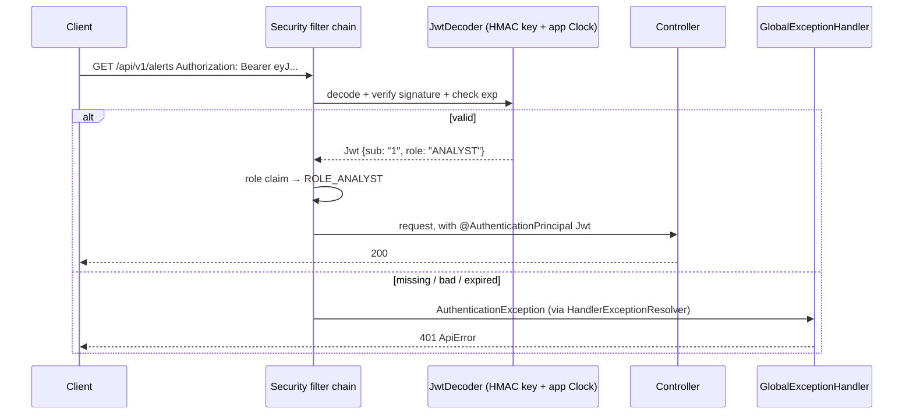
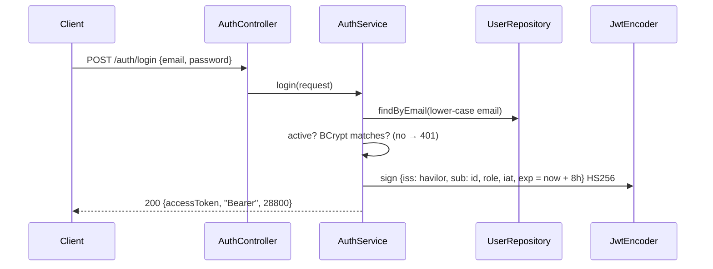

# Flow 12: Users and login (JWT)

**Goal:** analysts and managers log in; every `/api/v1` call needs a valid access token; an alert's assignee is a
real user.
**New idea:** stateless authentication: Spring Security as an **OAuth2 resource server** that checks JWTs we sign
ourselves with an HMAC secret.

**Built on:** `main` · **Status:** done, 101 tests passing, pushed

## The API

```json
POST /api/v1/auth/login            (no token needed)
{"email": "analyst@havilor.example.com", "password": "..."}
→ 200 {"accessToken": "eyJ...", "tokenType": "Bearer", "expiresIn": 28800}
→ 401 {"message": "Invalid email or password", ...}   (wrong password, unknown email or inactive user: same answer)

GET /api/v1/users/me               Authorization: Bearer eyJ...
→ 200 {"id": 1, "name": "Dana Analyst", "email": "analyst@havilor.example.com", "role": "ANALYST", "active": true}
```

Every other `/api/v1/**` call without a valid token → **401** `A valid access token is required`, in the usual
`ApiError` shape. A valid token but the wrong role → **403** `Your role is not allowed to do this` (used from Flow 16).

## How a request is checked





## Files

| File | What it does |
|---|---|
| `db/migration/V9__app_user.sql` (new) | `app_user` (name, email UNIQUE, password_hash, role CHECK, active). Clears the old placeholder `alert.assignee_id` values, then adds the FK `alert.assignee_id → app_user.id`. |
| `user/domain/User.java`, `user/domain/enums/Role.java` (new) | The entity (no setters) and `ANALYST`/`MANAGER`. Emails are stored lower-case (`User.normalizeEmail`). |
| `user/repository/UserRepository.java` (new) | `findByEmail`. |
| `user/service/AuthService.java` (new) | Checks the password with BCrypt, signs one token (8 hours). No refresh tokens. |
| `user/service/UserService.java` (new) | What other modules may ask: `getById`, `exists`. |
| `user/api/AuthController.java`, `UserController.java` (new) | `POST /auth/login`, `GET /users/me` (user id = the token's `sub`). |
| `user/api/request/LoginRequest`, `user/api/response/LoginResponse`, `UserResponse` (new) | DTOs. `UserResponse.role` is a String, so other modules can read it without touching `user.domain`. |
| `user/dev/DevUserSeeder.java` (new) | **dev profile only**: creates `analyst@havilor.example.com` and `manager@havilor.example.com` if missing, with the password from `HAVILOR_DEV_PASSWORD`. |
| `common/security/SecurityConfiguration.java` (new) | The filter chain (login open, `/api/v1/**` authenticated, stateless, no CSRF), the `role` claim → `ROLE_…`, the HMAC key (≥ 32 bytes or startup fails), `JwtEncoder`, `JwtDecoder` (expiry checked against the app `Clock`), BCrypt `PasswordEncoder`. |
| `common/error/UnauthorizedException.java` (new), `GlobalExceptionHandler.java` | 401 for a failed login, 401 for a missing/bad token, 403 for a wrong role. |
| `alert/service/AlertService.java` | `update`: an `assigneeId` must be an existing user (`UserService.exists`), else **400** `assigneeId: no user with id N`. |
| `application.yml` | `havilor.jwt.secret: ${HAVILOR_JWT_SECRET}` (no default: the app refuses to start without it), `havilor.dev.password: ${HAVILOR_DEV_PASSWORD:}`. |
| `pom.xml` | `spring-boot-starter-security-oauth2-resource-server` (Spring Security + Nimbus JOSE for JWTs). |
| `test/resources/config/application.yml` (new) | Fake test-only values for the two placeholders. Boot loads `config/application.yml` on top of `application.yml`. |
| `test/.../TestAuthConfiguration.java` (new) | Creates a test analyst + manager, logs both in through the real `AuthService`, and sends the analyst's token with **every** MockMvc request (`MockMvcBuilderCustomizer.defaultRequest`). Imported by every API test. |
| `test/.../user/AuthIntegrationTest.java` (new) | Login ok, case-insensitive email, the same 401 for all failures, 400 for missing fields, BCrypt in the table; no token / garbage / other key / expired → 401, valid → 200. |
| `test/.../user/dev/DevUserSeederIntegrationTest.java` (new) | With the dev profile both dev users log in and `/users/me` shows their role. |
| `test/.../alert/AlertUpdateIntegrationTest.java`, `AlertServiceTest.java` | Assign the real test analyst; unknown assignee → 400. |
| `test/.../ModuleBorderTest.java` | The border rule for **every** module, a **no-cycles** rule between modules, and "`common` knows no module". |
| `docs/postman/havilor.postman_collection.json` | Logs in first (`devPassword` variable), uses the token for the whole collection, assigns the alert to "me". |

## Decisions

- **Our own tokens, HMAC (HS256).** One app signs and checks, so one shared secret is the simplest correct choice.
  No key server, no refresh tokens, 8-hour lifetime (one shift).
- **Token = id + role only.** `sub` is the user id (what services need), `role` drives the authorities. A
  deactivated user's existing token keeps working until it expires: the token is not checked against the
  database on every request (simplest; fine for 8 hours).
- **401/403 use the one error format.** Spring Security's entry point and access-denied handler forward to
  `GlobalExceptionHandler` through Spring MVC's `HandlerExceptionResolver`, so there is no second error writer.
- **Login failures all look the same** (`Invalid email or password`), so the endpoint doesn't reveal which emails exist.
- **Paths outside `/api/v1` stay open**, because nothing is served there; unknown paths still give a plain 404.
- **Unknown assignee → 400, not 404:** the URL (the alert) exists; a field in the body is wrong.
- **Dev users get their password from the environment.** Fake users, but still no password in git
  (the safety rule). The dev profile refuses to start without `HAVILOR_DEV_PASSWORD`.
- **Tests use real tokens.** No mocked security: `TestAuthConfiguration` logs in through `AuthService`, so the
  same filter chain runs in tests as in production. `AuthIntegrationTest` leaves it out to test "no token".
- **`spring.anthropic.api-key` in `application.yml`** (added by Leul, uncommitted) was left untouched and kept out
  of the Flow 12 commits; it is handled in Flow 18.

## How to verify

1. `./mvnw test` → 101 tests, 0 failures.
2. Run locally with `HAVILOR_JWT_SECRET` (≥ 32 chars) and `HAVILOR_DEV_PASSWORD` set and the `dev` profile, then
   `npx newman run docs/postman/havilor.postman_collection.json --folder "Full loop" --env-var devPassword=...`
   → 19 requests, 21 assertions, 0 failures (checked).
3. `curl -i http://localhost:8080/api/v1/alerts` → 401 with the `ApiError` body.

## New concepts introduced

- **Stateless authentication with JWT** (header, claims, signature, expiry) and why no CSRF protection is needed.
- **OAuth2 resource server** in Spring Security: `JwtDecoder`, `JwtAuthenticationConverter`, authorities from a claim.
- **BCrypt** password hashing (salted, slow on purpose).
- **Secrets from the environment** with fail-fast placeholders.
- **Architecture tests for cycles** (`slices().beFreeOfCycles()`).
