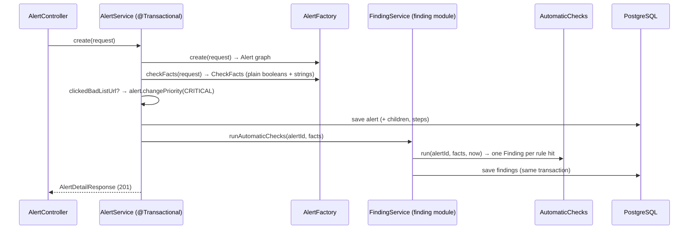

# Flow 13: Automatic checks → findings

**Goal:** when an alert arrives, Havilor runs simple rule checks and stores every hit as a **finding** that says
*why it matters*. A click on a bad-list URL makes the alert CRITICAL. The analyst can add her own findings.
**New idea:** a third module that another module calls during its own transaction, without a dependency cycle.

**Built on:** `main` · **Status:** done, 109 tests passing, pushed

## The API

```json
GET /api/v1/alerts/42/findings
→ 200 [{"id": 7, "alertId": 42, "type": "DMARC_FAIL", "severity": "HIGH", "title": "DMARC failed",
        "teachingText": "DMARC checks that the domain in the visible From address passed SPF or DKIM. ...",
        "source": "AUTOMATIC", "createdAt": "..."}, ...]

POST /api/v1/alerts/42/findings
{"type": "OTHER", "severity": "LOW", "title": "Sender domain registered 2 days ago", "teachingText": "..."}
→ 201 {..., "source": "MANUAL"}
```

## The rules

| Rule (from the new alert) | Finding type | Severity |
|---|---|---|
| `email.spfResult` = FAIL | `SPF_FAIL` | MEDIUM |
| `email.dkimResult` = FAIL | `DKIM_FAIL` | MEDIUM |
| `email.dmarcResult` = FAIL | `DMARC_FAIL` | HIGH |
| any URL with `onBadList` | `BAD_LIST_URL` ("URL on a bad list: a (+N more)") | HIGH |
| any attachment with verdict MALICIOUS | `MALICIOUS_ATTACHMENT` | HIGH |
| any click | `RECIPIENT_CLICKED` (title says "on a bad list" when it was) | HIGH |
| **critical rule:** a click on a bad-list URL | alert `priority` → **CRITICAL** | |



## Files

| File | What it does |
|---|---|
| `db/migration/V10__finding.sql` (new) | `finding` (alert_id FK `ON DELETE CASCADE`, type/severity/source CHECKs, title, teaching_text, created_at). |
| `finding/domain/Finding.java`, `domain/enums/{FindingType,Severity,FindingSource}.java` (new) | The entity (alert by id only) and its enums. |
| `finding/repository/FindingRepository.java` (new) | `findByAlertIdOrderById`. |
| `finding/service/CheckFacts.java` (new) | The facts the rules need, as plain values. Lives in `finding.service`, so `alert` may use it. |
| `finding/service/AutomaticChecks.java` (new) | The rules and the teaching texts. Pure logic, unit-tested. |
| `finding/service/FindingService.java` (new) | `runAutomaticChecks`, `listForAlert`, `addManual`. |
| `finding/api/FindingController.java`, `api/request/AddFindingRequest`, `api/response/FindingResponse` (new) | GET/POST `/alerts/{alertId}/findings`. `FindingResponse` uses Strings for type/severity/source, so other modules can read it without `finding.domain`. |
| `alert/service/AlertFactory.java` | `checkFacts(request)`: SPF/DKIM/DMARC FAIL, bad-list URLs, malicious attachments, recipients who clicked, "clicked a bad-list URL". |
| `alert/service/AlertService.java` | `create`: critical rule, then `FindingService.runAutomaticChecks` after the save. |
| `test/.../finding/service/AutomaticChecksTest.java` (new) | Clean → none; every rule → one finding each, in order; ordinary click; long titles cut to 300. |
| `test/.../finding/FindingIntegrationTest.java` (new) | Over HTTP: 5 automatic findings + CRITICAL; ordinary click → 1 finding, priority unchanged; manual finding 201; 400; unknown alert. |

## Decisions

- **Direction: `alert → finding`, never back.** The checks must run inside alert creation, so the alert module
  calls `FindingService`. The finding module therefore can't call the alert module (that would be a cycle, which
  `ModuleBorderTest` now forbids). It gets everything it needs as `CheckFacts`.
- **Consequence for an unknown alert id:** `GET .../findings` returns `[]`, and `POST` hits the foreign key and
  gets **409** `The request conflicts with existing data` (the generic message from Flow 11), not 404. The
  database still guarantees no finding without an alert.
- **One finding per rule, not per item.** Two bad URLs give one `BAD_LIST_URL` finding whose title names the first
  and counts the rest. Less noise for the analyst; the details are on the alert.
- **The critical rule lives in the alert module** (priority is the alert's field), computed from the same facts.
- **Facts come from the request**, which `AlertFactory` has already validated (clicks match real recipients and URLs).
- **Checks run only for a new alert.** Re-sending a ticket returns the stored alert and its existing findings.
- **No finding is ever changed or deleted** through the API; manual findings are not tied to a closed/open rule
  (not asked for).

## How to verify

1. `./mvnw test` → 109 tests, 0 failures.
2. Create an alert with `"dmarcResult": "FAIL"`, a URL with `"onBadList": true` and a click on it →
   `priority` is `CRITICAL`, and `GET /api/v1/alerts/{id}/findings` lists `DMARC_FAIL`, `BAD_LIST_URL`, `RECIPIENT_CLICKED`.

## New concepts introduced

- **Rule checks as pure functions** (facts in, findings out) and why that makes them easy to test.
- **Avoiding module cycles** by passing plain data across the border instead of calling back.
- **Teaching text as data**: the "why it matters" travels with each finding.
