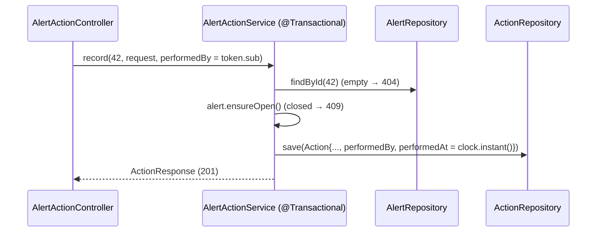

# Flow 14: Actions on an alert

**Goal:** the analyst records what she did about an alert (block the sender, purge the email, reset a password...),
how it went, and Havilor stores who did it and when.
**New idea:** the logged-in user (from the access token) becomes data: `performedBy`.

**Built on:** `main` · **Status:** done, 112 tests passing, pushed

## The API

```json
POST /api/v1/alerts/42/actions
{"type": "BLOCK_SENDER", "result": "DONE", "note": "Blocked invoices.example.net"}
→ 201 {"id": 3, "alertId": 42, "type": "BLOCK_SENDER", "result": "DONE", "note": "Blocked invoices.example.net",
       "performedBy": 1, "performedAt": "2026-11-08T15:04:00Z"}
→ 409 if the alert is closed · 404 if it doesn't exist · 400 for a missing or unknown type/result

GET /api/v1/alerts/42/actions   → 200 [...], oldest first (also on a closed alert)
```

`type`: `BLOCK_SENDER`, `PURGE_EMAIL`, `RESET_PASSWORD`, `BLOCK_URL`, `NOTIFY_USER`, `OTHER`.
`result`: `DONE`, `FAILED`, `PENDING`.



## Files

| File | What it does |
|---|---|
| `db/migration/V11__action.sql` (new) | `action` (alert_id FK cascade, type/result CHECKs, note ≤ 2000, performed_by FK → app_user, performed_at). |
| `alert/domain/Action.java`, `domain/enums/{ActionType,ActionResult}.java` (new) | The entity (alert by id, no setters) and its enums. |
| `alert/repository/ActionRepository.java` (new) | `findByAlertIdOrderById`. |
| `alert/service/AlertActionService.java` (new) | `record` (404, 409 via `Alert.ensureOpen`, blank note → null) and `list` (404). |
| `alert/api/AlertActionController.java`, `api/request/RecordActionRequest`, `api/response/ActionResponse` (new) | The endpoints; `performedBy` from `@AuthenticationPrincipal Jwt`. |
| `test/.../alert/AlertActionIntegrationTest.java` (new) | Records with analyst and manager tokens (performedBy follows the token), list order, closed → 409 but readable, 400s, 404s. |

## Decisions

- **Actions belong to the alert module.** They have no life of their own, and the rule "closed alert → 409" is the
  alert's. CLAUDE.md lists no `action` module.
- **`Action` keeps `alertId`, not a JPA relation**, and `Alert` has no list of actions: nothing needs them loaded
  with the alert, so the simplest mapping wins.
- **Who and when come from the server**, not the body: `performedBy` = token subject, `performedAt` = app clock.
- **Actions are never edited.** A later result ("the reset is done now") is a new action. No PATCH was asked for.
- **Recording an action does not change the alert** (status, version). Nothing asked for that.

## How to verify

1. `./mvnw test` → 112 tests, 0 failures.
2. `POST /api/v1/alerts/{id}/actions {"type":"PURGE_EMAIL","result":"DONE"}` → 201 with your user id in `performedBy`.

## New concepts introduced

- **The authenticated principal as data** (`@AuthenticationPrincipal Jwt`, `sub` → user id).
- **Append-only records** inside a module: create and read, never update.
