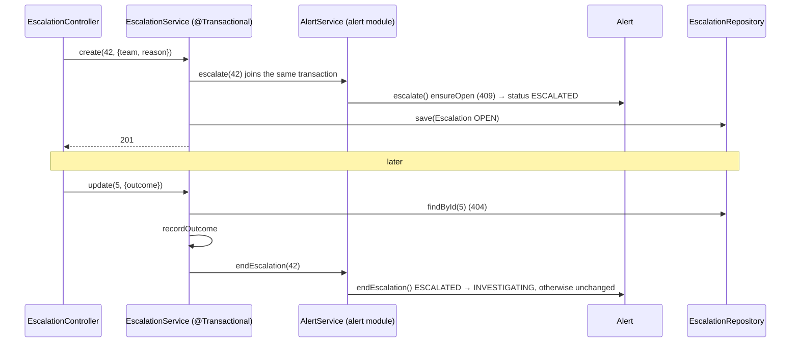

# Flow 15: Escalation

**Goal:** the analyst hands an alert to another team; the alert shows it is ESCALATED; when that team answers, the
alert goes back to INVESTIGATING.
**New idea:** a module that changes another module's entity **through that module's service**, in one transaction.

**Built on:** `main` · **Status:** done, 117 tests passing, pushed

## The API

```json
POST /api/v1/alerts/42/escalations      {"team": "Email security", "reason": "Need a tenant-wide purge"}
→ 201 {"id": 5, "alertId": 42, "team": "Email security", "reason": "...", "externalStatus": "OPEN", "outcome": null}
   and alert 42 is now ESCALATED.   404 unknown alert · 409 closed alert · 400 missing team/reason

PATCH /api/v1/escalations/5             {"externalStatus": "IN_PROGRESS"}            → alert stays ESCALATED
PATCH /api/v1/escalations/5             {"externalStatus": "RESOLVED", "outcome": "CONFIRMED_MALICIOUS"}
→ 200, and alert 42 is back to INVESTIGATING

GET /api/v1/alerts/42/escalations       → 200 [...]
```

`externalStatus`: `OPEN` (new), `IN_PROGRESS`, `RESOLVED`. `outcome`: `CONFIRMED_MALICIOUS`, `NOT_MALICIOUS`, `INCONCLUSIVE`.



## Files

| File | What it does |
|---|---|
| `db/migration/V12__escalation.sql` (new) | `escalation` (alert_id FK cascade, team, reason, external_status CHECK, outcome CHECK, nullable). |
| `escalation/domain/Escalation.java`, `domain/enums/{ExternalStatus,EscalationOutcome}.java` (new) | The entity (alert by id) with `changeExternalStatus`, `recordOutcome`. |
| `escalation/repository/EscalationRepository.java` (new) | `findByAlertIdOrderById`. |
| `escalation/service/EscalationService.java` (new) | `create` (alert → ESCALATED + save), `listForAlert` (404 via `AlertQueryService.ensureExists`), `update` (outcome → `AlertService.endEscalation`). |
| `escalation/api/EscalationController.java`, `api/request/{Create,Update}EscalationRequest`, `api/response/EscalationResponse` (new) | The three endpoints. |
| `alert/domain/Alert.java` | `escalate()` (open only) and `endEscalation()` (only from ESCALATED). |
| `alert/service/AlertService.java` | `escalate(id)`, `endEscalation(id)` for the escalation module. |
| `alert/service/AlertQueryService.java` | `ensureExists(id)` → 404. |
| `test/.../alert/AlertTest.java` | Escalate / answer / no-op; closed can't be escalated and a late answer leaves it closed. |
| `test/.../escalation/EscalationIntegrationTest.java` (new) | The whole round trip over HTTP; closed → 409; 400s and 404s. |

## Decisions

- **Direction: `escalation → alert`.** The escalation module owns its table and asks `AlertService` to change the
  alert's status. The alert module never calls the escalation module, so there is no cycle, and unknown alerts give
  a proper **404** here (unlike findings, see Flow 13).
- **One transaction for "escalate".** `EscalationService.create` is `@Transactional`; `AlertService.escalate` joins it.
  If saving the escalation failed, the alert's status change would roll back too.
- **A late answer never reopens or blocks.** `endEscalation` only acts on an ESCALATED alert. If the alert was
  closed meanwhile, the outcome is still recorded and the alert stays CLOSED.
- **Several escalations are allowed.** Any outcome sends the alert back to INVESTIGATING, even if another escalation
  is still open (simplest; can be refined if needed).
- **Only the listed fields.** Who escalated and when is recorded by the audit log (Flow 16), not by extra columns.
- **PATCH is partial** (null = unchanged), like the alert PATCH.

## How to verify

1. `./mvnw test` → 117 tests, 0 failures.
2. Escalate an alert → `GET /alerts/{id}` shows `ESCALATED`; PATCH the escalation with an `outcome` → `INVESTIGATING`.

## New concepts introduced

- **Cross-module writes through a service**, with transaction propagation (`REQUIRED` joins the caller's transaction).
- **Idempotent, forgiving state transitions** (`endEscalation` is a no-op unless the alert is ESCALATED).
