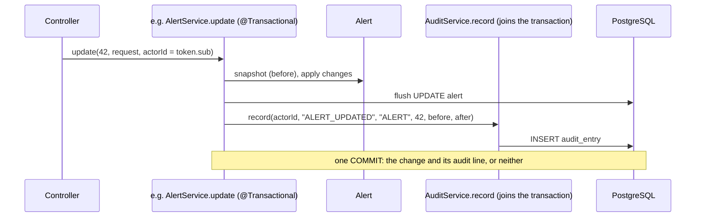

# Flow 16: Audit log

**Goal:** every change on an alert leaves a permanent line: who, what, when, before and after. Managers can read the
whole log.
**New idea:** an **append-only** table, protected in the code *and* in the database, written in the same
transaction as the change it describes.

**Built on:** `main` · **Status:** done, 123 tests passing, pushed

## The API

```json
GET /api/v1/alerts/42/audit                    (any logged-in user; oldest first)
→ 200 [{"id": 90, "actorId": 1, "action": "ALERT_UPDATED", "entityType": "ALERT", "entityId": 42,
        "oldValue": "status=NEW, priority=MEDIUM, assigneeId=null, ...",
        "newValue": "status=INVESTIGATING, priority=HIGH, assigneeId=1, ...", "createdAt": "..."}, ...]

GET /api/v1/audit?page=0&size=20               (MANAGER only; newest first; the usual page shape)
→ 200 {"content": [...], "page": 0, "size": 20, "totalElements": 135, "totalPages": 7}
→ 403 {"message": "Your role is not allowed to do this", ...} for an analyst
```

## What is recorded

| Where | `action` | old → new |
|---|---|---|
| `AlertService.update` (PATCH) | `ALERT_UPDATED` | status, priority, assigneeId, waitingOn, externalCaseNumber, followUpOn |
| `AlertService.close` | `ALERT_CLOSED` | `status=…, verdict=…` |
| `AlertStepService.updateStep` | `STEP_UPDATED` | `step 12: PENDING` → `step 12: DONE, answer=…` |
| `AlertActionService.record` | `ACTION_RECORDED` | – → `action 3: BLOCK_SENDER DONE, note=…` |
| `FindingService.addManual` | `FINDING_ADDED` | – → `finding 7: OTHER LOW, title=…` |
| `EscalationService.create` | `ESCALATED` | – → `escalation 5: team=…, reason=…` |
| `EscalationService.update` | `ESCALATION_UPDATED` | `externalStatus=…, outcome=…` before → after |

All with `entityType = "ALERT"`, `entityId` = the alert's id, `actorId` = the token's user.



## Files

| File | What it does |
|---|---|
| `db/migration/V13__audit_entry.sql` (new) | `audit_entry` (actor_id FK → app_user, action, entity_type, entity_id **without** FK, old/new TEXT, created_at) + a trigger that raises an error on any UPDATE or DELETE. |
| `audit/domain/AuditEntry.java` (new) | `@Immutable` entity: Hibernate never issues an UPDATE for it. |
| `audit/repository/AuditEntryRepository.java` (new) | A plain `Repository` with `save`, `findByEntityTypeAndEntityIdOrderById`, `findAll(Pageable)`: no delete method exists. |
| `audit/service/AuditService.java` (new) | `record(actor, action, entityType, entityId, oldValue, newValue)`, `forEntity`, `all(page, size)`. |
| `audit/api/AuditController.java`, `api/response/AuditEntryResponse` (new) | The two GETs. |
| `common/security/SecurityConfiguration.java` | `GET /api/v1/audit` → `hasRole("MANAGER")`. |
| `alert/service/{AlertService,AlertStepService,AlertActionService}.java`, `escalation/service/EscalationService.java`, `finding/service/FindingService.java` | Call `auditService.record(...)` after the change; take the actor id. |
| `alert/api/{AlertController,AlertStepController}.java`, `escalation/api/EscalationController.java`, `finding/api/FindingController.java` | Pass `Long.valueOf(token.getSubject())` to the service. |
| `test/.../alert/AlertServiceTest.java` | Verifies the exact audit call of an update. |
| `test/.../audit/AuditIntegrationTest.java` (new) | The full history of one alert in order (6 kinds), a step change, a refused change leaves no entry, manager reads / analyst 403, the database refuses UPDATE and DELETE, unknown alert → `[]`. |

## Decisions

- **Explicit calls, no AOP or events** (as asked): each service says what it records, right next to the change.
- **Same transaction.** `AuditService.record` joins the caller's transaction, so a rolled-back change leaves no
  line, and a committed change always has one.
- **Logged against the alert.** Steps, actions, findings and escalations are all part of an alert's story, so they
  use `entityType = ALERT` + the alert id; the `action` and the values say what exactly changed. One simple query
  gives the full history. (`record` still takes any entity type for later modules.)
- **Append-only, twice:** no update/delete in the code (`@Immutable`, a repository without delete), and a database
  trigger for anything else (a script, a future bug).
- **No foreign key on `entity_id`:** the log must survive even if the thing it describes is deleted. Deleting test
  alerts therefore leaves their audit lines.
- **Unknown alert → `[]`, not 404:** the audit module depends on no other module (alert → audit), so it can't
  check alerts. A log with no lines is a correct answer.
- **Values are plain text**, e.g. `status=NEW, priority=MEDIUM`. Readable by people, no JSON format to version.
- **Alert creation and the automatic findings are not audited** (not in the list; they are system actions, and
  the alert itself records `createdAt`).
- **Manager-only rule in the security config** (one place for every access rule), not `@PreAuthorize`.

## How to verify

1. `./mvnw test` → 123 tests, 0 failures.
2. PATCH an alert, then `GET /api/v1/alerts/{id}/audit` → one `ALERT_UPDATED` line with your user id.
3. `GET /api/v1/audit` with the analyst's token → 403; with the manager's → 200.

## New concepts introduced

- **Audit logs**: append-only, actor + before/after, written atomically with the change.
- **Database triggers** (PL/pgSQL) as a last line of defence.
- **Role-based authorization** with `hasRole` on a URL, and 403 vs 401.
