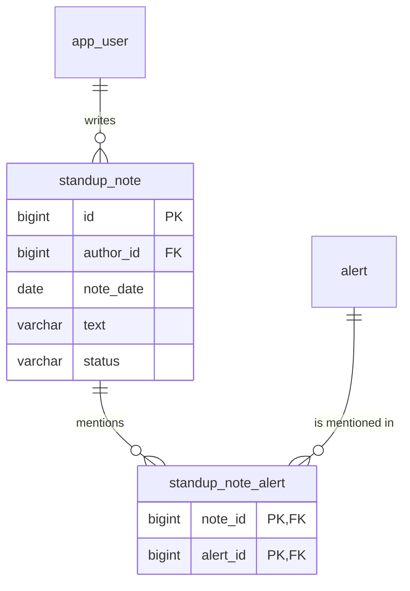

# Flow 17: Standup notes

**Goal:** an analyst writes notes for a day's standup, mentioning the alerts she worked on, and shares them when
ready. Managers see the team's **shared** notes.
**New idea:** a **many-to-many** relation through a join table, to rows of another module (kept as ids).

**Built on:** `main` · **Status:** done, 127 tests passing, pushed

## The API

```json
POST  /api/v1/standup/notes            {"noteDate": "2026-11-02", "text": "Worked the invoice wave", "alertIds": [42, 43]}
→ 201 {"id": 9, "authorId": 1, "noteDate": "2026-11-02", "text": "...", "status": "DRAFT", "alertIds": [42, 43]}

PATCH /api/v1/standup/notes/9          {"text": "...", "alertIds": [42]}   (all optional; alertIds replaces the list)
POST  /api/v1/standup/notes/9/share    → status SHARED (sharing again is harmless)
GET   /api/v1/standup/notes            → my notes (drafts and shared), newest day first, paged
GET   /api/v1/standup/team             → MANAGER only: everybody's SHARED notes, newest day first, paged
```

Someone else's note → **404**. A SHARED note can't be changed → **409**. An unknown alert id in `alertIds` → **400**.
An analyst on `/team` → **403**.



## Files

| File | What it does |
|---|---|
| `db/migration/V14__standup_note.sql` (new) | `standup_note` (author FK, date, text, status CHECK) and the join table `standup_note_alert` (composite PK, both FKs `ON DELETE CASCADE`). |
| `standup/domain/StandupNote.java`, `domain/enums/NoteStatus.java` (new) | The entity. `alertIds` is an `@ElementCollection` of ids mapped onto the join table. Changes refuse a SHARED note (409). |
| `standup/repository/StandupNoteRepository.java` (new) | `findByAuthorId`, `findByStatus` (paged), `findByIdAndAuthorId`. |
| `standup/service/StandupService.java` (new) | create / update / share own notes, `own`, `team`; checks mentioned alerts through `AlertQueryService.exists`. |
| `standup/api/StandupController.java`, `api/request/{Create,Update}NoteRequest`, `api/response/NoteResponse` (new) | The five endpoints; the author is the token's user. |
| `alert/service/AlertQueryService.java` | `exists(id)` for other modules. |
| `common/security/SecurityConfiguration.java` | `GET /api/v1/standup/team` → `hasRole("MANAGER")`. |
| `test/.../standup/StandupIntegrationTest.java` (new) | Draft → edit → share → team view → 409; privacy (404 for another author's note); analyst on team → 403; 400s. |

## Decisions

- **`@ElementCollection` of alert ids, not `@ManyToMany` with `Alert`.** The alerts belong to another module; the
  border rule forbids using its entities. The join table is still a real many-to-many in the database (both FKs).
- **Privacy by query:** `findByIdAndAuthorId` makes another author's note look like it doesn't exist (404), so ids
  can't be probed.
- **Shared = final** (409 on change), so what managers read doesn't change behind their back. Sharing twice is a no-op.
- **Unknown mentioned alert → 400** (a wrong field in the body), checked through the alert service; the FK would
  also stop it.
- **Lists are paged** with the shared `Paging` rules, newest day first.
- **Managers can write their own notes too**; only the team view is manager-only.
- **Only the listed fields**: no timestamps or "shared at" (not asked for).

## How to verify

1. `./mvnw test` → 127 tests, 0 failures.
2. As the analyst: POST a note, share it. As the manager: `GET /api/v1/standup/team` shows it; drafts never appear.

## New concepts introduced

- **Many-to-many with a join table**, and `@ElementCollection` for a set of plain values.
- **Ownership checks in the query** (`findByIdAndAuthorId`) and 404-instead-of-403 to avoid leaking existence.
