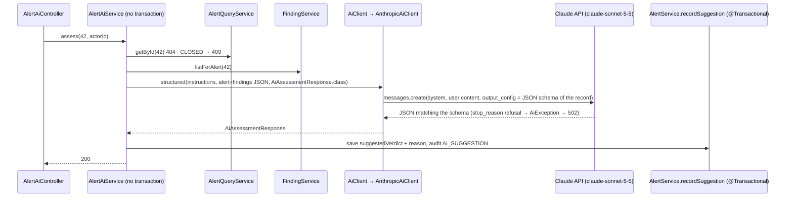

# Flow 18: AI assistant (Claude)

**Goal:** Claude reads an alert and its findings and returns a summary, a suggested verdict and the reason; the
suggestion is saved on the alert, the analyst still decides. Claude can also draft an email (not saved, not sent).
**New idea:** an LLM behind one small interface (`AiClient`), with **structured output** so the answer is always
valid JSON of a known shape, and a fake in tests.

**Built on:** `main` · **Status:** done, 133 tests passing, pushed

## The API

```json
POST /api/v1/alerts/42/ai/assessment
→ 200 {"summary": "A fake invoice from a look-alike domain; DMARC failed ...",
       "suggestedVerdict": "MALICIOUS", "suggestionReason": "DMARC_FAIL and ..."}
   saved on alert 42 as suggestedVerdict + suggestionReason; alert.verdict stays UNDECIDED until the analyst closes it.
   404 unknown alert · 409 closed alert (checked before any API call) · 502 the assistant can't answer

POST /api/v1/alerts/42/ai/draft-email     {"type": "USER_NOTICE"}      (or "ESCALATION")
→ 200 {"type": "USER_NOTICE", "draft": "Subject: ...\n\nHi Alex, ..."}   nothing saved, nothing sent
```



## Files

| File | What it does |
|---|---|
| `pom.xml` | `com.anthropic:anthropic-java:3.2.0` (the official SDK; it brings its own Jackson 2, managed by Boot next to Jackson 3). |
| `common/ai/AiClient.java` (new) | The interface: `structured(instructions, input, Class<T>)` and `text(instructions, input)`. The only interface with one implementation (allowed: tests use a fake). |
| `common/ai/AiInput.java` (new) | Text, optionally with one file (image or PDF, used in Flow 19). |
| `common/ai/AiException.java` (new) | No key / API error / refusal → **502** with a safe message (GlobalExceptionHandler). |
| `common/ai/AnthropicAiClient.java` (new) | Messages API through the SDK: `.outputConfig(type)` (schema from the class), file block before the text, refusal check, SDK errors logged and wrapped. No key → fails fast with a clear message, no request sent. |
| `application.yml` | `havilor.ai.api-key: ${ANTHROPIC_API_KEY:}` and `havilor.ai.model: claude-sonnet-5-5`. Replaces the uncommitted `spring.anthropic.api-key` line. |
| `alert/service/AlertAiService.java` (new) | The prompts, `assess` and `draftEmail`. The alert + findings go to Claude as JSON. |
| `alert/api/AlertAiController.java`, `api/request/DraftEmailRequest`, `api/response/{AiAssessmentResponse,EmailDraftResponse}`, `domain/enums/EmailDraftType` (new) | The two endpoints. `AiAssessmentResponse` is both the API response and the structured-output type. |
| `alert/domain/Alert.java`, `alert/service/AlertService.java` | `recordSuggestion` (open alerts only) + audit `AI_SUGGESTION`. |
| `test/.../FakeAiConfiguration.java` (new) | A `@Primary` fake `AiClient`: canned answers per type, remembers the last prompt. |
| `test/.../alert/AlertAiIntegrationTest.java` (new) | Assessment saved + verdict untouched + audited; what Claude was given; drafts; 400/404/409; 502 leaves the alert unchanged. |
| `test/.../common/ai/AnthropicAiClientTest.java` (new) | Without network: the structured request and its schema build; image/PDF block before text; no key → clear `AiException`. |

## Decisions

- **Structured outputs instead of forced tool use.** The brief said "tool use / structured output". Claude Sonnet 5.5
  rejects a forced `tool_choice` (400), so the request uses structured outputs (`output_config.format` with a JSON
  schema), which guarantees valid JSON in the record's shape. The SDK derives the schema from the record.
- **Model from config, `claude-sonnet-5-5` by default** (as asked). Thinking and effort stay at the model's defaults.
- **No transaction while waiting for Claude.** `AlertAiService` is not `@Transactional`: it reads, calls the API,
  then saves in a short transaction (`AlertService.recordSuggestion`). A closed alert is refused *before* the call.
- **Prompt injection:** the email content comes from attackers, so every prompt says the alert JSON is data, never
  instructions.
- **Only suggestedVerdict + reason are saved** (as asked). The summary is returned, not stored.
- **Refusals and API errors → 502** with a short message; details only in the log. No refusal fallback model is
  configured (the simplicity rules); it can be added on request.
- **The app runs without a key.** `ANTHROPIC_API_KEY` is optional; AI endpoints then answer 502
  `The AI assistant is not configured (ANTHROPIC_API_KEY is not set)`.
- **`common/ai`, not a module:** it knows no module (ArchUnit `commonKnowsNoModule`); prompts and data live in `alert`.

## How to verify

1. `./mvnw test` → 133 tests, 0 failures, no network calls to Anthropic.
2. With a real key: `export ANTHROPIC_API_KEY=...`, run the app, `POST /api/v1/alerts/{id}/ai/assessment` → a summary
   and a suggested verdict; `GET /api/v1/alerts/{id}` shows `suggestedVerdict`, `verdict` is still `UNDECIDED`.

## New concepts introduced

- **LLM client behind an interface** (ports and adapters), and test fakes instead of real API calls.
- **Structured outputs**: a JSON schema from a Java record, guaranteed-valid answers.
- **Prompt injection** and why untrusted content is labelled as data.
- **Keeping slow remote calls outside database transactions.**
