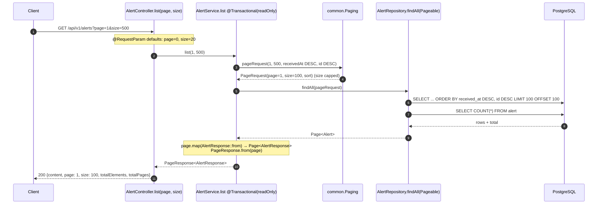

# Flow 2: List alerts with paging

**Goal:** `GET /api/v1/alerts?page=0&size=20` returns one page of alerts, newest first, in **our own** page JSON.
**New idea:** pagination.

**Branch:** `feature/alert-list-paging` · **Status:** done, 25 tests passing, pushed

Before this flow (same session): `c74b34d refactor(alert): clarify CreateAlertResult names`
(`created` → `wasCreated`, `created()`/`existing()` → `newlyCreated()`/`alreadyExisted()`), merged with Flow 1 in PR #2.

## The API

```
GET /api/v1/alerts?page=0&size=20
```

```json
{
  "content": [
    {"id": 73, "ticketNumber": "INC-DEMO-0002", "subject": "Fake alert 2", "status": "NEW", "receivedAt": "2026-10-31T02:00:00Z"},
    {"id": 72, "ticketNumber": "INC-DEMO-0001", "subject": "Fake alert 1", "status": "NEW", "receivedAt": "2026-10-30T01:00:00Z"}
  ],
  "page": 0,
  "size": 2,
  "totalElements": 2,
  "totalPages": 1
}
```

| Rule | Value |
|---|---|
| `page` | 0-based. Default **0**. Negative → **0** |
| `size` | Default **20**. Below 1 → **20**. Above 100 → **100** |
| Order | `receivedAt` **descending**, then `id` **descending** (tie-breaker) |
| `sort` param | Not supported: the order is fixed by the server |
| Response `size` | The size **actually used**, so a client that asked for 500 can see it got 100 |

## Decisions

- **Our own `PageResponse`, not Spring's `Page`.** Spring's `Page` turns into JSON with many internal fields
  (`pageable`, `sort`, `first`, `last`, `numberOfElements`...), and that shape can change between Spring versions.
  Our record has exactly 5 fields we choose and control. It lives in `common/` because every future list endpoint uses it.
- **Correct out-of-range values instead of rejecting them (400).** It matches how Spring's own paging support behaves,
  and the response shows the size used. Rejecting bad input with a proper error body is Flow 3's job, and we
  could switch `size > 100` to a 400 then if we want to be strict.
- **The paging rules live in `common/Paging`, called by the service**, not in the controller and not in global Spring
  config. "Max 100" is a business rule, so it sits where business rules live and is unit-testable without HTTP.
- **Tie-breaker `id DESC`.** If two alerts have the same `receivedAt`, the database may return them in any order, and
  the order can differ between two queries. Then an alert could show up on page 0 *and* page 1, or on neither.
  Adding the unique `id` makes the order total (every row has exactly one place), so pages never overlap or skip.
- **Index `(received_at DESC, id DESC)`** (migration V2) matches the `ORDER BY` exactly, so PostgreSQL can walk the
  index and stop after `size` rows instead of sorting the whole table on every request. With only a few rows
  PostgreSQL still chooses a plain table scan, because that's cheaper. The index matters once the table grows.

## How a list request flows



## Commits

| Commit | Message |
|---|---|
| `d5a8503` | feat(common): add shared Paging rules and PageResponse DTO |
| `e2c2669` | feat(alert): index alert by received_at desc, id desc |
| `19c44e0` | feat(alert): add paged, newest-first AlertService.list |
| `c83a6e4` | feat(alert): add GET /api/v1/alerts with paging |
| (last commit) | docs: mark flow 2 done in README and add flow-2 notes |

## Files created / changed

| File | What it does |
|---|---|
| `common/Paging.java` (new) | `final` class with a private constructor (a utility class, never instantiated). Constants `DEFAULT_SIZE = 20`, `MAX_SIZE = 100`. `pageRequest(page, size, sort)` corrects out-of-range values and builds Spring's `PageRequest`. |
| `common/PageResponse.java` (new) | Generic record `PageResponse<T>(content, page, size, totalElements, totalPages)`. `from(Page<T>)` copies the 5 values out of Spring's `Page`. |
| `db/migration/V2__index_alert_received_at.sql` (new) | `CREATE INDEX idx_alert_received_at_id ON alert (received_at DESC, id DESC)`. |
| `alert/AlertService.java` | New constant `NEWEST_FIRST` (`Sort` by `receivedAt` desc, `id` desc). New `list(page, size)`, `@Transactional(readOnly = true)`: builds the `PageRequest` via `Paging`, calls `findAll(Pageable)` (inherited from `JpaRepository`, so there's no new repository method), maps each `Alert` to `AlertResponse` with `Page.map`, wraps it in `PageResponse`. |
| `alert/AlertController.java` | New `@GetMapping` (no path, so `GET /api/v1/alerts`) with `@RequestParam(defaultValue = "0") int page` and `@RequestParam(defaultValue = "20") int size` (written as `"" + Paging.DEFAULT_SIZE` so there's one source of truth). Returns `PageResponse<AlertResponse>`; a plain return value means 200. |
| `test/.../common/PagingTest.java` (new) | 5 unit tests: valid values kept; size capped at 100; size < 1 → 20; page < 0 → 0; `PageResponse.from` copies the fields (45 items, size 20 → 3 pages). |
| `test/.../alert/AlertServiceTest.java` | +2 unit tests: `list` asks the repository for the right page, size and **sort** (checked with an `ArgumentCaptor`) and maps the result; `list(0, 500)` gives size 100. |
| `test/.../alert/AlertListIntegrationTest.java` (new) | 5 tests over MockMvc against PostgreSQL: defaults (page 0, size 20, `totalElements` = `COUNT(*)`); newest first across page 0 and page 1; same `receivedAt` → higher id first; `size=500` → 100; `page=-1&size=0` → 0 and 20. Test alerts use year-2999 dates so they're always the newest, whatever else is in the dev database. |
| `README.md` | Flow 2 ticked; `GET /api/v1/alerts` added to the API table. |

## Commands run

```bash
git switch -c feature/alert-list-paging
./mvnw test -Dtest=PagingTest
./mvnw test -Dtest=AlertServiceTest
./mvnw test                                       # 25 tests
docker exec havilor-db psql -U havilor -d havilor -c "\di idx_alert*"
./mvnw spring-boot:run                            # + curl smoke test
git push -u origin feature/alert-list-paging
```

## How to verify

1. `docker compose up -d` (and make sure **Docker Desktop is running**), then `./mvnw test` gives
   **`Tests run: 25, Failures: 0`**.
2. `docker exec havilor-db psql -U havilor -d havilor -c "\di idx_alert*"` lists `idx_alert_received_at_id`.
3. Start the app, POST two or three alerts with different `receivedAt` (see README), then:
   - `curl "http://localhost:8080/api/v1/alerts?page=0&size=2"` → the newest two, newest first, `"size":2`.
   - `curl "http://localhost:8080/api/v1/alerts?size=500"` → `"size":100`.
   - `curl "http://localhost:8080/api/v1/alerts"` → `"page":0,"size":20`.

## New concepts introduced

- **Pagination** with `page` + `size` → SQL `LIMIT size OFFSET page*size`, plus a `COUNT(*)` query for the totals.
- **Spring Data paging types:** `Pageable` / `PageRequest` (what you ask for), `Page<T>` (what you get back:
  content + totals), `Sort` / `Sort.Order`. `JpaRepository.findAll(Pageable)` comes for free.
- **`Page.map(...)`** to turn `Page<Alert>` into `Page<AlertResponse>` without losing the totals.
- **Generic record** `PageResponse<T>`: one page shape for every resource.
- **Stable ordering / tie-breaker:** why a sort needs a unique last column.
- **Database index** for an `ORDER BY ... LIMIT` query, and why the planner may ignore it on a tiny table.
- **`@RequestParam` with `defaultValue`**; compile-time constant in an annotation (`"" + Paging.DEFAULT_SIZE`).
- **Utility class** pattern: `final` + private constructor + static methods.
- **`ArgumentCaptor`** (Mockito): capture what the code passed to a mock and assert on it.
- **Testing against a shared database:** make test data recognisable (`INC-IT-` prefix, year 2999) and clean it up.

## Scoping decisions / known limits

- **No filters yet** (`?status`, `?priority`, `?assigneeId` in the journal's API table). They need those fields first
  (Flow 4 and later).
- **OFFSET paging** gets slower on very deep pages (the database still walks the skipped rows). Fine for an analyst
  queue; **keyset/cursor paging** (`WHERE (received_at, id) < (?, ?)`) is the upgrade if it ever matters.
- The list returns the full `AlertResponse`. A smaller "summary" DTO makes sense once the alert grows in Flow 4.
- `page=abc` already gets a **400** from Spring (type mismatch), but with Spring's default body. Flow 3 adds our error format.

## Issues hit

- **Docker Desktop was not running** at the start, so every DB-backed test failed with
  `Connection to localhost:5433 refused`. Fix: start Docker Desktop, then `docker compose up -d`.
- During the smoke test my script built an invalid date (`2026-10-32`), and the POST got **400** from Spring's JSON
  reader. That was a script bug, not an app bug, and it shows unreadable dates are already rejected before our code runs.

## Next

Flow 3: **Handle mistakes**: validation (400), not found (404), one error format via `@RestControllerAdvice`.
Waiting for Leul before starting.
