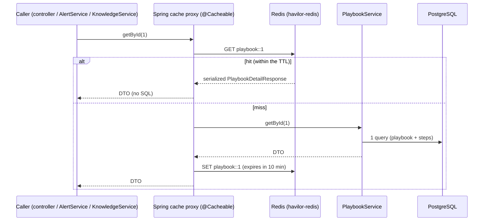

# Flow 21: Redis cache (playbook reads only)

**Goal:** playbook reads are served from Redis after the first time, for a configurable time (TTL).
**New idea:** a shared cache with Spring's cache abstraction (`@Cacheable`), and choosing *what* is safe to cache.

**Built on:** `main` · **Status:** done, 154 tests passing, pushed

## What is cached

| Method | Cache | Key | Who calls it |
|---|---|---|---|
| `PlaybookService.list()` | `playbooks` | (none) | `GET /playbooks`, knowledge indexing |
| `PlaybookService.getById(id)` | `playbook` | id | `GET /playbooks/{id}` |
| `PlaybookService.findActiveFor(caseType)` | `activePlaybook` | case type | **every new alert** |
| `PlaybookService.getSteps(playbookId)` | `playbookSteps` | playbook id | `GET/PATCH /alerts/{id}/steps`, knowledge indexing |

Nothing else is cached. TTL: `spring.cache.redis.time-to-live: 10m` in `application.yml`. In Redis the keys look like
`playbook::1`, `activePlaybook::DETECTED_PHISHING`.

## Why playbooks and not alerts

- **Playbooks don't change while the app runs.** They are seeded by Flyway (`@Immutable` entities, no write endpoint),
  so a cached copy is never wrong. The TTL only matters after a deploy with a new playbook migration: the old copy
  lives at most 10 minutes.
- **They are read all the time:** every new alert asks for the active playbook, and every step view reads the steps.
- **Alerts change constantly** (assign, steps, actions, escalation, close) and are read by several analysts at once.
  Caching them needs eviction on every write path, and a missed eviction means an analyst sees a stale case (e.g. an
  old status, or a "pending" step that is done). That risk is not worth it: an alert read is a few indexed queries.
- **Users, findings, audit and notes** change or are personal: same reasoning.

## Files

| File | What it does |
|---|---|
| `pom.xml` | `spring-boot-starter-cache`, `spring-boot-starter-data-redis`. |
| `compose.yaml` | Service `redis` (`redis:8`, port 6379, no volume: it is only a cache). |
| `application.yml` | `spring.data.redis.host/port` (local), `spring.cache.type: redis`, `spring.cache.redis.time-to-live: 10m`. |
| `common/CacheConfiguration.java` (new) | `@EnableCaching`; Boot builds the Redis cache manager from the properties. |
| `playbook/service/PlaybookService.java` | `@Cacheable` on the four reads. |
| `playbook/api/response/*`, `playbook/service/ActivePlaybook.java` | `implements Serializable`: the cached values are these DTOs (Redis stores them with Java serialization). |
| `test/.../TestcontainersConfiguration.java` | A Redis container (`@ServiceConnection(name = "redis")`) next to PostgreSQL. |
| `test/.../playbook/PlaybookCacheIntegrationTest.java` (new) | Cold read = 1 SQL statement, warm read = 0; list cached; key in Redis with TTL ≤ 600 s; creating alerts caches the active-playbook lookup; a 404 is not cached. |
| `test/.../playbook/PlaybookIntegrationTest.java`, `alert/AlertStepsIntegrationTest.java` | Clear their cache before counting statements, so they still measure a cold read. |

## Decisions

- **Spring's cache abstraction, configured by properties.** No custom `RedisCacheManager` bean: `spring.cache.type`
  and `spring.cache.redis.time-to-live` are enough.
- **Java serialization of DTOs** (Boot's default for Redis caches) instead of JSON: no type-info configuration, and only
  four small record types need `Serializable`. Entities are never cached.
- **`Optional` results:** Spring caches the content; "no active playbook" is cached too (as null).
- **`getSteps` has its own cache** because it calls `getById` inside the same class, which bypasses the cache proxy.
- **Redis is now a required service, like PostgreSQL.** If Redis is down, playbook reads (and so creating alerts)
  fail; the health check (Flow 23) reports it. A fall-back-to-the-database error handler was left out (simplicity);
  say if you want it.
- **Tests share one Redis** across all test contexts, so tests that count SQL clear the cache by name first.

## How to verify

1. `./mvnw test` → 154 tests, 0 failures.
2. `docker compose up -d`, run the app, `GET /api/v1/playbooks/1` twice, then
   `docker exec havilor-redis redis-cli TTL playbook::1` → a number ≤ 600.

## New concepts introduced

- **Caching**: cache-aside with `@Cacheable`, keys, TTL, and why caching mutable data is risky (invalidation).
- **Redis** as a shared cache for several app instances.
- **Spring proxies and self-invocation** (why `getSteps` → `getById` doesn't hit the cache).
