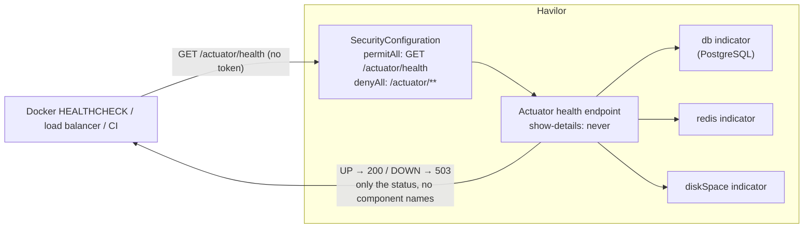

# Flow 23: Health check

**Goal:** one endpoint that tells Docker, a load balancer or CI whether Havilor is alive and its database and Redis
are reachable, without exposing anything else.
**New idea:** Spring Boot Actuator, switched on for exactly one endpoint.

**Built on:** `main` · **Status:** done, 161 tests passing, pushed

## The API

```
GET /actuator/health            (no token)
→ 200 {"status":"UP"}
→ 503 {"status":"DOWN"}          if PostgreSQL, Redis or disk space is not OK
```

Every other Actuator path (`/actuator`, `/actuator/env`, `/beans`, `/metrics`, `/info`, `/heapdump` ...) is off:
the endpoints don't exist, and the security config refuses `/actuator/**` anyway.



## Files

| File | What it does |
|---|---|
| `pom.xml` | `spring-boot-starter-actuator`. |
| `application.yml` | `management.endpoints.access.default: none` (all off), `management.endpoint.health.access: read-only`, `management.endpoints.web.exposure.include: health`, `management.endpoint.health.show-details: never`. |
| `common/security/SecurityConfiguration.java` | `GET /actuator/health` → `permitAll`; every other `/actuator/**` → `denyAll`. |
| `test/.../common/HealthIntegrationTest.java` (new) | Without a token: health is 200 `UP` with no `components`/`details`; seven other Actuator paths answer ≥ 400. |

## Decisions

- **Off by default, then one endpoint on** (`access.default: none`), rather than switching endpoints off one by one:
  a future Boot version can't quietly add an exposed endpoint.
- **No details for anyone** (`show-details: never`). Component names and versions help attackers and are not needed
  for a yes/no check; the logs have the details.
- **Two layers:** the endpoints are off *and* `/actuator/**` is denied, so a configuration mistake alone can't open them.
- **Redis is part of health** (Flow 21 made it a required service), so a Redis outage shows as DOWN.

## How to verify

1. `./mvnw test` → 161 tests, 0 failures.
2. Run the app, `curl -i http://localhost:8080/actuator/health` → `200 {"status":"UP"}`; `docker compose stop redis`
   → `503 {"status":"DOWN"}`; `curl -i http://localhost:8080/actuator/env` → refused.

## New concepts introduced

- **Spring Boot Actuator**, health indicators, exposure vs access.
- **Health checks** for containers and load balancers (liveness of the app and its dependencies).
- **Secure by default** configuration.
