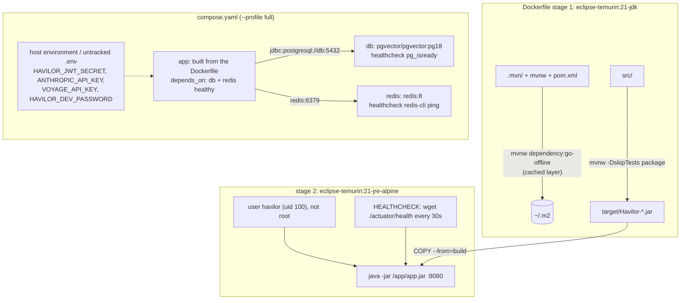

# Flow 24: Docker image

**Goal:** Havilor as a container image, and one command that runs the whole stack (app + PostgreSQL + Redis).
**New idea:** multi-stage builds, non-root containers, health checks, and secrets that stay outside images and files.

**Built on:** `main` · **Status:** done, 161 tests passing, pushed

> **Later change (Java version drift):** Dependabot PR #5 moved the image to `eclipse-temurin:25`. It was set back
> to `21-jdk` / `21-jre-alpine`, so the image runs the same Java as `pom.xml`, CI and local development (the version
> the tests run on). `.github/dependabot.yml` now ignores **major** updates of `eclipse-temurin`; minor and patch
> updates (security fixes within Java 21) still come as PRs. Moving to a new Java major is a deliberate change.

## Commands

```bash
docker build -t havilor .                       # just the image

export HAVILOR_JWT_SECRET="<32+ random characters>"   # required by the app
export SPRING_PROFILES_ACTIVE=dev HAVILOR_DEV_PASSWORD="<any>"   # optional: fake dev users to log in with
export ANTHROPIC_API_KEY=... VOYAGE_API_KEY=...       # optional
docker compose --profile full up -d --build     # db + redis + app (app waits for healthy db and Redis)
docker compose up -d                            # unchanged: only db + redis, run the app yourself
```



## Files

| File | What it does |
|---|---|
| `Dockerfile` (new) | Stage 1 builds with the project's Maven wrapper on JDK 21 (dependencies in their own cached layer). Stage 2: JRE 21 on Alpine, non-root user `havilor`, `HEALTHCHECK` on `/actuator/health`, `ENTRYPOINT java -jar`. No secret in the image. |
| `.dockerignore` (new) | Only `.mvn/`, `mvnw`, `pom.xml`, `src/` matter; `target/`, `.git/`, IDE folders, docs, `.env` stay out of the build context. |
| `compose.yaml` | Health checks for `db` and `redis`; new `app` service in profile `full` (built from the Dockerfile, waits for healthy db + Redis, reaches them by service name). Secrets as `${VAR:-}` from the host. |
| `.gitignore` | `.env` (where you may keep the secrets for compose). |
| `alert/dev/DevAlertController.java` | **Bug found by running the container:** `RandomGenerator.getDefault()` needs the `jdk.random` module, which the slim JRE doesn't ship, so the dev profile crashed at startup. Now `new SplittableRandom()` (in `java.base`). |

## Checked by running it

- `docker build` → image `havilor:local`; `id` inside → `uid=100(havilor)`.
- `docker compose --profile full up -d --build` with the dev profile: Flyway migrated the dev database to V17, the
  container became **healthy**, `/actuator/health` → `UP`; login → token; `POST /dev/generate-alerts` → 201;
  `GET /alerts`, `GET /playbooks` → 200; Redis held `playbooks::SimpleKey []` and `activePlaybook::DETECTED_PHISHING`.
- Without `HAVILOR_JWT_SECRET` the app container stops with `havilor.jwt.secret (env HAVILOR_JWT_SECRET) must be at
  least 32 bytes`, while plain `docker compose up -d` (db + Redis) still works.

## Decisions

- **Tests don't run in `docker build`:** they need Docker themselves (Testcontainers). CI (Flow 25) runs them before it
  builds the image.
- **Alpine JRE** (small, has `wget` for the health check through busybox) rather than a full JDK image.
- **The project's `mvnw`** in the build stage, so the image is built with the same Maven version as everywhere else
  (`.gitattributes` keeps `mvnw` with LF line endings, so it runs on Linux).
- **`${HAVILOR_JWT_SECRET:-}`, not `${...:?}`:** compose evaluates `:?` even for services outside the active
  profile, which would have broken `docker compose up -d`. The app enforces the secret itself (fail fast, clear message).
- **The database password in `compose.yaml` stays** as before: it is the local-only dev database (already in
  `application.yml`), reached only from this machine. Real secrets (JWT key, API keys, dev password) only come from the
  environment.
- **No image push or registry yet** (Flow 25 builds without pushing; deployment is a later slice).
- The health response in the container also lists `"groups":["liveness","readiness"]` (Boot's probe groups, names
  only); still no component details.

## New concepts introduced

- **Multi-stage Docker builds** and layer caching.
- **Non-root containers** and why (a break-in gets no root inside the container).
- **`HEALTHCHECK` and `depends_on: condition: service_healthy`.**
- **Compose profiles** and environment interpolation (`${VAR:-}` vs `${VAR:?}`).
