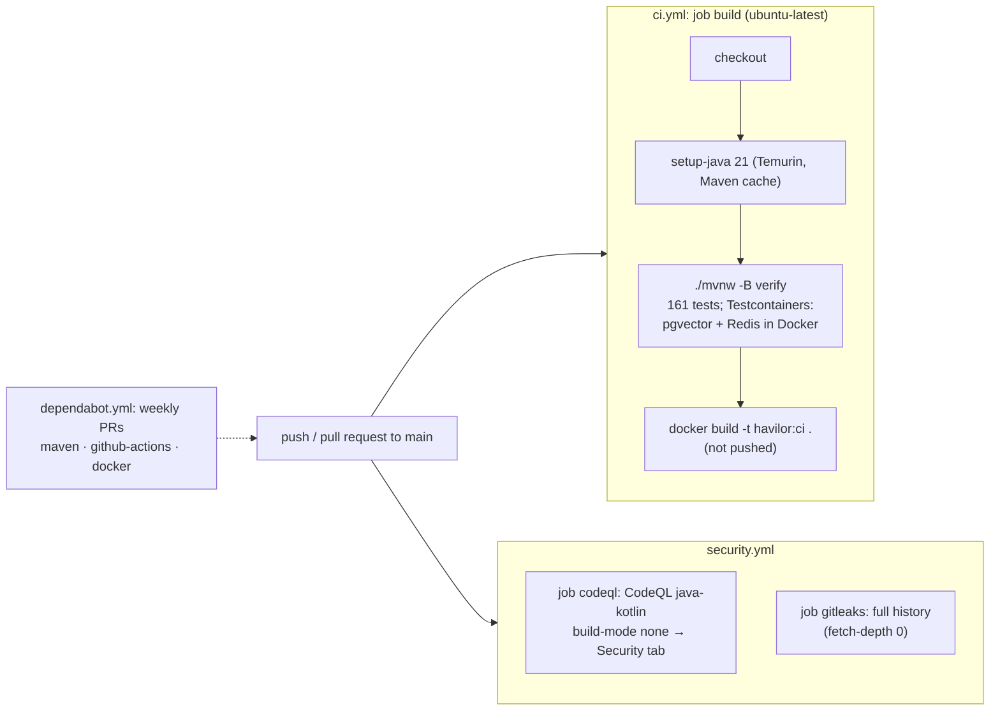

# Flow 25: CI/CD + DevSecOps (GitHub Actions)

**Goal:** every push and pull request to `main` is built, fully tested and packaged as a Docker image, and checked for
code vulnerabilities and leaked secrets, with no secret needed in the repository. Dependabot keeps dependencies fresh.
**New idea:** continuous integration with security checks built in ("shift left").

**Built on:** `main` · **Status:** done, 161 tests passing, pushed; CI green on GitHub (see below)

## What runs

## Files

| File | What it does |
|---|---|
| `.github/workflows/ci.yml` (new) | On push/PR to `main`: checkout, Java 21 (Temurin, Maven cache), `./mvnw -B verify` (all tests), `docker build`. `permissions: contents: read`. |
| `.github/workflows/security.yml` (new) | Job `codeql`: CodeQL for Java (`build-mode: none`, results in the Security tab; `security-events: write`). Job `gitleaks`: secret scan of the whole git history. |
| `.github/dependabot.yml` (new) | Weekly update PRs for Maven, GitHub Actions and the Dockerfile's base images. |
| `mvnw` | Marked executable in git (mode 100755). It was 100644, so `./mvnw` would have failed with "permission denied" on the Linux runner (Windows doesn't track the bit). |

## Why no secret is needed

- **Tests use fakes and test-only values:** `src/test/resources/config/application.yml` gives a fake JWT secret and dev
  password; `ANTHROPIC_API_KEY` / `VOYAGE_API_KEY` are empty, so the real clients are "not configured" and the AI tests
  use `FakeAiClient` / `FakeEmbeddingClient`. No test calls an external API.
- **Testcontainers** needs only Docker, which GitHub's `ubuntu-latest` runners have.
- **gitleaks** uses `GITHUB_TOKEN`, which GitHub creates for every run; nothing is configured in the repository.
  It is free for personal accounts (an organization would need a gitleaks license key).
- **CodeQL** code scanning is free for public repositories (this one is public).

## Checked before pushing

- `gitleaks` (same engine, v8.28.0 in Docker) over the full local history: **152 commits, no leaks**. The fake test values
  are not flagged, so no allowlist was needed.
- Every action tag used exists (`actions/checkout@v6`, `actions/setup-java@v6`, `github/codeql-action@v4`,
  `gitleaks/gitleaks-action@v2`).

## Decisions

- **One build job** (build + tests + image) instead of several: simplest, and the image is built only from tested code.
- **The image is built, not pushed** (as asked). Pushing to a registry comes with deployment.
- **CodeQL without a build** (`build-mode: none`): analyses the sources directly; faster and doesn't depend on Maven.
- **Major-version tags** (`@v6`) instead of commit SHAs: readable, and Dependabot proposes updates. Pinning to SHAs is
  stricter supply-chain hygiene; it can be done later.
- **Least privilege:** each workflow/job asks only for the permissions it needs (`contents: read`; CodeQL adds
  `security-events: write`).

## How to verify

- GitHub → Actions: workflows **CI** and **Security** run on every push to `main`, and are green.
- GitHub → Security → Code scanning shows the CodeQL results; Dependabot PRs appear weekly.

## New concepts introduced

- **Continuous integration** with GitHub Actions (triggers, jobs, steps, runners, caching).
- **SAST** (static analysis, CodeQL), **secret scanning** (gitleaks), **dependency updates** (Dependabot).
- **Least-privilege tokens** in workflows, and secret-free pipelines through fakes.
