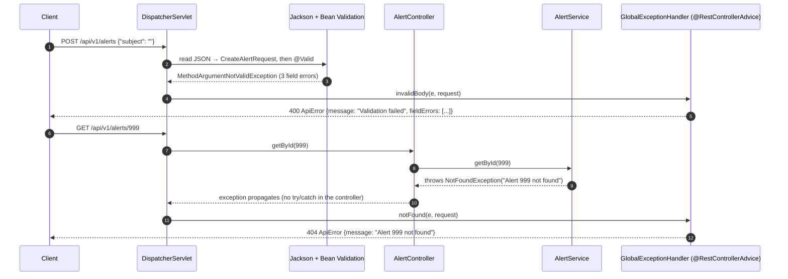

# Flow 3: Handle mistakes

**Goal:** every mistake (bad input, unknown id, broken rule, server bug) comes back as the **same JSON error body**.
**New idea:** one global error handler (`@RestControllerAdvice`).

**Branch:** built directly on `main` · **Status:** done, 33 tests passing, pushed

## The error format

```json
{
  "status": 400,
  "error": "Bad Request",
  "message": "Validation failed",
  "path": "/api/v1/alerts",
  "timestamp": "2026-11-03T10:15:30.123Z",
  "fieldErrors": [
    {"field": "receivedAt", "message": "must not be null"},
    {"field": "subject", "message": "size must be between 0 and 500"}
  ]
}
```

| Situation | Status | `message` | `fieldErrors` |
|---|---|---|---|
| `@Valid` finds broken fields | 400 | `Validation failed` | one per broken field, sorted by field name |
| Body missing / not JSON | 400 | `Request body is missing or is not valid JSON` | empty |
| Body is JSON but a value can't be read (bad date, unknown enum) | 400 | `Request body has an unreadable value` | the field path, e.g. `receivedAt` or `recipients[0].address` |
| Path/query param wrong type (`/alerts/abc`) | 400 | `Invalid value for parameter 'id'` | `{id: "must be a Long"}` |
| `NotFoundException` from a service | 404 | e.g. `Alert 42 not found` | empty |
| `ConflictException` from a service | 409 | the rule that was broken | empty |
| Spring's own web errors (unknown URL, 405, 415, missing param) | Spring's status | Spring's safe detail text | empty |
| Anything else | 500 | `Unexpected error` (details only in the log) | empty |

## Decisions

- **`fieldErrors` is always present** (an empty list when not relevant), so clients never check whether the key exists.
- **Our own `ApiError` record, not Spring's `ProblemDetail` (RFC 9457).** CLAUDE.md fixes the format
  `{status, error, message, path, timestamp}`; `fieldErrors` was added for validation. `ProblemDetail` would be the
  move if Havilor ever publishes a public API for other teams.
- **Jackson's parse message is never returned.** It can contain Java class names (`java.time.Instant`...). We only
  return *which field* failed, built from the exception's JSON path.
- **500 never leaks.** The handler logs method, URI and the full stack trace, and returns only `Unexpected error`.
  A test throws an exception whose message contains a fake secret and checks it is not in the body.
- **Spring's own exceptions keep their status.** They implement `org.springframework.web.ErrorResponse`, so the
  catch-all checks for that interface first. Without it, an unknown URL or a `DELETE` on `/alerts` would become a 500.
- **Validation limits match the database columns** (`ticketNumber` 50, `subject` 500), so anything valid fits the table.
  (Leul's local draft had `subject` max 100; the batch spec set 500 to match `VARCHAR(500)`.)
- **`getById` instead of `findById`.** By convention `find…` returns `Optional`; `get…` returns the value or throws.
  The controller no longer decides what "missing" means; the service does (request pattern step 3).
- **Exceptions are unchecked** (`RuntimeException`), so services need no `throws` clauses and `@Transactional`
  rolls back on them by default.

## How an error flows



## Commits

| Commit | Message |
|---|---|
| `9d19b42` | chore: remove package-info markers from modules that now hold code |
| `bcf75ac` | feat(alert): validate the create-alert request |
| `3b713ea` | feat(common): add NotFoundException and ConflictException |
| `c53f9be` | feat(common): add global exception handler with one error format |
| `1c2a331` | refactor(alert): throw NotFoundException for unknown alert ids |
| `d006dc8` | test(common): cover 400/404/405/409/500 error responses |

## Files created / changed

| File | What it does |
|---|---|
| `alert/CreateAlertRequest.java` | `@NotBlank @Size(max = 50) ticketNumber`, `@NotBlank @Size(max = 500) subject`, `@NotNull receivedAt`. |
| `alert/AlertController.java` | `@Valid` on the POST body. `GET /{id}` now just returns `alertService.getById(id)`. |
| `alert/AlertService.java` | `findById` → `getById`: returns `AlertResponse` or throws `NotFoundException.of("Alert", id)`. |
| `common/NotFoundException.java` (new) | Unchecked; `of(what, id)` builds "`<what> <id> not found`". |
| `common/ConflictException.java` (new) | Unchecked; for broken business rules (used from Flow 6). |
| `common/ApiError.java` (new) | The error record plus nested `FieldViolation(field, message)`. |
| `common/GlobalExceptionHandler.java` (new) | One `@ExceptionHandler` per case in the table above; every body goes through one `build(...)` method. |
| `alert/package-info.java`, `common/package-info.java` | Removed (Leul had staged this). The folders hold real classes now, so the empty markers aren't needed. |
| `test/.../common/ErrorHandlingIntegrationTest.java` (new) | 8 MockMvc tests, one per row of the table. A test-only `ThrowingController` (pulled in with `@Import`, so it exists only in this test's context) throws `ConflictException` and an unexpected exception. |
| `test/.../alert/AlertServiceTest.java` | `getById` found / throws `NotFoundException`. |
| `test/.../alert/AlertControllerIntegrationTest.java` | The 404 test also checks the message. |

## How to verify

1. `docker compose up -d`, then `./mvnw test` → `Tests run: 33, Failures: 0`.
2. `./mvnw spring-boot:run`, then:
   - `curl -i -X POST localhost:8080/api/v1/alerts -H "Content-Type: application/json" -d '{"subject":""}'` → 400 with 3 `fieldErrors`.
   - `curl -i localhost:8080/api/v1/alerts/999999` → 404 `Alert 999999 not found`.
   - `curl -i localhost:8080/api/v1/alerts/abc` → 400 `Invalid value for parameter 'id'`.
   - `curl -i -X DELETE localhost:8080/api/v1/alerts` → 405 in the same shape.

## New concepts introduced

- **`@RestControllerAdvice` + `@ExceptionHandler`**: one class that handles exceptions from every controller.
- **Bean Validation**: `@NotBlank`, `@Size`, `@NotNull` on a record, triggered by `@Valid`; `MethodArgumentNotValidException` and its `BindingResult`.
- **Where each 400 comes from**: validation (after reading), `HttpMessageNotReadableException` (while reading JSON), `MethodArgumentTypeMismatchException` (converting a path/query string).
- **Unchecked domain exceptions** as the way a service says "404" or "409" without knowing about HTTP.
- **Not leaking internals**: log the details, return a generic message.
- **`org.springframework.web.ErrorResponse`**: the interface Spring's own web exceptions implement (status + safe detail).
- **Test-only beans** with `@Import` on one test class.

## Known limits

- `@Valid` checks shape only. Business rules (closed alert, pending steps) are the services' job, from Flow 6.
- Unknown JSON properties are ignored, not rejected (Jackson default). Strict mode would break clients that send extra fields.
