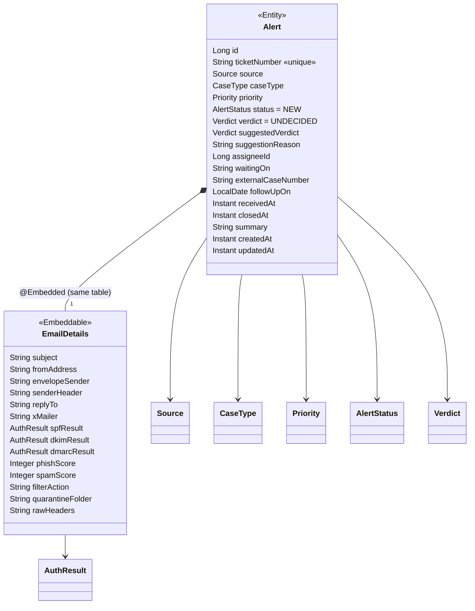

# Flow 4: Grow the alert

**Goal:** the alert gets every field from the ERD (class diagram v3): enums, the "waiting on external" fields,
timestamps, and the **embedded email details** (14 columns in the `alert` table, no separate table).
**New idea:** `@Embedded` / `@Embeddable` + `@Enumerated(EnumType.STRING)`.

**Built on:** `main` · **Status:** done, 37 tests passing, pushed

## The API now

```json
POST /api/v1/alerts
{
  "ticketNumber": "INC0010042",
  "source": "PROOFPOINT_TAP",
  "caseType": "DETECTED_PHISHING",
  "priority": "HIGH",
  "receivedAt": "2026-10-28T14:00:00Z",
  "email": {
    "subject": "Your mailbox is full",
    "fromAddress": "it-support@helpdesk.example.com",
    "envelopeSender": "bounce@mailer.example.net",
    "replyTo": "collect@harvest.example.net",
    "spfResult": "FAIL", "dkimResult": "NONE", "dmarcResult": "FAIL",
    "phishScore": 92
  }
}
```

The response has the same fields, plus `id`, `status` (always `NEW` at first), `verdict` (`UNDECIDED`),
`suggestedVerdict`, `suggestionReason`, `assigneeId`, `waitingOn`, `externalCaseNumber`, `followUpOn`, `closedAt`,
`summary`, `createdAt` and `updatedAt`.

**Breaking change:** `subject` moved from the top level into `email.subject`.

## Decisions

- **`@Embeddable EmailDetails`, not an `EmailAlert` subclass.** This is class diagram v3's "composition over
  inheritance": an alert *has* email details. `EmailDetails` has no id and no table, so its 14 fields are columns
  in `alert`.
- **`EnumType.STRING` everywhere.** `ORDINAL` (the JPA default) stores 0, 1, 2. Reordering the enum or inserting
  a value in the middle would then silently change the meaning of every old row.
- **CHECK constraints on enum columns** (`ck_alert_priority`...). The database refuses a value Java couldn't read
  back, even from a manual `UPDATE`. Trade-off: adding an enum value needs a migration that widens the CHECK,
  which is deliberate.
- **Migration defaults are dropped after the backfill.** V3 adds `source`, `case_type`, `priority`, `verdict`,
  `created_at` and `updated_at` as `NOT NULL DEFAULT ...` so the rows from Flows 1–3 get values. It then drops the
  defaults, so the app must always set them; a forgotten value fails loudly instead of quietly becoming `MEDIUM`.
- **Email columns are nullable in the DB except `subject`.** Older rows have no `from_address`. The **request**
  still requires `fromAddress`, so every new alert has one.
- **No `@Email` on addresses.** In a phishing tool, a malformed sender is evidence, not bad input.
- **The request never contains** `status`, `verdict`, `suggestedVerdict`, `suggestionReason`, `closedAt` or `summary`.
  If a caller sends them anyway, Jackson ignores them (tested). Assignment and "waiting on" come through PATCH (Flow 6).
- **`assigneeId` is a plain `BIGINT` with no FK yet.** The `app_user` table arrives with the user module (Slice 4).
  The FK constraint is added then.
- **`playbook_id` is not added yet.** It belongs to Flow 8, where the playbook link is made (one migration per flow,
  only the columns the flow needs).
- **`createdAt` / `updatedAt` via `@PrePersist` / `@PreUpdate`.** That's plain JPA with no Hibernate-specific annotations.
- **Builder only on `EmailDetails`** (14 optional fields). `Alert` keeps one constructor with its 6 required values,
  so a new alert can't be built without them.
- **Scores 0–100** (`@Min/@Max` in the request plus a CHECK in the DB). `rawHeaders` is `TEXT`, capped at 100,000
  characters in the request.

## Class and table



| Enum | Package | Values |
|---|---|---|
| `CaseType` | `common` (playbooks use it too) | `DETECTED_PHISHING`, `USER_REPORTED_EMAIL`, `RELEASE_REQUEST` |
| `AlertStatus` | `alert` | `NEW`, `INVESTIGATING`, `ESCALATED`, `WAITING_ON_EXTERNAL`, `CLOSED` |
| `Priority` | `alert` | `CRITICAL`, `HIGH`, `MEDIUM`, `LOW` |
| `Source` | `alert` | `SERVICENOW`, `PROOFPOINT_TAP`, `TEST_GENERATOR` |
| `Verdict` | `alert` | `UNDECIDED`, `MALICIOUS`, `BENIGN`, `FALSE_POSITIVE` |
| `AuthResult` | `alert` | `PASS`, `FAIL`, `NONE` |

## Commits

| Commit | Message |
|---|---|
| `efa4886` | feat(alert): add alert enums and V3 migration for the full alert |
| `711fb3b` | feat(alert): embed EmailDetails and map the full alert with enums |
| `5df6698` | feat(alert): accept and return the full alert in the API DTOs |
| `c11d759` | test(alert): cover the full alert round trip and enum storage |

## Files created / changed

| File | What it does |
|---|---|
| `db/migration/V3__grow_alert.sql` (new) | Adds 27 columns, backfills NOT NULL ones with temporary defaults, drops the defaults, adds CHECK constraints. |
| `common/CaseType.java` + `alert/{AlertStatus,Priority,Source,Verdict,AuthResult}.java` (new) | The enums above. |
| `alert/EmailDetails.java` (new) | `@Embeddable`, Lombok `@Builder`, 14 fields with column names and lengths. |
| `alert/Alert.java` | All ERD fields; `@Enumerated(STRING)`; `@Embedded email`; constructor sets `NEW` + `UNDECIDED`; `@PrePersist/@PreUpdate` timestamps. The old `STATUS_NEW` string constant is gone. |
| `alert/EmailDetailsRequest.java` (new) | Validated email part of the request; `toEmailDetails()` maps to the embeddable. |
| `alert/CreateAlertRequest.java` | `ticketNumber`, `source`, `caseType`, `priority`, `receivedAt`, `@Valid email`. |
| `alert/EmailDetailsResponse.java` (new), `alert/AlertResponse.java` | The full response, with `email` nested. |
| `alert/AlertService.java` | Builds the new `Alert` from the request. |
| `test/.../alert/TestAlerts.java` (new) | One place for fake test alerts, requests and the minimal JSON body (`example.com`/`example.net` addresses only). |
| `test/.../alert/FullAlertIntegrationTest.java` (new) | Every field round-trips; enums are stored as names; `status`/`verdict` in the request are ignored; the DB CHECK rejects `URGENT`. |
| `test/.../common/ErrorHandlingIntegrationTest.java` | Validation now reports 8 fields, including nested `email.fromAddress`; new test: an unknown enum value gives 400 naming the field. |
| Other tests | Use `TestAlerts`; `subject` → `email.subject`. |

## How to verify

1. `docker compose up -d`, then `./mvnw test` → `Tests run: 37, Failures: 0`.
2. `docker exec havilor-db psql -U havilor -d havilor -c "\d alert"` shows the 33 columns (all but `playbook_id`) and the `ck_alert_*` constraints.
3. POST the example above, then `GET /api/v1/alerts/{id}`: `status: NEW`, `verdict: UNDECIDED`, and `email` nested.
4. POST with `"priority": "URGENT"` → 400 with `fieldErrors[0].field = "priority"`.

## New concepts introduced

- **`@Embeddable` / `@Embedded`**: a value object stored in its owner's table (composition).
- **`@Enumerated(EnumType.STRING)` vs `ORDINAL`**, and why ORDINAL is dangerous.
- **CHECK constraints** as a database-level guard for enum columns and ranges.
- **Expand-style migration with backfill**: add as nullable/defaulted, fill, then tighten.
- **JPA lifecycle callbacks** `@PrePersist` / `@PreUpdate`.
- **Nested validation** with `@Valid` on a record component (`email.fromAddress` in `fieldErrors`).
- **Lombok `@Builder`** for objects with many optional fields.
- **Test data builders** (`TestAlerts`) so a schema change touches one test file, not ten.
