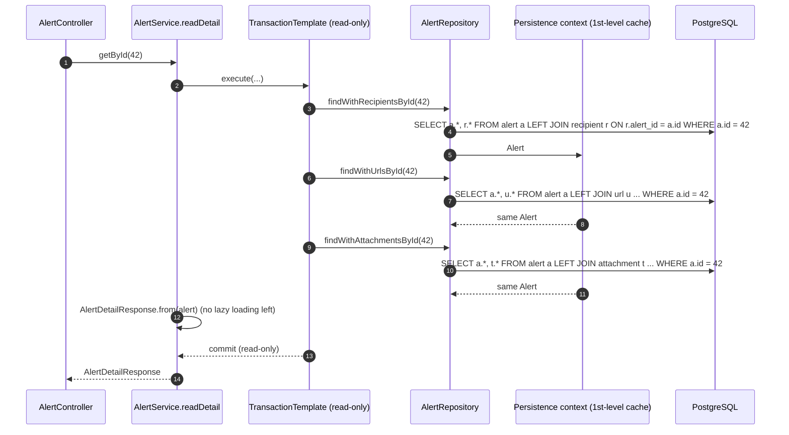
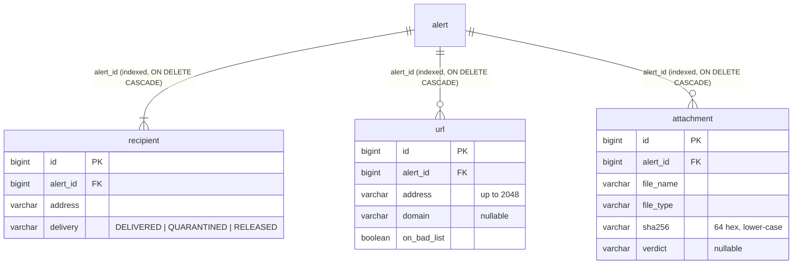

# Flow 5: Alert children

**Goal:** the email's **recipients, URLs and attachments** arrive with `POST /api/v1/alerts` and are stored as
child rows of the alert. The list returns a light summary; the detail view returns everything **without N+1 queries**.
**New idea:** one-to-many relationships (`@OneToMany` / `@ManyToOne`).

**Built on:** `main` · **Status:** done, 43 tests passing, pushed

## The API now

```json
POST /api/v1/alerts
{
  "ticketNumber": "INC0010043", "source": "PROOFPOINT_TAP", "caseType": "DETECTED_PHISHING",
  "priority": "HIGH", "receivedAt": "2026-10-28T14:00:00Z",
  "email": {"subject": "Invoice overdue", "fromAddress": "billing@invoices.example.net"},
  "recipients": [{"address": "alex@corp.example.com", "delivery": "DELIVERED"}],
  "urls": [{"address": "https://login.fake-bank.example.net/verify", "onBadList": true}],
  "attachments": [{"fileName": "invoice.pdf.exe", "sha256": "ab…(64 hex)", "verdict": "MALICIOUS"}]
}
```

| Endpoint | Returns |
|---|---|
| `POST /alerts`, `GET /alerts/{id}` | `AlertDetailResponse`: every alert field + `email` + `recipients[]` + `urls[]` + `attachments[]` (each child with its `id`) |
| `GET /alerts` | page of `AlertSummaryResponse`: `id, ticketNumber, source, caseType, priority, status, verdict, assigneeId, subject, fromAddress, receivedAt`. No children. |

Rules: `recipients` is required (at least 1, max 500); `urls` (max 500) and `attachments` (max 100) are optional.
A URL's `domain` is taken from its address when not given; `sha256` must be 64 hex characters and is stored lower-case.

## Decisions

- **Alert owns its children** (`cascade = ALL`, `orphanRemoval = true`). A recipient has no meaning without its
  alert, so it is saved, changed and deleted only through it. The DB backs this up with `ON DELETE CASCADE`.
- **The child holds the foreign key** (`@ManyToOne @JoinColumn(name = "alert_id")`, the *owning side*). The
  alert's list is `mappedBy = "alert"` (the *inverse side*). JPA writes `alert_id` from the child's field only, so
  **`addRecipient(...)` sets both sides**, and the getters return read-only lists so nobody can skip it.
- **`@ManyToOne(fetch = LAZY)`**. The JPA default for to-one is EAGER, which loads the parent with every child
  whether needed or not.
- **Every `alert_id` has an index.** PostgreSQL indexes primary keys and unique constraints, but **not foreign
  keys**. Without the index, "children of alert 42" is a full scan, and so is every `ON DELETE CASCADE`.
- **Detail = exactly 3 queries, whatever the size.** One query that fetch-joins all three lists is impossible with
  `List`s (Hibernate's `MultipleBagFetchException`). It would also return recipients × urls × attachments rows
  (25 × 25 × 25 = 15,625 rows for 75 children). Instead there are three small fetch-join queries
  (`findWithRecipientsById`, `…Urls…`, `…Attachments…`) in **one read-only transaction**. The persistence context
  hands back the same `Alert` instance each time, so each query fills in one more list. A test counts the
  statements with Hibernate `Statistics`: 3 for an alert with 1 child of each kind, and 3 for one with 25 of each.
- **The list never touches child tables.** `AlertSummaryResponse` reads only alert columns, so a page is one
  `SELECT` plus one `COUNT` (Spring Data skips the `COUNT` when the first page holds everything). This is the
  classic place N+1 happens: 20 alerts × 3 lazy lists = 61 queries.
- **`TransactionTemplate` instead of `@Transactional` for the detail load.** `create()` reuses it for duplicates,
  and a method calling an `@Transactional` method on `this` bypasses Spring's proxy, so no transaction would start
  (the "self-invocation" trap). `create()` itself still must not be transactional (see Flow 1).
- **Duplicate check reads only the id** (`select a.id … where ticketNumber = ?`), then loads the detail.
- **Malformed URLs are kept** with `domain = null`. A broken link in a phishing email is evidence; rejecting the
  alert would lose it.
- **Children have no `created_at`/`updated_at`** (the ERD note says every table has them). Children are only written
  together with their alert, whose timestamps cover them. They can be added if child-level edits appear.
- **`AlertResponse` was renamed `AlertDetailResponse`** to sit next to `AlertSummaryResponse`.

## How the detail load works



## Tables



## Commits

| Commit | Message |
|---|---|
| `192f7b4` | feat(alert): add recipient, url and attachment as alert children |
| `a6cd947` | feat(alert): accept recipients, urls and attachments in POST /alerts |
| `cf94590` | feat(alert): split list summary and detail views, load detail without N+1 |
| `719187a` | test(alert): cover alert children, summary list and bounded detail queries |

## Files created / changed

| File | What it does |
|---|---|
| `db/migration/V4__alert_children.sql` (new) | `recipient`, `url`, `attachment` tables, FKs with `ON DELETE CASCADE`, one index per `alert_id`, CHECKs on enum columns. |
| `alert/DeliveryStatus.java` (new) | `DELIVERED`, `QUARANTINED`, `RELEASED`. |
| `alert/Recipient.java`, `Url.java`, `Attachment.java` (new) | Child entities: `@ManyToOne(LAZY)` to `Alert`, package-private `belongTo(alert)`. `Url` derives the domain; `Attachment` lower-cases the hash. |
| `alert/Alert.java` | Three `@OneToMany(mappedBy, cascade ALL, orphanRemoval)` lists with `@OrderBy("id")`; `addRecipient/addUrl/addAttachment`; read-only getters. |
| `alert/RecipientRequest.java`, `UrlRequest.java`, `AttachmentRequest.java` (new) | Validated child parts of the request, each with a `toX()` mapper. |
| `alert/CreateAlertRequest.java` | `recipients` (`@NotEmpty`), `urls`, `attachments` with list caps and `List<@Valid ...>`; `toAlert()` builds the whole graph. |
| `alert/AlertRepository.java` | `findIdByTicketNumber`; three `left join fetch` queries for the detail load. |
| `alert/AlertService.java` | `readDetail` (3 queries in a `TransactionTemplate`); `list` returns summaries; `create` uses `toAlert()` and the id-only duplicate check. |
| `alert/AlertDetailResponse.java` (renamed from `AlertResponse`), `AlertSummaryResponse.java` (new), `RecipientResponse`, `UrlResponse`, `AttachmentResponse` (new) | Detail vs list DTOs. |
| `alert/AlertController.java` | The list returns `PageResponse<AlertSummaryResponse>`. |
| `test/.../alert/AlertChildrenIntegrationTest.java` (new) | Children round-trip (domain derivation, hash lower-casing); list has no children; **3 statements** for detail with 1 or 25 children; 1–2 for a list page; validation of children. |
| `test/.../alert/AlertServiceTest.java` | Built by hand with a mocked `PlatformTransactionManager`; new tests: children created and pointing back to the alert. |
| `test/.../alert/TestAlerts.java`, other tests | One recipient in every fake alert; id regex now takes the *first* `"id"` (children have ids too). |

## How to verify

1. `docker compose up -d`, then `./mvnw test` → `Tests run: 43, Failures: 0`.
2. `docker exec havilor-db psql -U havilor -d havilor -c "\di idx_*_alert_id"` → three indexes.
3. POST the example above and `GET /api/v1/alerts/{id}`: the three lists come back with ids; `GET /api/v1/alerts` shows only summaries.
4. To watch the SQL: start with `--spring.jpa.show-sql=true` and GET one alert: exactly three `select`s.

## New concepts introduced

- **`@OneToMany(mappedBy)` / `@ManyToOne` + `@JoinColumn`**: owning vs inverse side.
- **`cascade = ALL` + `orphanRemoval`**: aggregate root owns its children.
- **Bidirectional sync helpers** (`addX`) and read-only collection getters.
- **LAZY vs EAGER**, and why to-one defaults are a trap.
- **N+1 queries**, fetch joins, `MultipleBagFetchException`, and the cartesian-product problem.
- **Persistence context as identity map**: the same row in one transaction is the same Java object.
- **Summary vs detail DTOs** for list and single views.
- **Counting SQL statements in a test** with Hibernate `Statistics`.
- **Spring proxy self-invocation** and `TransactionTemplate` as the programmatic alternative.
- **Foreign keys need their own index in PostgreSQL.**
