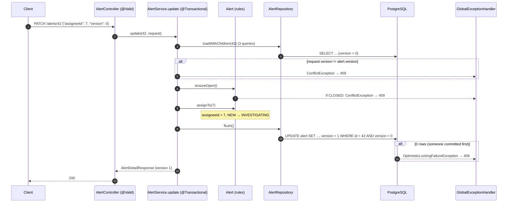

# Flow 6: Update an alert

**Goal:** `PATCH /api/v1/alerts/{id}` changes priority, assignee and the "waiting on external" fields, following
the business rules, and never silently overwrites someone else's change.
**New idea:** business rules (rich entity methods, 409) + optimistic locking (`@Version`).

**Built on:** `main` · **Status:** done, 54 tests passing, pushed

## The API

```json
PATCH /api/v1/alerts/42
{"assigneeId": 7, "priority": "CRITICAL", "followUpOn": "2026-11-10", "version": 0}
```

| Field | Meaning |
|---|---|
| `priority`, `assigneeId`, `followUpOn` | `null` / left out = unchanged |
| `waitingOn`, `externalCaseNumber` | `null` = unchanged, `""` = clear |
| `version` (optional) | the version the client last saw; if the alert has moved on, the update is refused |

| Result | When |
|---|---|
| **200** + full alert (with the new `version`) | changed |
| **400** | invalid field (`assigneeId` ≤ 0, text too long, unknown enum) |
| **404** | unknown id |
| **409** `Alert 42 is closed and can't be changed` | alert is `CLOSED` |
| **409** `… was changed by someone else (version 3, you sent 2) …` | stale `version` sent |
| **409** `Changed by another request at the same time …` | two requests raced and `@Version` caught the second |

**Rule:** assigning an alert that is `NEW` moves it to `INVESTIGATING`. Other statuses stay as they are.

## Decisions

- **Rules live on `Alert`, not in the service.** There are no setters; `assignTo`, `changePriority`,
  `changeWaitingOn`... each check `ensureOpen()` first. Whatever code path changes an alert, the closed-alert rule
  can't be skipped. The service only decides *which* fields were sent. This is the "rich domain model", as opposed
  to an "anemic" entity with getters and setters and all logic in services.
- **`null` = "not sent" (PATCH semantics).** We don't use JSON Merge Patch or JSON Patch: they are more powerful but
  much heavier for five fields. The cost is that `null` can't mean "clear". So text fields clear with `""`, and
  `assigneeId` / `followUpOn` can't be cleared yet (an "unassign" action can come with users in Slice 4).
- **Two layers against lost updates:**
  1. **Client version check** (optional `version` in the body, returned in every detail response). It catches the
     *slow* conflict: an analyst edits a screen she loaded five minutes ago while a colleague changed the alert.
     Without it, `@Version` alone only protects the few milliseconds between our own read and write.
  2. **`@Version`** catches the *fast* conflict: two requests that read the same version at the same moment.
     Hibernate writes `UPDATE … SET version = version + 1 WHERE id = ? AND version = ?`; zero rows updated →
     `OptimisticLockingFailureException` → 409 in `GlobalExceptionHandler`.
- **Optimistic, not pessimistic (`SELECT … FOR UPDATE`).** Conflicts are rare (one analyst per alert), so we don't
  make every update wait on a row lock. We detect the rare conflict and let the client retry.
- **`flush()` before mapping the response**, so the version check runs inside `update` and the response already
  shows the new `version` and `updatedAt`.
- **The concurrency test is deterministic.** Both requests send `version: 0`. Whichever runs second loses, either
  at the version check (it read version 1) or at the `UPDATE` (it read 0 before the winner committed). The test
  always expects exactly one 200 and one 409, and the stored version ends at 1.
- **Waiting fields don't change the status yet.** Setting `waitingOn` doesn't move the alert to
  `WAITING_ON_EXTERNAL`. The batch spec only named the assign rule; a "wait on external" action with its own rule fits
  better than a side effect of a PATCH field.

## How a PATCH flows



## Commits

| Commit | Message |
|---|---|
| `f9dea4c` | feat(alert): add business-rule methods and optimistic locking to Alert |
| `c2a6ddc` | feat(alert): add PATCH /api/v1/alerts/{id} with version check |
| `43a45a8` | test(alert): cover update rules, stale versions and concurrent updates |

## Files created / changed

| File | What it does |
|---|---|
| `db/migration/V5__alert_version.sql` (new) | `version BIGINT NOT NULL DEFAULT 0`. |
| `alert/Alert.java` | `@Version long version`; `ensureOpen`, `changePriority`, `assignTo` (NEW → INVESTIGATING), `changeWaitingOn`, `changeExternalCaseNumber`, `changeFollowUpOn`. |
| `alert/UpdateAlertRequest.java` (new) | All-optional PATCH body with `@Positive assigneeId`, length limits, optional `version`. |
| `alert/AlertService.java` | `update(id, request)`: load, version check, `ensureOpen`, apply sent fields, flush. `loadWithChildren` is shared with `readDetail`. |
| `alert/AlertController.java` | `@PatchMapping("/{id}")`. |
| `alert/AlertDetailResponse.java` | Adds `version`. |
| `common/GlobalExceptionHandler.java` | `OptimisticLockingFailureException` → 409. |
| `test/.../alert/AlertTest.java` (new) | Unit tests of the entity rules (assign, re-assign keeps status, blank clears, closed refuses everything). |
| `test/.../alert/AlertServiceTest.java` | Only sent fields change; a stale version is refused and nothing changes. |
| `test/.../alert/AlertUpdateIntegrationTest.java` (new) | Partial updates and version increments; closed → 409; stale version → 409; **two concurrent PATCHes → exactly one 200 and one 409**; 400/404. |

## How to verify

1. `./mvnw test` → `Tests run: 54, Failures: 0`.
2. Create an alert, then `curl -X PATCH localhost:8080/api/v1/alerts/{id} -H "Content-Type: application/json" -d '{"assigneeId":7}'` → `status: INVESTIGATING`, `version: 1`.
3. Repeat with `"version": 0` → 409 naming versions 1 and 0.
4. `docker exec havilor-db psql -U havilor -d havilor -c "UPDATE alert SET status='CLOSED' WHERE id={id}"`, then PATCH → 409 closed.

## New concepts introduced

- **Rich domain model**: behaviour methods instead of setters; invariants enforced by the entity.
- **PATCH semantics** (null = unchanged) and their limits, vs JSON Merge Patch / JSON Patch.
- **Optimistic locking** with `@Version`, the `WHERE version = ?` trick, and `OptimisticLockingFailureException`.
- **Lost update problem**: the fast race (handled by `@Version`) vs the slow stale screen (handled by the client's version).
- **Optimistic vs pessimistic locking** and when each fits.
- **`flush()`**: forcing the SQL to run before the method returns.
- **Testing a race deterministically** with a `CountDownLatch` and an outcome that doesn't depend on timing.
