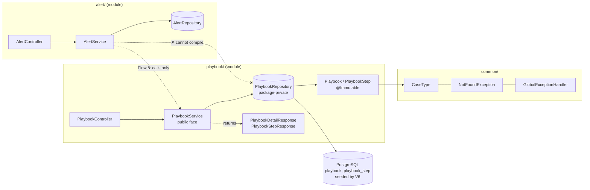

# Flow 7: Playbook module

**Goal:** a second module, `playbook/`, with a **seeded** "Phishing investigation" playbook (version 1, 8 steps).
Every step says what to check, **why it matters** (the teaching text), the question to answer, the answer options,
when it applies, and how to do it. Read it with `GET /api/v1/playbooks` and `GET /api/v1/playbooks/{id}`.
**New idea:** a second module + seed data.

**Built on:** `main` · **Status:** done, 61 tests passing, pushed

> **Later change (layer refactor, after Flow 10):** classes moved into `api/`, `api/request/`, `api/response/`, `domain/`, `repository/` and `service/` sub-packages (paths below are the new ones). `PlaybookRepository` had to become public for `playbook/service/` to use it, so the border is now enforced by an ArchUnit test (`ModuleBorderTest`) instead of Java visibility. See [refactor-layers.md](refactor-layers.md).

## The API

| Method | Path | Result |
|---|---|---|
| `GET` | `/api/v1/playbooks` | **200** `[{id, name, caseType, version, active}]`, sorted by case type then version (not paged: a handful of rows) |
| `GET` | `/api/v1/playbooks/{id}` | **200** the playbook with `steps[]` in order: `{id, orderNo, title, whyItMatters, question, answerOptions[], appliesWhen, toolGuide}`; **404** if unknown |

## The seeded steps

| # | Title | Applies when | Answer options |
|---|---|---|---|
| 1 | Check alert details (From vs envelope sender, recipients, SPF/DKIM/DMARC) | always | Legitimate · Suspicious · Spoofed |
| 2 | Check URLs (reputation of each URL/domain) | always | Malicious · Suspicious · Clean · No URLs |
| 3 | Check attachments (inspect safely) | always | Malicious · Suspicious · Clean · No attachments |
| 4 | Check click activity (did anyone click?) | always | Clicked and permitted · Clicked but blocked · No clicks |
| 5 | Check for suspicious sign-ins | Someone clicked a URL | Suspicious sign-ins · Normal activity only |
| 6 | Check the endpoint (process tree, behaviour) | The user opened an attachment or ran a download | Malicious activity · Suspicious · Clean |
| 7 | Check the sender relationship (contacted before?) | always | Known sender · Known sender with an unusual request · First contact |
| 8 | Communicate with the affected user and third parties | always | Users and third parties · Users only · Nobody needed |

Every step has a 2–3 sentence `whyItMatters` and a `toolGuide`. Tools are described generically
(email security console, EDR console, identity provider sign-in logs); no real tenant or company names.

## Decisions

- **Seed through Flyway, not a `CommandLineRunner`.** Seed data is part of the schema's history: it is versioned,
  runs exactly once per database, and is the same in every environment and test.
- **Playbooks are immutable reference data.** `@Immutable` on both entities makes Hibernate refuse updates, and
  there is no public constructor. **A new version is a new row** (`UNIQUE (case_type, version)`). An alert started
  on version 1 keeps pointing at version 1 even after version 2 is seeded, so its steps never change under the analyst.
- **"One active playbook per case type" is a partial unique index**
  (`CREATE UNIQUE INDEX … ON playbook (case_type) WHERE active`). A plain UNIQUE would also forbid two *inactive*
  versions. Flow 8 picks "the active playbook for this case type", so the database guarantees there is never more
  than one.
- **`UNIQUE (playbook_id, order_no)`** stops two "step 3"s. Its index starts with `playbook_id`, so it also serves
  "steps of playbook X in order", and no separate FK index is needed here.
- **`active` was added** (not in the ERD) because Flow 8 needs to choose a playbook.
- **`answerOptions` is one TEXT column** (`'Malicious|Suspicious|Clean'`) mapped to `List<String>` by a JPA
  `AttributeConverter`. A child table or a PostgreSQL array would be heavier for a short, read-only list.
- **Detail = 1 query** (`left join fetch p.steps`; one collection is fine to fetch-join). The test counts it.
- **Border rule, enforced by the compiler.** `PlaybookRepository` is **package-private**, so code in `alert/`
  cannot even reference it. Other modules must go through `PlaybookService` and get DTOs back (used in Flow 8).
- **Steps have no `@Id` generation.** The app never inserts playbook rows; the IDs come from the migration.

## Module layout

## Commits

| Commit | Message |
|---|---|
| `1a200b4` | feat(playbook): add playbook and step entities with seeded phishing playbook |
| `2e2ac39` | feat(playbook): add GET /api/v1/playbooks and /api/v1/playbooks/{id} |
| `e8b638c` | test(playbook): cover the seeded playbook, step order and constraints |

## Files created / changed

| File | What it does |
|---|---|
| `db/migration/V6__playbook.sql` (new) | `playbook` + `playbook_step` tables, UNIQUE/CHECK constraints, partial unique index, and the seed (1 playbook, 8 steps via `INSERT … SELECT … CROSS JOIN (VALUES …)`). |
| `playbook/domain/Playbook.java`, `PlaybookStep.java` (new) | `@Immutable` entities; steps `@OrderBy("orderNo")`. |
| `playbook/domain/AnswerOptionsConverter.java` (new) | `List<String>` ↔ `'a|b|c'`. |
| `playbook/repository/PlaybookRepository.java` (new, package-private) | `findAll(Sort)`, `findWithStepsById`, `findActiveWithStepsByCaseType` (for Flow 8). |
| `playbook/service/PlaybookService.java` (new) | `list()`, `getById(id)` → DTOs; 404 via `NotFoundException`. |
| `playbook/api/PlaybookController.java` (new) | The two GET endpoints. |
| `playbook/api/response/Playbook{Summary,Detail,Step}Response.java` (new) | DTOs. `PlaybookStepResponse` is public for the alert module. |
| `playbook/package-info.java` | Removed (the module has real classes now). |
| `test/.../playbook/PlaybookIntegrationTest.java` (new) | List, detail (8 steps in order, options, `appliesWhen`, **1 query**), 404, partial unique index, duplicate step number. |
| `test/.../playbook/domain/AnswerOptionsConverterTest.java` (new) | Round trip, empty and missing values. |

## How to verify

1. `./mvnw test` → `Tests run: 61, Failures: 0`.
2. `curl localhost:8080/api/v1/playbooks` → one active phishing playbook, then `curl localhost:8080/api/v1/playbooks/1` → 8 steps.
3. `docker exec havilor-db psql -U havilor -d havilor -c "SELECT order_no, title, applies_when FROM playbook_step ORDER BY order_no"`.

## New concepts introduced

- **Seed data in migrations** and why it beats startup code.
- **Versioned reference data**: never update in place, add a new version.
- **Partial unique index** (`… WHERE active`).
- **`@Immutable`** entities.
- **JPA `AttributeConverter`** for a custom column format.
- **Module border enforced by Java visibility** (package-private repository, public service + DTOs).
- **`INSERT … SELECT … FROM (VALUES …)`** to seed child rows that need the parent's generated id.
