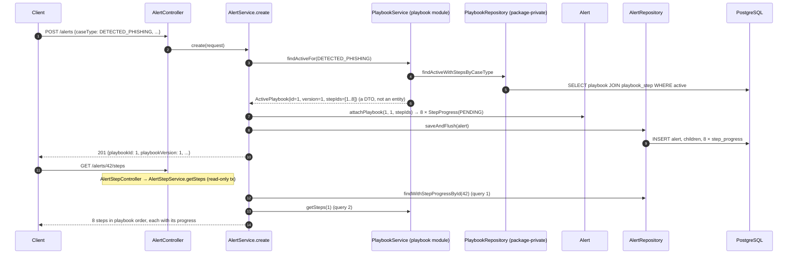

# Flow 8: Steps on an alert

**Goal:** when an alert arrives, it follows the **active playbook for its case type**, and gets one `PENDING` step
progress row per step. The analyst reads the steps (with *why it matters*) and works them one by one.
**New idea:** crossing a module border **through a Service**.

**Built on:** `main` · **Status:** done, 69 tests passing, pushed

> **Later change (refactor after Flow 10, see [refactor-layers.md](refactor-layers.md)):** `Alert.recordStep(...)` now takes the app `Clock` for `completedAt`.

> **Later change (layer refactor, after Flow 10):** classes moved into `api/`, `api/request/`, `api/response/`, `domain/`, `repository/` and `service/` sub-packages (paths below are the new ones). `PlaybookRepository` had to become public for `playbook/service/` to use it, so the border is now enforced by an ArchUnit test (`ModuleBorderTest`) instead of Java visibility. See [refactor-layers.md](refactor-layers.md).

## The API

| Method | Path | Result |
|---|---|---|
| `GET` | `/api/v1/alerts/{id}/steps` | **200** `[{stepId, orderNo, title, whyItMatters, question, answerOptions[], appliesWhen, toolGuide, status, answer, completedAt}]` in playbook order; `[]` if the alert has no playbook; **404** unknown alert |
| `PATCH` | `/api/v1/alerts/{id}/steps/{stepId}` | body `{"status": "DONE" \| "SKIPPED" \| "PENDING", "answer": "..."}` → **200** the step; **400** no/invalid status; **404** unknown alert or step not on this alert; **409** alert closed |

`GET /api/v1/alerts/{id}` now also shows `playbookId` and `playbookVersion`.

**Rules:**
- `DONE`/`SKIPPED` set `completedAt`; going back to `PENDING` clears it.
- Working a step (`DONE`/`SKIPPED`) on a `NEW` alert moves it to `INVESTIGATING`.
- A closed alert's steps can't change (409).

## Decisions

- **The alert module never touches playbook entities or repositories.** It calls two methods on `PlaybookService`:
  - `findActiveFor(caseType)` → `ActivePlaybook(id, version, stepIds)`, used at create;
  - `getSteps(playbookId)` → `List<PlaybookStepResponse>`, used to show and update steps.
  
  Both return DTOs. `ModuleBorderTest` fails the build if a file in `alert/` imports `Playbook`, `PlaybookStep` or
  `PlaybookRepository`. (The repository is package-private anyway, so it wouldn't compile.)
- **`StepProgress` holds `playbookStepId` (a `Long`), not a `@ManyToOne PlaybookStep`.** An entity relationship
  would tie the alert module to the playbook module's classes. The database still has the FK
  (`step_progress.playbook_step_id → playbook_step.id`) for integrity; if the modules are ever split into
  services, that FK is the one thing to drop.
- **Joining texts and progress happens in Java, in `AlertStepService`.** Two queries (alert + progress rows; playbook
  + steps), merged by step id, in **playbook order**. A test counts the 2 queries, not 1 + 8.
- **Store `playbook_id` and `playbook_version`.** Version 2 of the phishing playbook can be seeded later without
  changing what an open alert shows. The version is stored even though the id already implies it, so the record is
  readable on its own (audit).
- **Playbook chosen at create time, outside the insert transaction.** `create()` is still not transactional (Flow 1's
  duplicate handling). The playbook read runs in `PlaybookService`'s own read-only transaction. Playbooks are
  immutable, so nothing can change between that read and the insert.
- **No active playbook → no steps** (today `USER_REPORTED_EMAIL` and `RELEASE_REQUEST`). The alert is still created;
  `GET …/steps` returns `[]`.
- **Backfill in V7.** Open alerts that existed before Flow 8 get the active playbook and `PENDING` steps, as if they
  had arrived today. Closed ones stay without a playbook.
- **DB guarantees:** `UNIQUE (alert_id, playbook_step_id)` (never the same step twice) and
  `CHECK ((status = 'PENDING') = (completed_at IS NULL))` (`completedAt` is set exactly when a step is finished).
- **`answer` is free text** (max 2000). The step's `answerOptions` are suggestions; analysts add notes.
- **`StepStatus` is `PENDING / DONE / SKIPPED`** (batch spec), not the class diagram's "Not started".
- **A separate `AlertStepController` / `AlertStepService`**, so `AlertService` doesn't grow into a god class.
  Both are still in the `alert` module: step progress belongs to the alert.
- **Step changes don't bump the alert's `@Version`.** Hibernate only versions the alert when *its own* columns or
  collections change. Two analysts ticking the same step at the same moment: last write wins. That's acceptable for a
  checklist; a `@Version` on `StepProgress` would be the fix if it matters.

## Crossing the border

## Commits

| Commit | Message |
|---|---|
| `e8b6d65` | feat(alert): track playbook step progress on alerts |
| `8bc6ac5` | feat(playbook): expose active playbook and steps to other modules |
| `2489865` | feat(alert): attach the active playbook when an alert arrives |
| `e239836` | feat(alert): add GET and PATCH /api/v1/alerts/{id}/steps |
| `7cf79f6` | test(alert): cover alert steps, playbook attach and the module border |

## Files created / changed

| File | What it does |
|---|---|
| `db/migration/V7__alert_steps.sql` (new) | `alert.playbook_id` (FK + index) and `playbook_version`; `step_progress` table with UNIQUE, CHECKs and FK index; backfill. |
| `alert/domain/enums/StepStatus.java`, `alert/domain/StepProgress.java` (new) | The association entity; `record(status, answer)` keeps `completedAt` in step with the status. |
| `alert/domain/Alert.java` | `playbookId`, `playbookVersion`, `stepProgress` list; `attachPlaybook`, `recordStep` (404 / 409 / NEW → INVESTIGATING), `pendingStepCount` (for Flow 9). |
| `playbook/service/ActivePlaybook.java` (new), `playbook/service/PlaybookService.java` | `findActiveFor(caseType)`, `getSteps(playbookId)`. |
| `alert/service/AlertService.java` | Takes `PlaybookService`; attaches the active playbook before saving. |
| `alert/repository/AlertRepository.java` | `findWithStepProgressById`. |
| `alert/service/AlertStepService.java`, `AlertStepController.java`, `AlertStepResponse.java`, `UpdateStepRequest.java` (new) | The steps endpoints. |
| `alert/api/response/AlertDetailResponse.java` | `playbookId`, `playbookVersion`. |
| `test/.../alert/AlertStepsIntegrationTest.java` (new) | 8 pending steps; no playbook → `[]`; DONE/undo and NEW → INVESTIGATING; **2 queries**; 400/404/409; UNIQUE constraint. |
| `test/.../ModuleBorderTest.java` (new) | No playbook entity/repository imports in `alert/`. |
| `test/.../alert/AlertServiceTest.java` | Mocks `PlaybookService`; a new alert gets one PENDING row per step id. |

## How to verify

1. `./mvnw test` → `Tests run: 69, Failures: 0`.
2. POST a `DETECTED_PHISHING` alert → `playbookId` set. `GET /api/v1/alerts/{id}/steps` → 8 `PENDING` steps.
3. `PATCH /api/v1/alerts/{id}/steps/{stepId}` with `{"status":"DONE","answer":"Spoofed"}` → `completedAt` set; the alert is now `INVESTIGATING`.

## New concepts introduced

- **Calling another module through its Service + DTOs**, and why not through its entities.
- **Association class** (`StepProgress` between Alert and PlaybookStep) holding an **id reference** instead of an entity reference.
- **In-memory join** of two small result sets by key (a `Map<Long, StepProgress>`).
- **Architecture test**: a unit test that guards a design rule.
- **Data backfill** inside a schema migration.
- **CHECK constraints across two columns** (`(status = 'PENDING') = (completed_at IS NULL)`).
