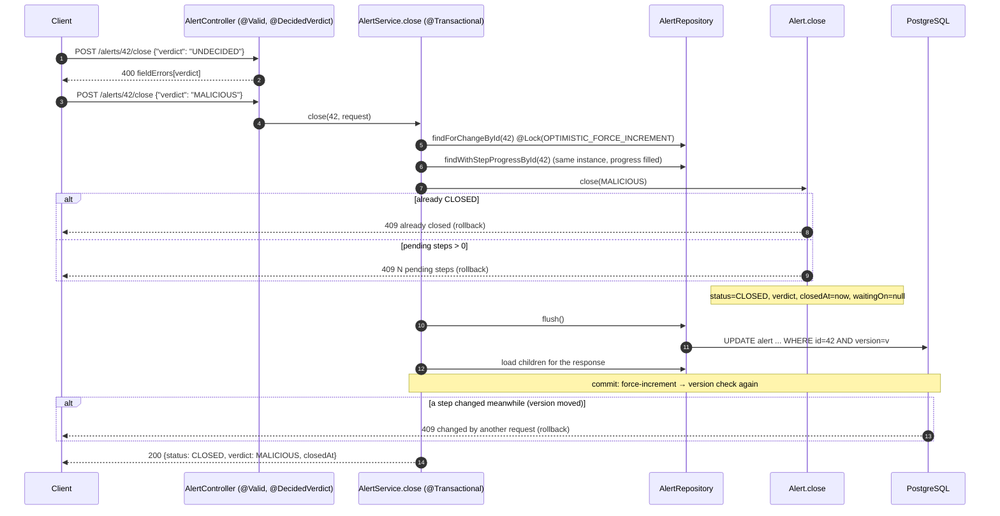

# Flow 9: Close an alert

**Goal:** `POST /api/v1/alerts/{id}/close {verdict}` ends the case with the analyst's decision, but only when every
rule allows it.
**New idea:** `@Transactional` with several rules: all checks pass and the alert closes, or nothing changes.

**Built on:** `main` · **Status:** done, 78 tests passing, pushed

## The API

```json
POST /api/v1/alerts/42/close
{"verdict": "MALICIOUS"}
```

| Result | When |
|---|---|
| **200** full alert: `status: CLOSED`, `verdict`, `closedAt` set, `waitingOn` cleared | all rules pass |
| **400** `verdict: must not be null` | no verdict |
| **400** `verdict: must be a decision (MALICIOUS, BENIGN or FALSE_POSITIVE), not UNDECIDED` | `UNDECIDED` |
| **404** | unknown alert |
| **409** `Alert 42 is already closed` | closed before |
| **409** `Alert 42 has 3 pending steps. Finish or skip every step before closing.` | any step still `PENDING` |
| **409** `Changed by another request at the same time …` | a step was changed while closing (see below) |

After closing, PATCH on the alert or its steps gives **409** (Flow 6/8's `ensureOpen`).

## Decisions

- **The rules live in `Alert.close(verdict)`**, checked in a fixed order: real verdict → not already closed → no
  pending steps. Only then does it change four fields together (`status`, `verdict`, `closedAt`, `waitingOn`).
  The service only loads, calls, and flushes, all inside one `@Transactional`. If any rule throws, the transaction
  rolls back and the database is untouched (a test checks the stored status is still `NEW`).
- **"Not UNDECIDED" is checked twice, on purpose.** A custom Bean Validation constraint `@DecidedVerdict` gives the
  client a clean 400 with `fieldErrors` at the boundary. The entity also refuses UNDECIDED
  (`IllegalArgumentException`), so no other code path, like a future batch job, can close without a decision.
- **Why a custom constraint and not a smaller enum?** A `CloseVerdict` enum without UNDECIDED would also work, but
  the error would be the generic "unreadable value". The constraint names the rule in the message.
- **Closing and step changes can't race (`OPTIMISTIC_FORCE_INCREMENT`).** The danger: analyst A closes (all steps
  done) while B sets a step back to `PENDING`, so both commit and we get a closed alert with a pending step.
  Both operations now load the alert with `LockModeType.OPTIMISTIC_FORCE_INCREMENT`, which bumps the alert's
  `@Version` at commit even when no alert column changed. Whichever commits second fails the version check →
  409. This also closes the "last write wins on steps" gap noted in Flow 8.
- **The lock is on a plain query, not on the fetch join.** First attempt: the lock on
  `select a … left join fetch a.stepProgress` → Hibernate tried to lock the `StepProgress` rows too and failed
  (`has no version and may not be locked`), giving 500s in the tests. Fix (`e6f4af4`): lock with
  `select a from Alert a where a.id = :id`, then load the progress rows with the normal fetch join; the persistence
  context returns the same `Alert`. Both are wrapped in one repository `default` method,
  `findForChangeWithStepProgressById`.
- **Closing clears `waitingOn`** (nothing to wait for), but keeps `externalCaseNumber` and `followUpOn` as history.
- **No `summary` in the close request yet.** The journal's FR-27 mentions "close with verdict and summary". The batch
  spec asked for `{verdict}`, and the AI summary arrives in Slice 3; adding an optional field is easy then.
- **200 with the alert, not 204.** The client gets the final state (closedAt, verdict) without a second GET.
- **`POST /close`, not `PATCH {status: CLOSED}`.** Closing is a business action with its own rules (API design
  convention from the journal), not a field edit.

## How a close flows



## Commits

| Commit | Message |
|---|---|
| `87e1cdf` | feat(alert): add close rules to Alert and a decided-verdict constraint |
| `e92a602` | feat(alert): add POST /api/v1/alerts/{id}/close |
| `e6f4af4` | fix(alert): force-increment only the alert, not its unversioned step rows |
| `dbbc5d3` | test(alert): cover closing rules and step-change version bumps |

## Files created / changed

| File | What it does |
|---|---|
| `alert/Alert.java` | `close(verdict)` with the three rules and the four field changes. |
| `alert/DecidedVerdict.java` (new) | Custom constraint annotation + nested `ConstraintValidator`. |
| `alert/CloseAlertRequest.java` (new) | `@NotNull @DecidedVerdict Verdict verdict`. |
| `alert/AlertRepository.java` | `findForChangeById` (`@Lock(OPTIMISTIC_FORCE_INCREMENT)`) + default `findForChangeWithStepProgressById`. |
| `alert/AlertService.java` | `close(id, request)`: lock and load, `alert.close`, flush, return the detail. |
| `alert/AlertStepService.java` | `updateStep` uses the same lock-and-load, so step changes bump the alert version. |
| `alert/AlertController.java` | `@PostMapping("/{id}/close")`. |
| `test/.../alert/AlertTest.java` | Close sets the 4 fields; pending steps refuse (message counts them); twice / UNDECIDED refused. |
| `test/.../alert/AlertCloseIntegrationTest.java` (new) | Close after finishing all 8 steps via the API; pending → 409 and the DB is unchanged; no playbook → closes; twice → 409; 400s; a step change bumps the alert version. |

## How to verify

1. `./mvnw test` → `Tests run: 78, Failures: 0`.
2. Create a phishing alert and close it → 409 "8 pending steps". Mark each step DONE/SKIPPED via
   `PATCH …/steps/{stepId}`, close with `{"verdict":"MALICIOUS"}` → 200 `CLOSED`.
3. Close again → 409 "already closed"; PATCH the alert → 409 "closed and can't be changed".

## New concepts introduced

- **Transaction as a unit of several rules**: rollback on any `RuntimeException`.
- **Custom Bean Validation constraint** (`@Constraint` + `ConstraintValidator`).
- **Defence in depth**: the same rule at the API boundary and in the domain.
- **`LockModeType.OPTIMISTIC_FORCE_INCREMENT`** to make a child change count as a parent change.
- **Lock scope with fetch joins**: a lock on a join query applies to every joined entity.
- **Spring Data `default` methods** in a repository interface.
- **Action endpoints** (`POST /close`) vs field updates (PATCH).
