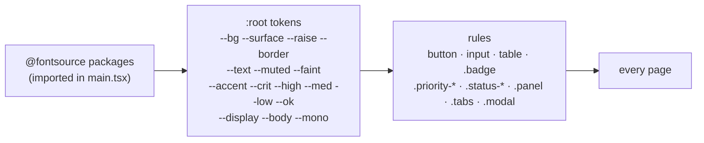

# Flow D1: Brand base (Midnight Signal)

**Goal:** the app gets Havilor's look from `docs/design/`: dark surfaces, a cyan accent, the brand fonts, the logo
and favicon. Every existing element (buttons, inputs, tables, tags, chips, panels, tabs, modals) is restyled with the
design tokens, so the later design flows only have to build layout.
**New idea:** **design tokens**: every colour, font and radius is a named CSS variable, and the rules only use the
names. Changing the theme means changing the tokens, not hunting through 700 lines.

**Built on:** `main` · **Status:** done, `npm run build` passes, pushed

## How it works

| Token group | Values (from `docs/design/README.md`) |
|---|---|
| Surfaces | `--side #070C17` · `--bg #0A1120` · `--surface2 #0D1626` · `--surface #101A2C` · `--raise #14213A` |
| Lines | `--border #1C2940` · `--border2 #253553` |
| Text | `--text #E6EDF7` · `--muted #8494AD` · `--faint #5E6C84` |
| Accent | `--accent #22D3EE` · `--accent-soft` (12 %) · `--accent-text #04202A` |
| Meaning | `--crit #F0525A` · `--high #F97316` · `--med #EAB308` · `--low #38BDF8` · `--ok #34D399` |
| Type | `--display` Space Grotesk · `--body` Inter · `--mono` JetBrains Mono |

## Files

| File | What it does |
|---|---|
| `frontend/package.json`, `package-lock.json` | `@fontsource/space-grotesk`, `@fontsource/inter`, `@fontsource/jetbrains-mono` (exact versions): the only new dependencies. |
| `frontend/src/main.tsx` | Imports only the weights the design uses (Inter 400/500/600, Space Grotesk 500/600, JetBrains Mono 400/500). |
| `frontend/public/*.svg` | The logo files and `favicon.svg`, copied from `docs/design/logo/`. |
| `frontend/index.html` | Favicon link, `theme-color`; the browser title stays "Havilor". |
| `frontend/src/index.css` | Rewritten around the tokens. Primary button = cyan; `.secondary` = outlined; `.danger` = red outline. Severity tags (`.priority-*`, `.level-*`) = small mono uppercase, outlined and tinted. Status chips (`.status-*`) = rounded pills. Tables with uppercase faint headers and a hover row. `color-scheme: dark` for native controls. |

## Decisions

- **No UI library, no Tailwind:** one plain stylesheet, as before; only the values changed to tokens.
- **Self-hosted fonts** (`@fontsource`): no request to a font CDN, works offline, nothing about the user goes to a
  third party.
- **Same class names as before,** so this flow changes no component; D2–D5 rebuild the login, shell and queue.
- **Colour only for meaning:** red/orange/yellow/blue for severity, cyan for active/AI/primary, green for done.
- `.level-high` (AI evidence) uses red, like a critical signal, while `.priority-high` stays orange.

## How to verify

`npm run dev` → every page is dark with the cyan accent, headings in Space Grotesk, tickets and emails in mono; the
browser tab shows the hexagon favicon and "Havilor". Buttons, inputs, tables, tags and modals all use the new look.

## New concepts introduced

- **Design tokens as CSS custom properties.**
- **Self-hosting web fonts** with npm packages.
- **`color-scheme: dark`** for native browser controls.
