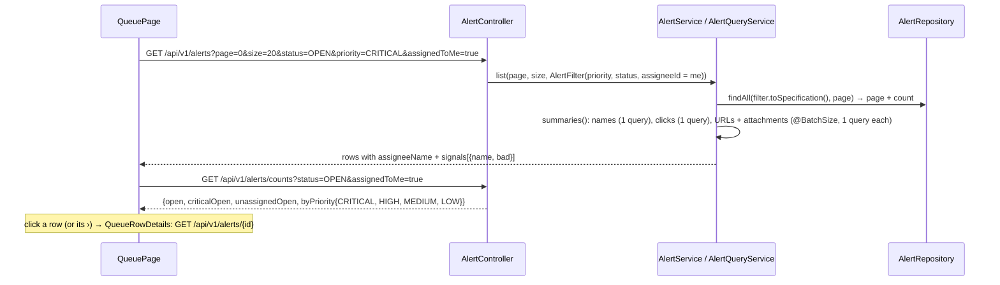

# Flow D4: Alert queue

**Goal:** the queue looks and works like `docs/design/mockups/s1-queue.png`: open / critical / unassigned at a
glance, filters by priority (with counts) and status, an "Assigned to me" switch, outlined severity tags, a Signals
column, assignee avatars, status chips, and rows that open to show the facts an analyst checks first.
**New idea:** **filtering in the backend with a JPA Specification** (optional conditions combined into one query),
and computing a per-row column **without N+1 queries** (batch fetching + one projection query).

**Built on:** `main` · **Status:** done, 185 backend tests pass (5 new), `npm run build` passes, screenshot checked
against a running backend, pushed

## How it works

**Signals** (from data Havilor already has; red = `bad`):

| Signal | Shown when | Red when |
|---|---|---|
| URL | the email has links | a link is on a block list |
| FILE | it has attachments | an attachment was judged MALICIOUS |
| CLICK | someone clicked a link | a click was let through |
| SPF / DKIM / DMARC | the check FAILED or returned NONE | it FAILED (NONE is neutral; PASS is not a signal) |

## Files

### Backend

| File | What it does |
|---|---|
| `alert/service/AlertFilter.java` (new) | Optional priority, status (`OPEN` = not CLOSED, or one status; anything else → 400) and assignee → a `Specification`. |
| `alert/repository/AlertRepository.java` | `JpaSpecificationExecutor`; `findClickFlagsByAlertIds` (one query, `(alertId, permitted)` per click). |
| `alert/repository/ClickFlag.java` (new) | That projection. |
| `alert/domain/Alert.java` | `@BatchSize(100)` on `urls` and `attachments`. |
| `alert/service/Signals.java` (new) | The signal rules above. |
| `alert/api/response/AlertSummaryResponse.java` | `signals: [{name, bad}]`. |
| `alert/api/response/QueueCountsResponse.java` (new) | `open`, `criticalOpen`, `unassignedOpen`, `byPriority`. |
| `alert/service/AlertService.java`, `AlertQueryService.java`, `api/AlertController.java` | `GET /alerts` takes `priority`, `status`, `assignedToMe`; new `GET /alerts/counts`; `summaries()` adds signals. |
| `test/.../alert/QueueFilterIntegrationTest.java` (new) | Each filter and combinations; 400 for unknown values; counts before/after; signals on a row (bad/neutral/absent). |
| `test/.../QueryCountIntegrationTest.java` | A page of 5 alerts with links, files, clicks and assignees = **6 statements**, independent of the row count. |
| `test/.../alert/AlertServiceTest.java` | Uses the Specification overload. |
| `test/.../alert/AlertChildrenIntegrationTest.java` | The queue page bound is now 4–6 statements (was 1–2): the signals read the clicks, URLs and attachments of the whole page in one query each. |

### Front end

| File | What it does |
|---|---|
| `src/pages/QueuePage.tsx` | Title + "N open · N critical · N unassigned", "+ New alert", filters, the table, the pager (only when there is more than one page). Filters are sent to the backend; changing one goes back to page 1. |
| `src/components/QueueFilters.tsx` (new) | Segmented priority filter with coloured dots and counts ("All" = their sum), segmented status filter (Open, New, Investigating, Escalated, Closed), "Assigned to me" switch (a checkbox with `role="switch"`). |
| `src/components/QueueBits.tsx` (new) | `PriorityTag`, `StatusChip`, `SignalTags`, `AssigneeCell` (avatar + "Dana A."). |
| `src/components/QueueRowDetails.tsx` (new) | The opened row: envelope sender, SPF/DKIM/DMARC tags (green pass, red fail, neutral none), first bad URL, first click ("alex · allowed · 3 min after delivery"), "Open alert →". |
| `src/api/types.ts`, `src/format.ts` | `Signal`, `QueueCounts`, `fromAddress`; `formatQueueTime` (time today, else "Nov 10"), `shortName`, `statusLabel`. |
| `src/index.css` | Segmented filters, switch, signal tags, expanded row, status chip colours. |

## Decisions

- **Filters in the backend,** not in the browser: with paging, filtering one page in the browser would hide alerts
  and give wrong counts. One `Specification` covers every combination instead of a derived query per combination.
- **Counts:** the subtitle is the whole queue; the priority buttons use the current status and "Assigned to me"
  filters, so they match what clicking them shows. 7 small count queries.
- **Signals computed in the backend** in a fixed number of queries (measured: 6 for a page), so the queue never
  becomes one query per row.
- **The opened row loads the alert detail** when it opens, not for every row up front.
- **Left out:** "Export" (no export feature) and a "Waiting on external" status button (the mockup doesn't have one;
  those alerts are in "Open").
- **Keyboard:** the › is a real button with `aria-expanded`; the whole row is also clickable with the mouse.
- Row click opens the details here; Flow D5 changes it to open the slide-over panel.

## How to verify

As the analyst on `/alerts`: the subtitle shows open / critical / unassigned; click "Critical" → only critical rows,
its count matches; "Closed" → closed alerts; switch on "Assigned to me" → only yours, and the priority counts change.
Click a row → envelope sender, SPF/DKIM/DMARC, bad URL, who clicked, "Open alert →". `GET /alerts?status=SLEEPING`
→ 400.

## New concepts introduced

- **JPA Specifications** for optional filters.
- **Avoiding N+1:** `@BatchSize` on collections and a constructor-expression projection (`select new …`).
- **Segmented controls and switches** built from plain buttons and a checkbox.
