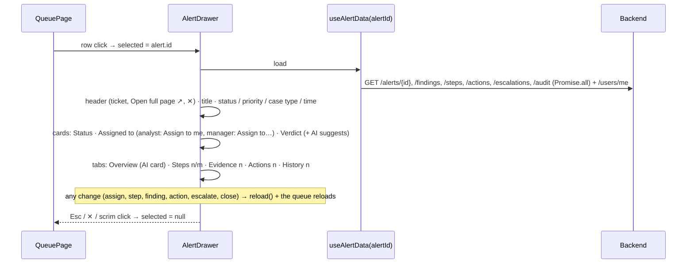

# Flow D5: Slide-over alert panel

**Goal:** clicking an alert in the queue opens it in a panel over the queue (`docs/design/mockups/s2-drawer.png`):
the analyst reads the AI card, checks the steps and evidence and acts, without losing her place in the queue. Esc, ✕
or a click on the dimmed queue closes it; "Open full page" goes to `/alerts/{id}`.
**New idea:** a **custom hook** (`useAlertData`) so two views of the same data load it the same way, and an
**overlay panel** with focus and Esc handling.

**Built on:** `main` · **Status:** done, `npm run build` passes, screenshots checked against a running backend (analyst
and manager), pushed

## How it works

## Files

| File | What it does |
|---|---|
| `src/api/useAlertData.ts` (new) | The hook: the alert + findings, steps, actions, escalations, history, `me`, `reload()`, `alertIsOpen`, `canWork`. |
| `src/pages/AlertDetailPage.tsx` | Uses the hook (same behaviour as before, 50 lines shorter). |
| `src/components/AlertDrawer.tsx` (new) | The panel: scrim + `role="dialog"` aside; Esc closes unless a modal is open (Esc is then the modal's); focus starts on ✕; tabs with counts; analyst-only "Escalate" / "Close alert" at the bottom (same `canWork` rule as the full page). |
| `src/components/DrawerCards.tsx` (new) | Status, Assigned to (changeable in place), Verdict + "AI suggests …". |
| `src/components/AssessmentCard.tsx` | Restyled like the design: cyan border + top glow, "✦ AI assessment", verdict badge (red malicious, green benign, blue false positive), 3-bar confidence meter, evidence with severity dots, next steps as a drawn checklist, "Would change my mind if …", references. Used in the panel and on the full page. |
| `src/components/AiAssessmentPanel.tsx` | The card first, then "Assess again" (secondary); before any assessment, a short explanation and "Get AI assessment". |
| `src/components/AssignToSelect.tsx` | Shorter placeholder ("Choose…") so it fits in a card. |
| `src/pages/QueuePage.tsx` | Row click opens the panel; the › button still expands the row; the queue and counts reload after a change in the panel. |
| `src/index.css` | `.scrim`, `.drawer` (slides in; no animation with `prefers-reduced-motion`), `.cards3` / `.pick`, tab counts, the AI card. |

## Decisions

- **One data hook for page and panel,** so they can't drift apart; the panel shows the same tabs in a shorter form
  (the AI tab is the Overview; the email draft buttons stay on the full page).
- **Status and verdict are shown, not edited, in the cards:** the backend changes them through the investigation
  itself (assign → investigating, escalate, close with a verdict). The mockup's ▾ menus would have needed new
  endpoints; "Assigned to" is the one that can change in place, with the F25 role rules.
- **"Useful?" thumbs left out:** nothing would store the answer yet.
- **Esc belongs to the innermost layer:** if a modal (e.g. "Close alert") is open, Esc closes only the modal.
- **The queue reloads after a change in the panel,** so status chips, assignees and counts stay true.
- No route change for the panel (it's state on the queue page); "Open full page" is the shareable URL.

## How to verify

Analyst on `/alerts`: click a row → the panel slides in over the dimmed queue: ticket, title, chips, the three cards,
tabs with counts, the AI card (if the alert was assessed). "Assign to me" in the card → the queue behind shows you as
assignee. Steps tab → mark a step → "Steps 1/8". Esc → closed. "Open full page ↗" → `/alerts/{id}`. The › on a row
still expands it in place. As the manager: "Assign to" dropdown in the card, no Escalate/Close, no forms.

## New concepts introduced

- **Custom React hooks** for shared data loading.
- **Overlay panels:** scrim, `role="dialog"`, `aria-modal`, initial focus, Esc handling, cleanup of event listeners.
- **`prefers-reduced-motion`** for users who turn animations off.
