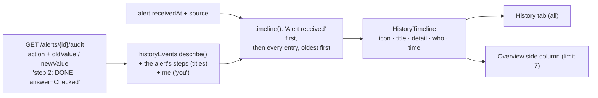

# Flow D8: History timeline

**Goal:** an alert's history reads like a story (`docs/design/mockups/s3-detail.png`): a round icon per kind of
event, a plain title ("Step done: Check URLs", "Escalated to Incident Response"), a detail line, and the time in mono.
Shown on the History tab and, the latest events only, in the Overview's side column ("All n ›" opens the tab).
**New idea:** **a presentation layer for machine data**: the audit log keeps exact technical snapshots; one small
pure function turns them into words for people.

**Built on:** `main` · **Status:** done, `npm run build` passes, screenshot checked against a running backend, pushed

## How it works

| Audit action | Icon | Title | Detail |
|---|---|---|---|
| (alert itself) | bell | Alert received | From test generator |
| ALERT_UPDATED (assignee changed) | user | Assigned to you / user #n | Status NEW → INVESTIGATING |
| ALERT_UPDATED (other) | dot | Alert updated | priority Medium → Critical |
| STEP_UPDATED | check | Step done / skipped / reopened: *step title* | Answer: … |
| FINDING_ADDED | doc | Finding added | *finding title* |
| ACTION_RECORDED | bolt | Action: Block sender | Result: done |
| ESCALATED | flag | Escalated to *team* | *reason* |
| ESCALATION_UPDATED | flag | Escalation updated | their status …, outcome … |
| ALERT_CLOSED | lock | Alert closed | Verdict: … |
| AI_SUGGESTION | spark | AI assessment | Suggested MALICIOUS |

## Files

| File | What it does |
|---|---|
| `src/historyEvents.ts` (new) | `describe(entry, steps, me)` and `timeline(entries, steps, me, received)`: the table above. Reads the backend's known audit formats (`key=value` lists, `step N: STATUS, answer=…`). |
| `src/components/HistoryTimeline.tsx` | The vertical timeline: icon circles joined by a line, title, detail + who, `<time>` in mono ("22:38" today, "Nov 10 22:38" otherwise; the full date as a tooltip). `limit` shows only the newest n. |
| `src/pages/AlertDetailPage.tsx` | History tab inside a section; Overview side column with `limit={7}`; counts include "Alert received". |
| `src/components/AlertDrawer.tsx` | The panel's History tab uses the same timeline. |
| `src/index.css` | `.tl` rules (replacing the old `.timeline`). |

## Decisions

- **Readable text in the front end, exact text in the backend:** the audit trail stays a precise, append-only
  record; turning it into words is presentation. If a format is unknown, the action name and raw text still show.
- **Step titles come from the alert's steps** (already loaded), so "Step done: Check URLs" instead of "step 12".
- **"Alert received" is added from the alert's own data** (`receivedAt`, `source`): it's not an audit entry, but it's
  where the story starts. The tab count includes it.
- **Oldest first in both places;** the side column shows the latest 7 of that story.
- **Who** is "You" or "User #n" (the audit entries only have ids, as before).

## How to verify

Open an alert you worked on: the Overview's right column shows icons and titles like "Assigned to you", "Step done:
Check URLs", "Finding added", "Escalated to …", with mono times; "All n ›" opens the History tab with the whole story.

## New concepts introduced

- **Pure functions for presentation** (easy to read, no state).
- **Regular expressions** to read a known text format.
- **The `<time dateTime>` element** for machine-readable times.
