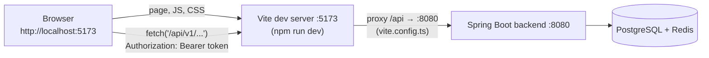

# Flow F1: Front-end project setup

**Goal:** a React + TypeScript front end in `frontend/`, small enough that a beginner can read every file, talking to
the backend through the Vite dev server.
**New idea:** a single-page app (SPA) with its own dev server that proxies API calls to the backend.

**Built on:** `main` · **Status:** done, `npm run build` passes, CI job added, pushed

## How the pieces talk



The browser only ever sees `localhost:5173`, so the backend needs no CORS settings.

## Files

| File | What it does |
|---|---|
| `frontend/package.json`, `package-lock.json` (new) | Scripts `dev`, `build` (`tsc` type-check, then `vite build`), `preview`. Dependencies: `react`, `react-dom`, `react-router`; dev: `vite`, `@vitejs/plugin-react`, `typescript`, React types. Nothing else. |
| `frontend/tsconfig.json` (new) | Strict TypeScript; it only checks (`noEmit`), Vite bundles. |
| `frontend/vite.config.ts` (new) | React plugin, port 5173, proxy `/api` → `http://localhost:8080`. |
| `frontend/index.html`, `src/main.tsx` (new) | The page with `<div id="root">`, and the entry that renders `<App>` inside `BrowserRouter`. |
| `frontend/src/App.tsx` (new) | The routes (a placeholder until F2–F4). |
| `frontend/src/index.css` (new) | The one global stylesheet (colour variables + simple rules). |
| `frontend/src/api/api.ts` (new) | The one fetch helper: token in `sessionStorage`, `Authorization: Bearer` on every call, JSON in/out, backend errors as `ApiError` with the backend's `message`, and a 401 with a token → clear it and go to `/login`. |
| `frontend/src/api/types.ts` (new) | The JSON shapes the pages use (grows per flow). |
| `frontend/.gitignore` (new) | `node_modules/`, `dist/`. |
| `.github/workflows/ci.yml` | New job `frontend`: Node 22, `npm ci`, `npm run build` (type errors fail the build). |
| `README.md` | "Run the front end". |

Folders: `src/api/` (talking to the backend), `src/pages/` (one file per URL, from F2), `src/components/` (pieces
used by pages, from F2).

## Decisions

- **Written by hand, not from the Vite template:** the template adds ESLint configs, demo assets and CSS; the brief
  allows nothing extra, and every file here is short and commented.
- **One fetch helper** so the token, JSON and error handling exist once. Pages never call `fetch` themselves.
- **401 handling:** only when a token was sent (it expired). A 401 *without* a token is a failed login, which the login
  page shows as an error instead of redirecting.
- **`window.location.assign('/login')`** for the redirect: a full page load, simple and the same from anywhere.
- **Versions:** the latest at install time (React 19, React Router 7, Vite 8, TypeScript 7), pinned by
  `package-lock.json`; CI uses `npm ci` to install exactly those.

## How to verify

```bash
cd frontend
npm install
npm run build     # tsc + vite: no errors
npm run dev       # http://localhost:5173 shows "Havilor"
```

## New concepts introduced

- **SPA + dev server + proxy** (why no CORS is needed).
- **Vite** (dev server, bundling) and **TypeScript** type-checking as a build step.
- **Client-side routing** with React Router.
- **sessionStorage vs localStorage vs cookies** for a token.
