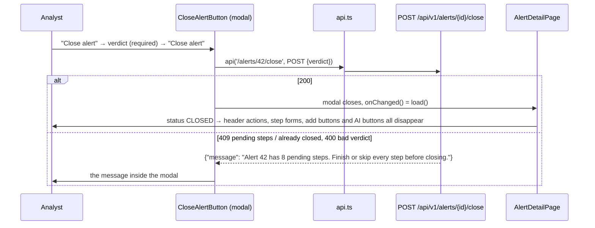

# Flow F11: Close an alert

**Goal:** the analyst makes the final decision from the header: "Close alert" → pick a verdict → closed. The backend's
rules are shown where she clicked (inside the modal), and a closed alert offers no action buttons anywhere.
**New idea:** letting the backend own the business rules, and the UI simply showing its answer.

**Built on:** `main` · **Status:** done, `npm run build` passes, checked against a running backend, pushed

## How it works

## Files

| File | What it does |
|---|---|
| `src/components/CloseAlertButton.tsx` (new) | A red button and a modal: "closing is final", verdict `<select>` (MALICIOUS, BENIGN, FALSE_POSITIVE; required), errors inside the modal, reload on success. |
| `src/components/HeaderActions.tsx` | Adds "Close alert" next to "Assign to me" and the priority. |
| `src/api/api.ts` | Error text now includes the backend's field errors (e.g. `Validation failed: verdict must not be null`). |
| `src/index.css` | `button.danger`. |

**A closed alert hides every action button:** the header actions (`AlertHeader`), the step forms (`StepList
editable`), "Add finding", "Add action" and the AI tab's buttons (`alertIsOpen` in `AlertDetailPage`).

## Checked against a running backend

The exact requests the components send, against a backend with the dev profile on a throwaway database:
assign to me → 200 (INVESTIGATING); priority → 200; close without a verdict → 400 with the field error; close with
pending steps → 409 `Alert 3 has 8 pending steps. Finish or skip every step before closing.`; a step DONE / SKIPPED →
200; add finding → 201 (MANUAL); add action → 201; AI assessment and draft without a key → 502 `The AI assistant is not
configured (ANTHROPIC_API_KEY is not set)`; close after finishing the steps → 200 CLOSED; a change after closing → 409.

## Decisions

- **The rules stay in the backend.** The UI doesn't count pending steps or block the button; it sends the request and
  shows the answer, so the rule exists in one place.
- **Field errors joined into the message**, so a 400 says *what* is wrong (one small change in `api.ts`, used by every
  form).
- **The verdict list has no UNDECIDED** (that isn't a decision); the backend would refuse it with 400 anyway.

## How to verify

Open a phishing alert with pending steps → "Close alert" → MALICIOUS → the modal shows the pending-steps message.
Finish or skip all steps (Investigation) → close again → status CLOSED, and no buttons remain on any tab.

## New concepts introduced

- **Server-side business rules, client-side display.**
- **Confirmation for a final step** (a modal with a warning and a red button).
