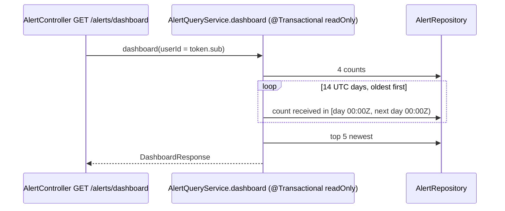

# Flow F13: Backend dashboard endpoint

**Goal:** one request that gives the analyst's start page its numbers: open alerts, assigned to me, critical open,
closed in the last 7 days, alerts per day (14 days), and the 5 newest alerts.
**New idea:** derived Spring Data count queries, and dates in UTC.

**Built on:** `main` · **Status:** done, 164 tests passing, pushed

## The API

```json
GET /api/v1/alerts/dashboard        (any logged-in user)
→ 200 {"openAlerts": 12, "assignedToMe": 3, "criticalOpen": 1, "closedLast7Days": 5,
       "alertsPerDay": [{"date": "2026-10-29", "count": 0}, ..., {"date": "2026-11-11", "count": 4}],   // 14 days
       "recent": [ ...5 AlertSummaryResponse, newest first... ]}
```

| Field | Meaning | Query (Spring Data method → SQL) |
|---|---|---|
| `openAlerts` | status ≠ CLOSED | `countByStatusNot(CLOSED)` |
| `assignedToMe` | open and `assigneeId` = the token's user | `countByStatusNotAndAssigneeId(CLOSED, me)` |
| `criticalOpen` | open and priority CRITICAL | `countByStatusNotAndPriority(CLOSED, CRITICAL)` |
| `closedLast7Days` | `closedAt` ≥ now − 7 days | `countByClosedAtGreaterThanEqual(now − 7d)` |
| `alertsPerDay` | alerts **received** per UTC day, the last 14 days ending today, oldest first, zero days included | `countByReceivedAtGreaterThanEqualAndReceivedAtLessThan(day start, next day start)` × 14 |
| `recent` | the 5 newest by `receivedAt` (id breaks ties), like the queue | `findTop5ByOrderByReceivedAtDescIdDesc()` |



## Files

| File | What it does |
|---|---|
| `alert/repository/AlertRepository.java` | The six derived queries above. |
| `alert/api/response/DashboardResponse.java` (new) | The response, with `DayCount(date, count)`. |
| `alert/service/AlertQueryService.java` | `dashboard(userId)`; now takes the app `Clock` ("now" and "today" in UTC). |
| `alert/api/AlertController.java` | `GET /api/v1/alerts/dashboard`; `/dashboard` wins over `/{id}` because Spring prefers the exact path. |
| `test/.../alert/AlertServiceTest.java` | `AlertQueryService` built with the test clock. |
| `test/.../alert/DashboardIntegrationTest.java` (new) | Four known alerts (critical, assigned to me, closed, one outside the window): each count changes by exactly the expected amount; 14 days from 2026-10-19 to 2026-11-01 with only the three used days +1; newest first in `recent` (≤ 5); "assigned to me" is per user; no token → 401. |

## Decisions

- **One count query per chart day** (14 tiny queries on the indexed `received_at`) instead of a `GROUP BY` on a date:
  simplest to read, days with no alerts come out as 0 by themselves, and the day boundaries are exactly UTC
  (a database `::date` would use the database session's time zone).
- **"Per day" = when the alert was received** (it arrived in the queue that day).
- **"Closed last 7 days" = the last 7 × 24 hours**, not calendar days.
- **In `AlertQueryService`** (the alert module's read side), like the other reads.
- **Tests compare before/after** because the test database is shared by every test class in a run.

## How to verify

`./mvnw test` → 164 tests. Running app: `GET /api/v1/alerts/dashboard` with a token → the numbers; assign an alert to
yourself → `assignedToMe` goes up by one.

## New concepts introduced

- **Derived query methods** (`countBy…`, `findTop5By…OrderBy…`).
- **Dates vs instants, and UTC day boundaries.**
- **Testing against shared data with differences** instead of absolute numbers.
