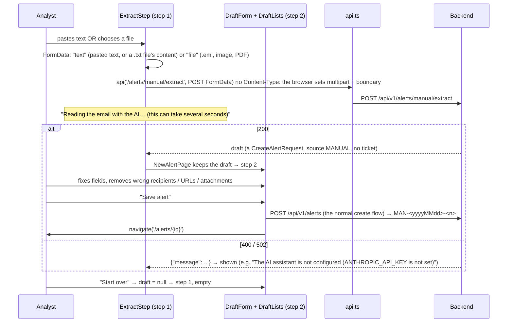

# Flow F15: New alert page (manual intake)

**Goal:** the analyst turns a suspicious email nobody else sent in (pasted text, raw headers, an `.eml`, a `.txt` with
headers, a screenshot or a PDF) into a real alert: the AI drafts it, she checks it, Havilor saves it.
**New idea:** file uploads from the browser (`FormData`, multipart), and a two-step form on one page.

**Built on:** `main` · **Status:** done, `npm run build` passes, checked against a running backend, pushed

## How it works

## Files

| File | What it does |
|---|---|
| `src/api/api.ts` | A `FormData` body is sent as-is, without a Content-Type header (the browser adds `multipart/form-data; boundary=…`); everything else stays JSON. |
| `src/pages/NewAlertPage.tsx` (new) | Holds the draft; no draft → step 1, a draft → step 2; "Start over" clears it. |
| `src/components/ExtractStep.tsx` (new) | A text box OR a file input (each disabled while the other is used); `.txt` content goes in the `text` field; other files go in `file`; loading label; backend errors shown. |
| `src/components/DraftForm.tsx` (new) | Editable: ticket number (optional), received at (`datetime-local`, converted to/from UTC), case type, priority, subject, from, Reply-To, envelope sender, SPF/DKIM/DMARC (or unknown). "Save alert" → `POST /alerts` with source MANUAL, empty text → null; then the detail page. |
| `src/components/DraftLists.tsx` (new) | Recipients, URLs, attachments read-only, each with Remove (a new list without that item). |
| `src/api/types.ts` | `AlertDraft` (the `CreateAlertRequest` shape). |
| `src/App.tsx` | `/alerts/new` → `NewAlertPage`. |
| `src/index.css` | Two-column form grid, draft lists, small buttons. |

## Checked against a running backend

Requests shaped exactly like the page's, on a throwaway database: extract with a `text` part and with an `.eml` file
part → both reach the AI step (here 502 `The AI assistant is not configured (ANTHROPIC_API_KEY is not set)`, no key on
this machine); a `.zip` → 400 `file: must be an .eml file, an image (PNG, JPEG, GIF, WebP) or a PDF`; saving a draft →
201 `MAN-20261111-1`, source MANUAL; no "received at" → 400 `receivedAt must not be null`; all recipients removed →
400 `recipients must not be empty`. All of these show in the form.

## Decisions

- **`.txt` is read in the browser** (`file.text()`) and sent as the `text` field: the backend accepts headers as text but
  only `.eml`/images/PDFs as files, so no backend change was needed.
- **Text OR file, enforced by disabling the other input**, so the backend's "exactly one" rule isn't hit by accident (if
  it were, its message would show).
- **The whole draft is kept** (including fields not shown, like raw headers) and sent back on save; only the listed
  fields are editable.
- **`datetime-local` is local time:** the form converts the draft's UTC time for display and back to UTC on save.
- **Removing items, not editing them**, as asked: a wrong recipient or URL is removed; a missing one would be added on
  the alert later (not in this flow).
- **The real AI extraction was not run here** (no `ANTHROPIC_API_KEY` on this machine); the backend side is covered by
  its own tests with a fake AI client (Flow 19).

## How to verify

With `ANTHROPIC_API_KEY` set: New alert → paste a fake email (example.com addresses) → "Extract the alert" → the draft
appears → fix the priority, remove a recipient → "Save alert" → the new alert opens with a `MAN-…` ticket. Without the
key: the red 502 message appears under the button.

## New concepts introduced

- **`FormData` and multipart uploads**, and why the browser must set the Content-Type.
- **Reading a local file in the browser** (`File.text()`).
- **A multi-step form** driven by one piece of state.
- **Immutable updates** (`{ ...draft, field }`, `filter` instead of `splice`).
