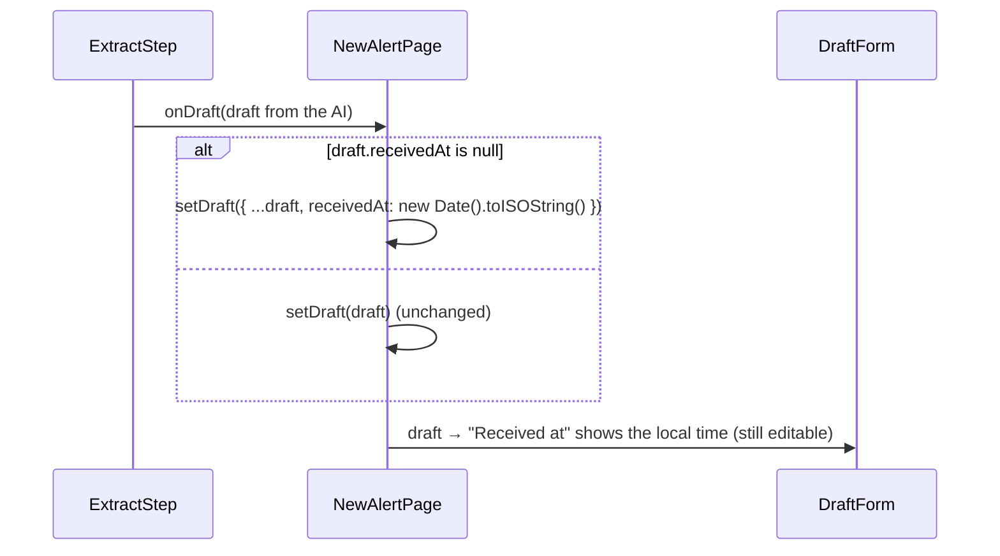

# Flow F16: "Received at" defaults to now on the New alert draft

**Goal:** when the AI can't tell when the email arrived (`receivedAt: null` in the draft), the form starts with
"now" instead of an empty field, so the analyst isn't stopped by a 400 `receivedAt must not be null`.
**New idea:** none, a small fix: adjust data once, when it arrives, instead of in every place that shows it.

**Built on:** `main` · **Status:** done, `npm run build` passes, pushed

## How it works

## Files

| File | What it does |
|---|---|
| `src/pages/NewAlertPage.tsx` | `handleDraft`: keeps the AI's `receivedAt` if it has one, otherwise uses the current time (UTC ISO text, like the backend's). |

## Decisions

- **Defaulted in `NewAlertPage`, where the draft arrives**, not in `DraftForm`: the draft state itself holds "now", so
  what the form shows is exactly what "Save alert" sends.
- **"Now" = when the draft arrived**, not when "Save" is clicked: the analyst sees the value and can change it.
- The backend still requires `receivedAt` (an analyst who empties the field still gets the 400 message).

## How to verify

New alert → paste text without a `Date:` header → "Extract the alert" (needs `ANTHROPIC_API_KEY`) → "Received at"
shows the current date and time → "Save alert" works without touching it.

## New concepts introduced

- **Normalising data at the edge:** fix up incoming data once, at the point it enters the page's state.
- **`??` (nullish coalescing):** `a ?? b` is `b` only when `a` is `null`/`undefined`.
