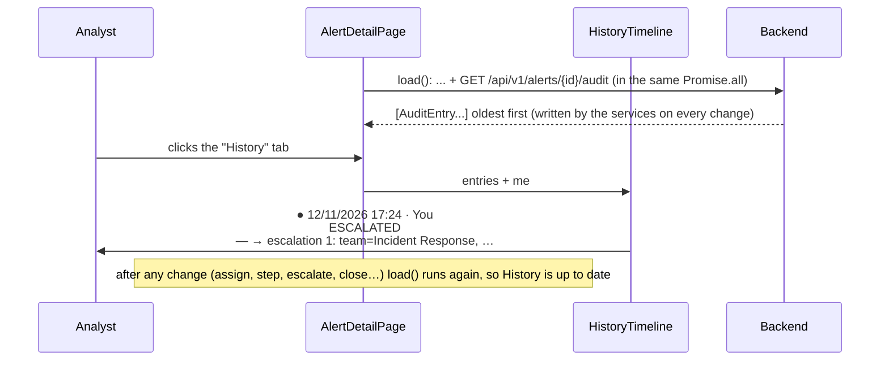

# Flow F18: History tab (the alert's audit trail)

**Goal:** the analyst (or a reviewer) sees everything that happened to an alert, in order: when, who, what, and the
value before → after. Useful for handovers ("what did my colleague already do?") and for reviews.
**New idea:** showing an audit trail, and a timeline drawn with plain CSS (a border line + `::before` dots).

**Built on:** `main` · **Status:** done, `npm run build` passes, checked against a running backend, pushed

## How it works

## Files

| File | What it does |
|---|---|
| `src/api/types.ts` | `AuditEntry` (the backend's `AuditEntryResponse`; also used by the manager's audit log in F20). |
| `src/components/HistoryTimeline.tsx` (new) | The timeline: date/time and who ("You", "User #n", or "System"), the action, `old → new`. |
| `src/pages/AlertDetailPage.tsx` | A sixth tab, "History"; `load()` also fetches `/alerts/{id}/audit`. |
| `src/index.css` | `.timeline`: a vertical line with a dot per entry. |

## Checked against a running backend

After the F17 check, `GET /alerts/1/audit` returned three entries, oldest first: `ESCALATED` (— → `escalation 1:
team=Incident Response, …`), then two `ESCALATION_UPDATED` (`externalStatus=OPEN … → IN_PROGRESS …`, then
`… → RESOLVED, outcome=CONFIRMED_MALICIOUS`), all by actor 1 (= "You" for the analyst).

## Decisions

- **Loaded with the rest of the page**, not only when the tab opens: one `load()` for everything keeps the page
  simple, and History is never stale after a change.
- **"Who" = "You" or "User #n":** the backend has no "list users" endpoint, and adding one only for names isn't in
  this flow (same as the Actions list).
- **The texts are shown as the backend wrote them** (`oldValue`, `newValue`): they are short and readable already.
- The history is read-only, also on open alerts: an audit trail must not be edited.

## How to verify

Open an alert → assign it to yourself, mark a step done, escalate → History tab: one entry per change, oldest at the
top, with "You" and the old → new values.

## New concepts introduced

- **Audit trail:** an append-only record of who changed what and when.
- **CSS pseudo-elements (`::before`)** to draw the timeline dots without extra HTML.
