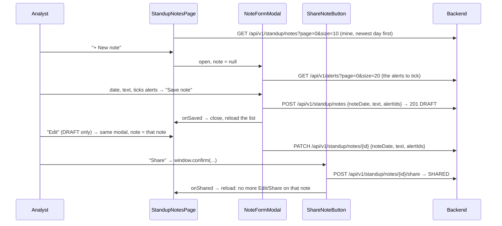

# Flow F19: Standup notes page

**Goal:** the analyst writes her daily standup note in Havilor (what she worked on, what's next, blockers), mentions
the alerts it's about, and shares it with her manager when it's ready. Until then it's a private draft she can change.
**New idea:** one modal for both "new" and "edit", checkboxes for choosing several items, and a confirm before a step
that can't be undone.

**Built on:** `main` · **Status:** done, `npm run build` passes, checked against a running backend, pushed

## How it works

## Files

| File | What it does |
|---|---|
| `src/api/types.ts` | `StandupNote` (the backend's `NoteResponse`). |
| `src/pages/StandupNotesPage.tsx` (new) | My notes, 10 per page; "+ New note"; Edit and Share on drafts only. |
| `src/components/NoteCard.tsx` (new) | One note: date, DRAFT/SHARED badge, text (line breaks kept), mentioned alerts as links; reused by the managers' "Team standups" (F20). |
| `src/components/NoteFormModal.tsx` (new) | New or edit: date (today by default), text, checkboxes of the 20 newest alerts → POST or PATCH. |
| `src/components/ShareNoteButton.tsx` (new) | Confirm, then `POST /standup/notes/{id}/share`. |
| `src/components/Pager.tsx` (new) | Previous / "Page x of y (n notes)" / Next; reused in F20. |
| `src/App.tsx`, `src/components/Sidebar.tsx` | `/standup` route and the "✎ Standup notes" sidebar link. |
| `src/index.css` | Note header, badges, the scrolling checkbox list. |

## Checked against a running backend

Throwaway database, requests shaped like the page's: create with `alertIds [1,3]` → 201 DRAFT; an unknown alert →
400 `Validation failed: alertIds no alert with id 999`; PATCH date/text/alerts → 200; share → 200 SHARED; PATCH a
shared note → 409 `Note 1 is shared and can't be changed`; list → newest day first, both statuses.

## Decisions

- **"My recent alerts" = the 20 newest alerts** (`GET /alerts?page=0&size=20`): the backend has no "assigned to me"
  filter, and adding one is outside this flow. An alert a draft already mentions but that isn't among the 20 stays
  in the list as "Alert #n", so editing never drops it silently.
- **One modal for new and edit** (`note = null` means new): same fields, same checks; only the request differs.
- **PATCH sends all three fields:** `alertIds` replaces the whole list on the backend, which is exactly what the
  checkboxes show.
- **Share asks first** (`window.confirm`, the browser's own dialog): sharing can't be undone.
- **SHARED = read-only in the page** (no buttons); the backend enforces it too (409).
- Sharing an already shared note is harmless on the backend (200), so the button doesn't need to guard against it.

## How to verify

Standup notes in the sidebar → "+ New note" → text, tick two alerts → Save → the note appears as DRAFT with "Mentions:
Alert #…" links → Edit → change the text, untick one → Save → Share → OK → it's SHARED, no buttons. Click an "Alert
#…" link → the alert opens.

## New concepts introduced

- **Reusing one form for create and update.**
- **Checkbox lists** kept as an array of ids in state (add / filter out).
- **`useEffect` on `[open, note]`:** reset the form each time the modal opens.
- **`children`** to let a page put its own buttons inside a shared card component.
