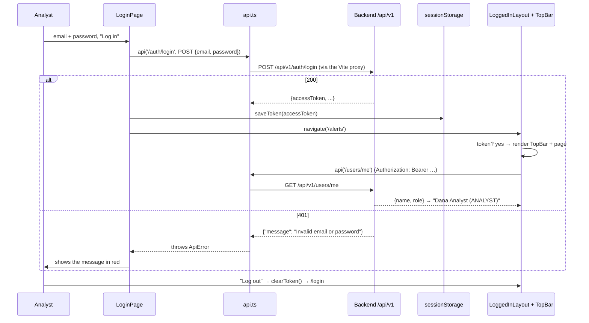

# Flow F2: Login page and top bar

**Goal:** log in with email + password, keep the token for this browser tab, see who is logged in, log out.
**New idea:** React state (`useState`), side effects (`useEffect`), forms, and a route guard.

**Built on:** `main` · **Status:** done, `npm run build` passes, pushed

## How it works

## Files

| File | What it does |
|---|---|
| `src/pages/LoginPage.tsx` (new) | Controlled form (email, password in `useState`), `POST /auth/login`, `saveToken`, `navigate('/alerts')`; the backend's error message is shown; the button is disabled while waiting. |
| `src/components/ErrorMessage.tsx` (new) | Shows an error's message in red (`role="alert"` for screen readers); nothing when there is no error. |
| `src/components/LoggedInLayout.tsx` (new) | The route guard: no token → `<Navigate to="/login">`; otherwise the top bar + `<Outlet />` (the page). |
| `src/components/TopBar.tsx` (new) | `GET /users/me` once (`useEffect` with `[]`), shows name and role; "Log out" clears the token and goes to `/login`. |
| `src/App.tsx` | Routes: `/login`; `/alerts` inside the layout (placeholder until F3); anything else → `/alerts`. |
| `src/index.css` | Panel, form, button, error and top-bar styles. |

## Decisions

- **Logout = forget the token.** The backend has no session to end (stateless JWT); the token simply expires after
  8 hours. It lives only in this tab's `sessionStorage`.
- **The guard checks only that a token exists.** Whether it is still valid, the backend decides: the first API call
  with an expired token gets 401, and `api.ts` sends the user to the login page.
- **`required` and `type="email"` on the inputs** stop an empty form in the browser; any other mistake comes back as
  the backend's message.

## How to verify

Backend running with the dev profile, `npm run dev`, open http://localhost:5173 → redirected to `/login`; a wrong
password shows "Invalid email or password"; the right one shows the top bar with the user; "Log out" returns to login.

## New concepts introduced

- **`useState`** (component memory) and **controlled inputs**.
- **`useEffect`** for loading data when a component appears.
- **Nested routes and a layout route** (`<Outlet />`) as a login guard.
