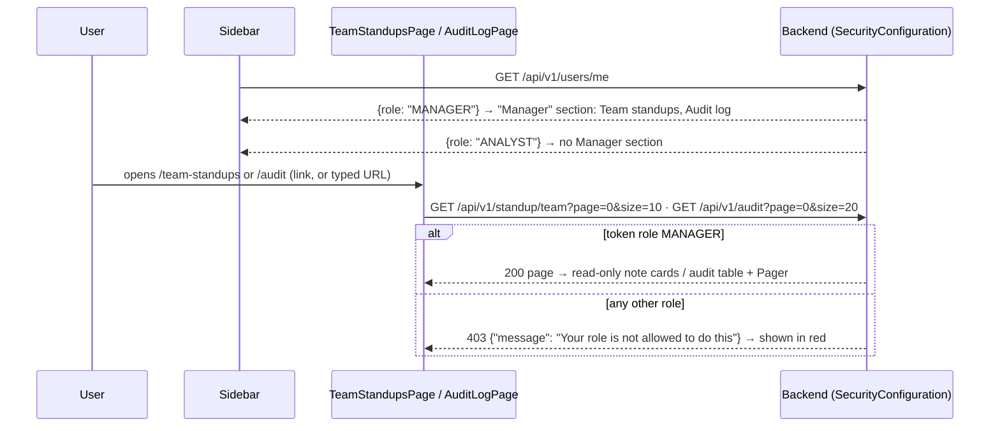

# Flow F20: Manager pages (team standups, audit log)

**Goal:** a manager reads the team's shared standup notes and the full audit log. These links only show in the
sidebar for role MANAGER; an analyst who types the URL gets the backend's own 403 message.
**New idea:** role-based UI: show or hide parts of the page from `/users/me`, while the **backend** stays the real
guard.

**Built on:** `main` · **Status:** done, `npm run build` passes, checked against a running backend, pushed

## How it works

## Files

| File | What it does |
|---|---|
| `src/components/Sidebar.tsx` | A "Manager" heading and two links, only when `user.role === 'MANAGER'`. |
| `src/pages/TeamStandupsPage.tsx` (new) | `GET /standup/team`, 10 per page, `NoteCard` with the author ("User #n"), no buttons. |
| `src/pages/AuditLogPage.tsx` (new) | `GET /audit`, 20 per page: when, who, action, on (a link to the alert), old → new. |
| `src/App.tsx` | Routes `/team-standups` and `/audit`, inside the normal logged-in layout. |
| `src/index.css` | `.sidebar-section` (the small "Manager" heading). |

## Checked against a running backend

Throwaway database: `/users/me` → ANALYST for the analyst, MANAGER for the manager. As analyst: `/standup/team` and
`/audit` → 403 `Your role is not allowed to do this`. As manager: `/standup/team` → the shared note from F19 only (the
draft is not there); `/audit` → the F17 entries, newest first.

## Decisions

- **Hiding links is convenience, not security:** the backend checks the role in the token on every call
  (`hasRole("MANAGER")` in `SecurityConfiguration`). The pages don't check the role themselves; they just show
  whatever the backend answers, so an analyst on `/audit` sees the 403 message, as asked.
- **403 does not log you out:** `api.ts` only clears the token on 401 (not logged in). 403 means "logged in, but not
  allowed", so the user stays on the page with the message.
- **"Who" = "User #n":** there is no endpoint to list users yet (same as the other pages).
- **"On" links to the alert** when the entry is about an alert (all entries so far are).
- Read-only: managers don't edit notes or audit entries.

## How to verify

Log in as `manager@havilor.example.com` → the sidebar shows "Manager · Team standups · Audit log" → Team standups:
the shared notes only → Audit log: the newest changes, Next/Previous, click "Alert #n". Log out, log in as
`analyst@havilor.example.com` → no Manager section → type `http://localhost:5173/audit` → the red message "Your
role is not allowed to do this" (same on `/team-standups`).

## New concepts introduced

- **Role-based UI vs authorization:** the UI hides, the server decides.
- **401 vs 403:** "who are you?" vs "I know who you are, and the answer is no".
