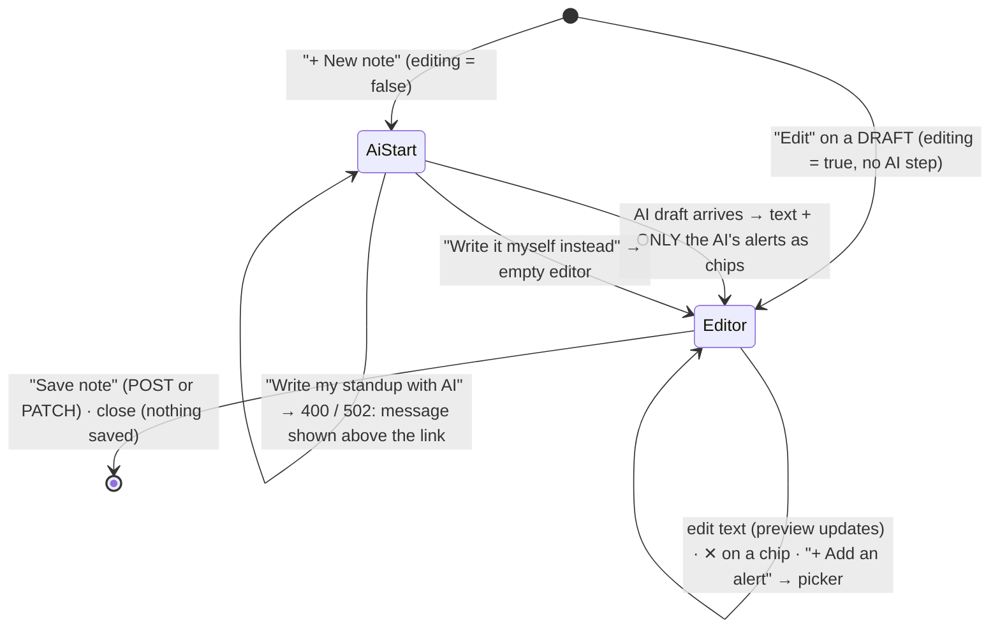

# Flow F22: The New standup note modal is AI-first

**Goal:** writing the daily standup starts with one button: "Write my standup with AI". The editor appears only once
there is a draft, so the common path is one click, then check, then save. Writing it by hand stays one small link
away, for days with no recorded activity or when the AI is unavailable. Front end only.
**New idea:** a multi-step modal driven by one piece of state, and "chips" for a short list you can remove from.

**Built on:** `main` · **Status:** done, `npm run build` passes, pushed (no backend change)

## How it works



```
Step 1 (new note)                          Step 2 (editor + preview)
┌───────────────────────────────┐          ┌──────────────────────────────────┬──────────────────────────┐
│ Date [2026-11-12]             │          │ Date [2026-11-12]                │ Preview: what the team   │
│ Havilor drafts your standup … │  draft   │ ┌──────────────────────────────┐ │ will see                 │
│ [✦ Write my standup with AI]  │ ───────▶ │ │Yesterday: …                  │ │ Yesterday:  • …          │
│ (red 400/502 message)         │          │ └──────────────────────────────┘ │ Today:      • …          │
│ Write it myself instead       │ ───────▶ │ Mention alerts                   │ Blockers:   • Nothing.   │
└───────────────────────────────┘ (empty)  │ (INC-GEN-526d… ✕) (INC-GEN-4b3… ✕)│ Mentions: INC-GEN-526d…  │
                                           │ + Add an alert → ☐ checkbox list │                          │
                                           │ [Save note]                      │                          │
                                           └──────────────────────────────────┴──────────────────────────┘
```

## Files

| File | What it does |
|---|---|
| `src/components/AiNoteStart.tsx` (new, replaces `DraftNoteWithAiButton.tsx`) | Step 1: date, the primary "✦ Write my standup with AI" button (loading label), the backend's 400/502 message, and the "Write it myself instead" link. |
| `src/components/NoteFormModal.tsx` | `editing` state: `false` = step 1 (new notes only), `true` = editor + preview. Editing a draft starts at `true`. The picker is closed each time the modal opens. |
| `src/components/MentionChips.tsx` (new) | The mentioned alerts as chips (ticket number + ✕). |
| `src/components/AlertPicker.tsx` (new) | The existing checkbox list of the 20 newest alerts, now behind "+ Add an alert". |
| `src/components/TicketLink.tsx` | `plain` option: the ticket number without a link (inside the form, a link would leave the unsaved note). |
| `src/index.css` | `.ai-start`, `button.link` (a button styled as a text link), `.chips`. |

## Decisions

- **One `editing` flag instead of a step number:** there are only two views. A new note starts in step 1; an
  existing draft starts in the editor.
- **The AI's alerts and nothing else:** after a draft, the chips are exactly `alertIds` from the answer. The checkbox
  list stays hidden until "+ Add an alert".
- **"Write it myself instead" is always visible in step 1,** not only after an error, so nobody has to wait for an AI
  call to write by hand. After a 400 or 502 the message appears right above it.
- **"Add an alert" toggles the existing picker** (ticking or unticking there also changes the chips). Chips remove;
  the picker adds. Alerts already mentioned but not among the 20 newest still show as chips, so nothing is dropped
  silently.
- **Buttons styled as links** (`button.link`) for the two secondary actions: they do something on the page, so they
  are `<button>`s, not `<a>`s.
- No "draft again" in the editor: not asked. Closing and reopening the modal starts over at step 1.
- Never auto-save or auto-share: unchanged from F21.

## How to verify

Standup notes → "+ New note": only the date and "✦ Write my standup with AI" (plus the small link).
- With `ANTHROPIC_API_KEY` and some activity today: click it → the editor opens with the text, the preview, and chips
  for the AI's alerts → ✕ one chip (it leaves the preview's "Mentions" too) → "+ Add an alert" → tick one → a new chip
  → Save note.
- A date with no activity → red "Validation failed: noteDate No activity recorded on this date" above "Write it
  myself instead"; without the key → the red 502 message. Click the link → the empty editor.
- "Edit" on a DRAFT → straight into the editor with its text and chips, no AI step.

## New concepts introduced

- **Progressive disclosure:** show the one main action first, more only when needed.
- **Chips** as a compact, removable list.
- **Conditional rendering by state** (`editing ? editor : start`) for a step-by-step UI without a router.
