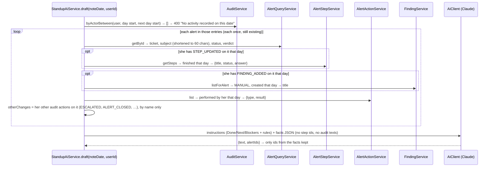

# Flow F23: Clearer AI standup notes

**Goal:** the AI-written standup reads like a person wrote it: one line per alert saying what was checked, what was
found and the outcome, using the playbook step titles in plain words. No "step 12", no "completed 3 of 7 steps", no
ids. The sections are renamed **Done / Next / Blockers**.
**New idea:** better AI output starts with better input. Give the model the right facts in the right words, and
leave out what it must not repeat (ids, raw audit texts).

**Built on:** `main` · **Status:** done, 169 backend tests pass (2 new), `npm run build` passes, pushed

## How it works



**Facts sent to Claude (example):**

```json
{"noteDate": "2026-11-12",
 "alerts": [{"id": 42, "ticketNumber": "INC-GEN-526d13f97f", "shortSubject": "Action required: verify your account",
             "status": "ESCALATED", "verdict": "UNDECIDED",
             "stepsCompleted": [{"title": "Check the sender", "status": "DONE", "answer": "Spoofed"}],
             "findingsAdded": ["Look-alike sender domain"],
             "actionsRecorded": [{"type": "BLOCK_SENDER", "result": "DONE"}],
             "otherChanges": ["ESCALATED"]}]}
```

The alert `id` is only there so Claude can answer with `alertIds`; the rules forbid writing ids in the text.

## Files

| File | What it does |
|---|---|
| `standup/service/StandupAiService.java` | New facts: one entry per alert (`AlertFact` with `StepFact`, `ActionFact`); uses `AlertStepService`, `AlertActionService` and `FindingService`; `shortSubject` (60 chars, then "…"). Instructions: sections Done/Next/Blockers and the new rules, word for word. The old "activity" list with raw audit texts is gone. |
| `test/.../standup/StandupAiIntegrationTest.java` | The facts contain the step title and answer, the finding title, the action type and result, and `otherChanges`; they contain **no** `stepId`, no `step <id>` and no raw audit texts; the instructions contain the new rules. Alerts are now `DETECTED_PHISHING` so they have playbook steps. |
| `test/.../standup/service/StandupAiServiceTest.java` (new) | `shortSubject`: short stays, long is cut with "…". |
| `frontend/src/components/NoteContent.tsx` | Headings for `Done:`, `Next:`, `Blockers:` (older notes with `Yesterday:`/`Today:` still render as sections). |
| `frontend/src/components/NoteFormModal.tsx` | Placeholder: `Done:\n- INC-… (short subject): what you checked, what you found, the outcome.\nNext:\n- …\nBlockers:\n- Nothing.` |

## Decisions

- **Raw audit texts are no longer sent.** They contain internal ids ("step 12: DONE", "escalation 3: …"), which is
  exactly what the note must not show. Each alert is now described with structured facts in words. Changes without
  their own detail (escalated, closed, priority changed) are listed by action name; the alert's current status and
  verdict show the result.
- **"Completed by her that day" without a "done by" field:** a step counts if it was finished that day (not PENDING,
  `completedAt` in the day) on an alert where the audit log shows her updating steps that day. Same for manual
  findings (`FINDING_ADDED`). Actions store who did them, so they are filtered exactly. Known limit: if a colleague
  also finished steps on the same alert the same day, those are included too. Exact "done by" would need a new
  column, which this flow didn't ask for.
- **Skipped steps stay in the facts with their status**, as specified ("title, status and answer"); the rule "Do not
  mention skipped steps" keeps them out of the text.
- **Short subject = first 60 characters + "…"**, done in code so the rule "<ticket> (<short subject>)" gets a
  predictable input.
- **Dependencies:** `standup` now also uses `finding` (service + response only). No cycle (`finding → audit`), and the
  ArchUnit border and cycle tests pass.
- **Old notes still render:** the preview/heading parser accepts both the new and the old section names, so notes
  written with F21's "Yesterday/Today" keep their headings.

## How to verify

With `ANTHROPIC_API_KEY` set, as the analyst: open a DETECTED_PHISHING alert → mark two steps done with answers, skip
one → add a finding → add an action → Standup notes → "+ New note" → "✦ Write my standup with AI". Expect `Done:`
with one line like "INC-… (Action required: verify your account): checked the sender and the links, found a
look-alike domain, blocked the sender.", no step numbers or ids, nothing about the skipped step; then `Next:` and
`Blockers:`. The preview shows the three headings. Without the key: the red 502 message, as before.

## New concepts introduced

- **Prompt input design:** shape the facts the way you want the answer to read (titles, not ids).
- **Data minimisation for LLMs:** don't send what the model must not repeat.
- **Approximating "who did it"** from the audit log when an entity has no author field, and naming the limit.
