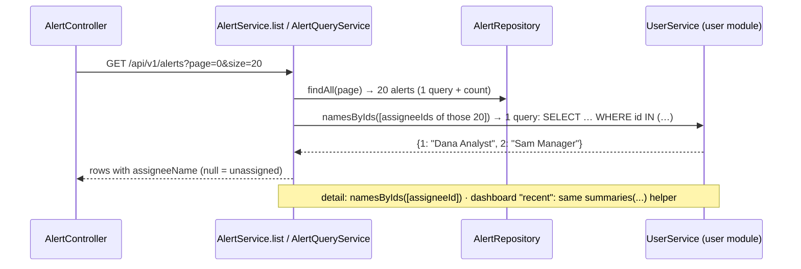

# Flow F24: Assignee names

**Goal:** the analyst sees *who* has an alert ("Dana Analyst"), not "User #1".
**New idea:** enriching a list across a module border **without N+1 queries**: collect the ids of one page, ask the
other module once for all their names.

**Built on:** `main` · **Status:** done, 170 backend tests pass (1 new), `npm run build` passes, pushed

## How it works

## Files

| File | What it does |
|---|---|
| `user/service/UserService.java` | `namesByIds(ids)`: one `findAllById` for all ids, nulls ignored, unknown ids missing. |
| `alert/api/response/AlertSummaryResponse.java`, `AlertDetailResponse.java` | New field `assigneeName`; `from(...)` takes it as a parameter (the alert module's DTO can't look users up itself). |
| `alert/service/AlertQueryService.java` | Gets `UserService`; `summaries(alerts)` (queue rows + names, one user query); detail adds the name. |
| `alert/service/AlertService.java` | The queue uses `summaries(...)`. |
| `test/.../alert/AssigneeNameIntegrationTest.java` (new) | Unassigned → null; after assigning → the name in PATCH answer, detail, queue row, dashboard "recent". |
| `test/.../alert/AlertServiceTest.java` | New constructor argument. |
| `frontend/src/api/types.ts` | `assigneeName` on `AlertSummary` and `AlertDetail`. |
| `frontend/src/components/AlertHeader.tsx` | "Dana Analyst (you)" / "Sam Manager" / "Unassigned". |
| `frontend/src/pages/QueuePage.tsx`, `components/RecentAlerts.tsx` | New Assignee column. |

## Decisions

- **Names, not user objects:** the alert answers carry just `assigneeName`; the email and role stay in the user module.
- **One user query per list,** not one per row: `namesByIds` with `IN (...)`. The alert queue stays 2 + 1 queries.
- **"Everywhere" = everywhere an assignee is shown** (header, queue, dashboard). Other "User #n" labels are *actors*
  (who did an action, who wrote a history entry or a note); their responses only have ids, and this flow asked for
  `assigneeName` only. They can get the same treatment later with `namesByIds`.
- No cache for names: one indexed query per page is cheap.

## How to verify

Log in as the analyst → open an unassigned alert → "Assign to me" → the header shows "Dana Analyst (you)" → the
queue's Assignee column and the dashboard's recent alerts show "Dana Analyst".

## New concepts introduced

- **Batch lookups across a module border** (collect ids → one `IN` query → a map).
- **N+1 queries, and how a map lookup avoids them.**
