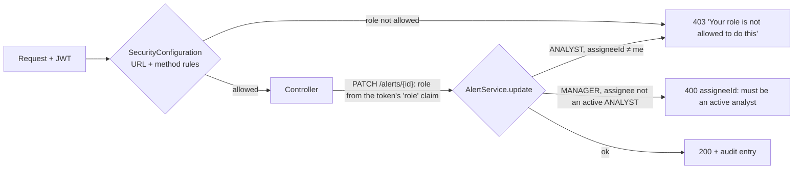

# Flow F25: Manager vs analyst rights, enforced in the backend

**Goal:** the analyst works the alert; the manager oversees. A manager reads everything, changes priority and
assigns alerts to analysts, but doesn't do the investigation (steps, findings, actions, AI, escalations, closing).
An analyst can't hand alerts to other people. **The backend enforces this**; the front end only hides what the user
can't do anyway.
**New idea:** authorization in two places, each where it fits best: **URL rules** in the security filter for "who may
call this endpoint", and a **business rule** in the service for "who may assign to whom".

**Built on:** `main` · **Status:** done, 175 backend tests pass (5 new), `npm run build` passes, pushed

## The rules

| What | ANALYST | MANAGER | Where it's enforced |
|---|---|---|---|
| All reads (alerts, steps, findings, actions, escalations, history, dashboard) | ✅ | ✅ | `.authenticated()` |
| Change priority (`PATCH /alerts/{id}`) | ✅ | ✅ | — |
| Assign (`PATCH /alerts/{id} {assigneeId}`) | only herself, else **403** | any active ANALYST, else **400** | `AlertService.update` |
| `GET /users?role=ANALYST` (assign list) | **403** | ✅ | `SecurityConfiguration` |
| Steps (`PATCH …/steps/{id}`), findings, actions, AI (`POST …/ai/**`), escalations (create `POST`, update `PATCH /escalations/{id}`), close | ✅ | **403** | `SecurityConfiguration` |
| Create alert, manual intake, standup notes | ✅ | ✅ | unchanged |

## Files

| File | What it does |
|---|---|
| `common/security/SecurityConfiguration.java` | `hasRole("ANALYST")` for the investigation endpoints; `hasRole("MANAGER")` for `GET /api/v1/users`. |
| `user/api/UserController.java` | `GET /api/v1/users?role=ANALYST`: active users with that role, by name; unknown role → 400. |
| `user/repository/UserRepository.java` | `findByRoleAndActiveTrueOrderByName`. |
| `user/service/UserService.java` | `activeByRole(role)`, `isActiveAnalyst(id)`. |
| `alert/api/AlertController.java` | Reads the role from the token and passes `actorIsManager` to the service. |
| `alert/service/AlertService.java` | The assignment rule (403 / 400). |
| `test/.../common/security/RoleRulesIntegrationTest.java` (new) | Every analyst-only endpoint → 403 for the manager (and nothing changed); reads and priority for both; the assignment rules; the users list. |
| `test/.../alert/AlertServiceTest.java` | Assignment rule unit tests (manager → only active analysts; analyst → only herself). |
| `test/.../alert/AlertActionIntegrationTest.java`, `AlertUpdateIntegrationTest.java`, `standup/StandupAiIntegrationTest.java` | Updated: the manager no longer records actions; "unknown assignee" is now a manager assigning. |
| `frontend/src/components/AssignToSelect.tsx` (new) | The manager's "Assign to" dropdown of active analysts. |
| `frontend/src/components/HeaderActions.tsx` | Manager: "Assign to…" + priority. Analyst: "Assign to me", priority, Escalate, Close. |
| `frontend/src/pages/AlertDetailPage.tsx` | `canWork = open && ANALYST` drives every investigation button and form; the AI tab explains why it is empty for a manager. |

## Decisions

- **URL rules for "which role may call it"** (one readable list in `SecurityConfiguration`, like the existing manager
  rules); **service rule for assignment**, because it depends on the request body and on another user.
- **The role comes from the JWT** (`role` claim) in the controller, not from a database lookup per request.
- **Analyst assigning someone else = 403** (not allowed for her role); **manager assigning a non-analyst = 400** (the
  request itself is wrong). An unknown id is a non-analyst too, so the message is the same.
- **Unassigning isn't possible** (no null assignee in a PATCH), unchanged.
- **Creating alerts, manual intake and standup notes stay open to both roles:** not in the list.
- A manager's own "Assign to me" isn't offered: managers aren't assignees (only analysts are).

## How to verify

As `manager@havilor.example.com`: open an alert → the header shows "Assign to" with the analysts and the priority,
no Escalate/Close → pick "Dana Analyst" → the assignee changes → the Investigation, Evidence and Actions tabs show no
buttons; the AI tab says it's for the analyst. As the analyst: "Assign to me", Escalate and Close are there as before.
With a manager's token, `curl -X POST …/alerts/1/actions` → 403 "Your role is not allowed to do this".

## New concepts introduced

- **Role-based authorization** with `hasRole` per URL and HTTP method.
- **Business-rule authorization** in the service (depends on the data, not just the URL).
- **403 vs 400:** "you may not" vs "this request is wrong".
- **Defence in depth:** the UI hides, the server refuses.
