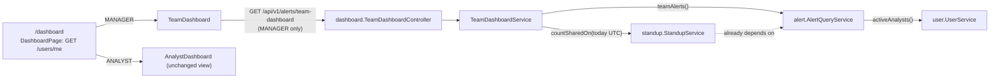

# Flow F26: Manager dashboard

**Goal:** a manager's start page answers "what needs attention and who has how much?": unassigned and critical open
alerts, the oldest open alert, each analyst's open and recently closed alerts, and how many standups are in today.
Analysts keep their own dashboard.
**New idea:** a read model that **combines two modules without a cycle**, through a small module of its own.

**Built on:** `main` · **Status:** done, 178 backend tests pass (3 new), `npm run build` passes, pushed

## How it works



`standup → alert` already exists (notes mention alerts). Asking standup from inside the alert module would add
`alert → standup`, a cycle, which `ModuleBorderTest` forbids. So the combination sits in a new `dashboard` module
that only reads from the others; nothing depends on it.

**Answer (example):**

```json
{"unassignedOpen": 4, "criticalOpen": 1,
 "oldestOpen": {"alertId": 17, "ticketNumber": "INC-GEN-4b3bfe15b9", "receivedAt": "2026-11-09T08:12:00Z", "ageHours": 74},
 "analysts": [{"analystId": 1, "name": "Dana Analyst", "openAlerts": 3, "closedLast7Days": 5}],
 "standupsSharedToday": 1}
```

## Files

| File | What it does |
|---|---|
| `alert/api/response/TeamAlertsResponse.java` (new) | The alert numbers: `unassignedOpen`, `criticalOpen`, `oldestOpen` (id, ticket, receivedAt, ageHours), `analysts` (open, closed last 7 days). |
| `alert/repository/AlertRepository.java` | `countByStatusNotAndAssigneeIdIsNull`, `countByClosedAtGreaterThanEqualAndAssigneeId`, `findFirstByStatusNotOrderByReceivedAtAscIdAsc`. |
| `alert/service/AlertQueryService.java` | `teamAlerts()`. |
| `user/service/UserService.java` | `activeAnalysts()`. |
| `standup/repository/…`, `standup/service/StandupService.java` | `countSharedOn(date)`: SHARED notes for that day. |
| `dashboard/` (new module) | `TeamDashboardController` (`GET /api/v1/alerts/team-dashboard`), `TeamDashboardService`, `TeamDashboardResponse`. |
| `common/security/SecurityConfiguration.java` | The endpoint is `hasRole("MANAGER")`. |
| `test/.../ModuleBorderTest.java` | `dashboard` gets the same border rule; `common` may not know it. |
| `test/.../dashboard/TeamDashboardIntegrationTest.java` (new) | Before/after: +2 unassigned, +1 critical, +1 open and +1 closed for the analyst, +1 shared standup (a draft doesn't count); the oldest open alert and its age; analysts listed, managers not; analyst → 403. |
| `frontend/src/pages/DashboardPage.tsx` | Picks the view by role. |
| `frontend/src/components/AnalystDashboard.tsx` | The former dashboard page, unchanged in what it shows. |
| `frontend/src/components/TeamDashboard.tsx` (new) | Four stat cards (unassigned, critical, standups today, oldest open with age + ticket link) and the analysts table. |
| `frontend/src/format.ts` | `formatAge(hours)` → "3 d 2 h". |

## Decisions

- **New `dashboard` module** instead of `alert → standup` (cycle). It's the smallest structure that keeps the border
  rules; it has one controller, one service, one response.
- **The path stays `/api/v1/alerts/team-dashboard`** as asked; a fixed path wins over `/alerts/{id}`.
- **Per analyst = every active analyst, including those with 0,** so an idle analyst is visible too. Two small count
  queries per analyst: simple and fine for a team; one grouped query would be the optimisation if teams grow.
- **"Shared today" = SHARED notes whose note date is today (UTC).** Notes don't store when they were shared.
- **Age in whole hours** from `receivedAt`, computed with the app clock; the page formats it as days + hours.
- **"Open" = not CLOSED** (NEW, INVESTIGATING, ESCALATED, WAITING), like the analyst dashboard.

## How to verify

Log in as `manager@havilor.example.com` → the dashboard is "Team dashboard": unassigned, critical, standups shared
today, the oldest open alert (click its ticket) and the analysts table. Assign an alert to Dana (alert header →
"Assign to") → back on the dashboard her "Open now" is one higher and "Unassigned open" one lower. As the analyst:
the usual dashboard. `GET /api/v1/alerts/team-dashboard` with the analyst's token → 403.

## New concepts introduced

- **Read models / composition across modules** without breaking the dependency direction.
- **Derived queries** for counts with `IsNull` and `findFirst…OrderBy…`.
- **Role-based views** of the same URL.
