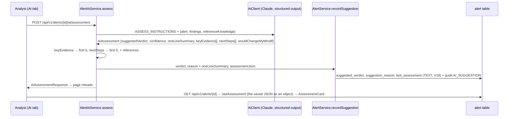

# Flow F27: Readable AI assessment

**Goal:** the AI assessment reads at a glance: a verdict and how sure the AI is, one line on what happened, a short
list of evidence with how serious each item is, what to do next, and what would change its mind. No paragraphs, no
internal field names. The last assessment is saved on the alert, so it shows again without a new (paid) AI call.
**New idea:** **shaping LLM output with a schema** (structured output with enums and lists), then **enforcing the
limits in code**, and storing a document-like value as one JSON column.

**Built on:** `main` · **Status:** done, 180 backend tests pass (2 new), `npm run build` passes, pushed

## How it works



**Answer / `lastAssessment` (example):**

```json
{"suggestedVerdict": "MALICIOUS", "confidence": "HIGH",
 "oneLineSummary": "A fake invoice from a look-alike domain that failed DMARC.",
 "keyEvidence": [{"text": "The email failed DMARC.", "severity": "HIGH"},
                 {"text": "The sender's domain is not the vendor's.", "severity": "MEDIUM"}],
 "nextSteps": ["Block the sender's domain", "Remove the email from all mailboxes"],
 "wouldChangeMyMindIf": "The vendor confirms they sent it from this domain.",
 "references": [{"sourceType": "CLOSED_ALERT", "sourceId": 12}]}
```

## Files

| File | What it does |
|---|---|
| `db/migration/V18__alert_last_assessment.sql` (new) | `alert.last_assessment TEXT` (null = never assessed). |
| `alert/domain/Alert.java` | `lastAssessment` field; `recordSuggestion(verdict, reason, assessmentJson)`. |
| `alert/service/AiAssessment.java` | The structured-output type: verdict, `Level confidence`, `oneLineSummary`, `List<Evidence{text, Level severity}>`, `nextSteps`, `wouldChangeMyMindIf`. |
| `alert/api/response/AiAssessmentResponse.java` | The same fields + `references`. This is also exactly what's saved. |
| `alert/service/AlertAiService.java` | New instructions (field list with limits; plain everyday English, no paragraphs, no internal field names); caps the lists (6 / 5); saves reason = one-line summary and the full JSON. |
| `alert/service/AlertService.java` | `recordSuggestion` passes the JSON on. |
| `alert/api/response/AlertDetailResponse.java` | `lastAssessment`, sent with `@JsonRawValue`: the stored JSON goes out as an object, not as a string. |
| `test/.../alert/AlertAiIntegrationTest.java` | The new fields come back; reason = summary; `lastAssessment` is an object on the detail; the rules are in the instructions; 7 evidence / 6 steps are cut to 6 / 5; never assessed → no `lastAssessment`. |
| `test/.../knowledge/KnowledgeIntegrationTest.java` | New constructor. |
| `frontend/src/components/AssessmentCard.tsx` (new) | The simple card: verdict + confidence badge, one line, evidence with severity badges, numbered next steps, "Would change my mind", references. |
| `frontend/src/components/AiAssessmentPanel.tsx` | Shows the saved assessment; "Get AI assessment" / "Assess again" reloads the page. |
| `frontend/src/pages/AlertDetailPage.tsx` | The AI tab passes `alert.lastAssessment`; a closed alert or a manager sees the saved card read-only. |
| `frontend/src/api/types.ts`, `index.css` | The new shape; LOW/MEDIUM/HIGH badge colours. |

## Decisions

- **Limits in two places:** the instructions ask for ≤ 25 words, ≤ 6 evidence, ≤ 5 steps; the code also cuts the
  lists (`first(list, max)`), because a schema can't promise the model counts right. The 25-word summary is not cut
  (cutting a sentence makes it worse); it's guided by the instructions only.
- **One TEXT column with the whole JSON** instead of new tables: it's always read and written as a whole, never
  queried by its parts. TEXT, not `jsonb`: PostgreSQL never needs to look inside it.
- **`@JsonRawValue`** returns the stored JSON as an object without parsing it again on every read.
- **`suggestionReason` = `oneLineSummary`**, so the Overview tab and the knowledge text keep working unchanged.
- **The response no longer has `summary` / `suggestionReason`:** the new, structured fields replace them (the
  front end was updated in the same flow).
- **Severity and confidence share one enum (`LOW|MEDIUM|HIGH`)**, nested in `AiAssessment`.
- The alert JSON Claude reads now also contains the previous assessment (like the previous suggested verdict before).
- **A flaky test fixed on the way:** `AlertStepsIntegrationTest.readingStepsTakesTwoQueries` failed only in the full run (1 query instead of 2: the steps still came from Redis). It emptied the cache with `clear()`, which Spring documents as possibly deferred; `invalidate()` empties it immediately. With that, the run that failed every time passes.
- The real Claude call was not run here (no `ANTHROPIC_API_KEY` on this machine); the tests use the fake `AiClient`.

## How to verify

With `ANTHROPIC_API_KEY` set, as the analyst: open an alert → AI tab → "Get AI assessment" → the card: verdict and a
confidence badge, one line, evidence with HIGH/MEDIUM/LOW badges, numbered next steps, "Would change my mind". Reload
the page → the same card, no new call ("Assess again" makes a new one). Overview → "Reason" shows the one-line
summary. As the manager (or on a closed alert): the AI tab shows the saved card, no button.

## New concepts introduced

- **Structured output with enums and nested lists** as the contract with the model.
- **Validating / normalising model output in code** (caps, nulls → empty lists).
- **Storing a document as JSON text** and returning it raw (`@JsonRawValue`).
