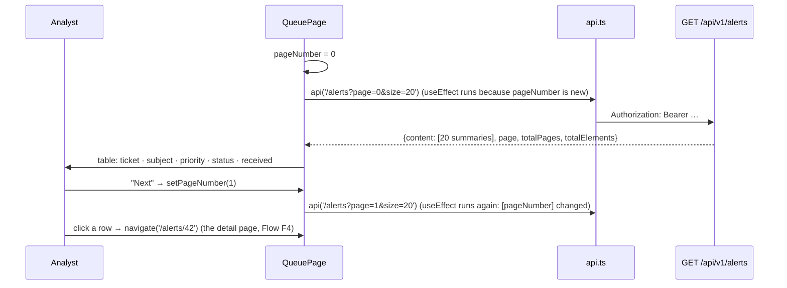

# Flow F3: Alert queue

**Goal:** the analyst's list of alerts, newest first, one page at a time; clicking a row opens the alert.
**New idea:** loading data again when state changes (`useEffect` with a dependency), and rendering a list.

**Built on:** `main` · **Status:** done, `npm run build` passes, pushed

## How it works

## Files

| File | What it does |
|---|---|
| `src/pages/QueuePage.tsx` (new) | `pageNumber` state; `useEffect([pageNumber])` loads that page; the table; Previous/Next (disabled at the ends) with "Page x of y (n alerts)"; a row click navigates to `/alerts/{id}`; errors shown. |
| `src/api/types.ts` | `AlertSummary` (only the shown fields). |
| `src/format.ts` (new) | `formatDateTime`: ISO time → the user's local date and time. |
| `src/App.tsx` | `/alerts` → `QueuePage`. |
| `src/index.css` | Table, clickable row, priority badges, pager. |

## Decisions

- **The backend sorts and pages** (newest first, 20 per page); the page only asks for `page` and `size`.
- **Previous/Next only** (as asked): no page numbers, filters or sorting controls.
- **The whole row is clickable** (a simple `onClick` + `navigate`). A link per row would also work; one handler is
  simpler to read.
- **Times in the user's own time zone** (`toLocaleString`); the backend sends UTC.

## How to verify

Logged in, `/alerts` shows the newest alerts; with more than 20 alerts (`POST /api/v1/dev/generate-alerts?count=30` in
the dev profile), Next/Previous move through the pages; clicking a row opens `/alerts/{id}`.

## New concepts introduced

- **Effect dependencies** (`[pageNumber]`): when to load again.
- **Rendering lists with `map`** and why each row needs a `key`.
- **Conditional rendering** (`{page && ...}`, disabled buttons).
