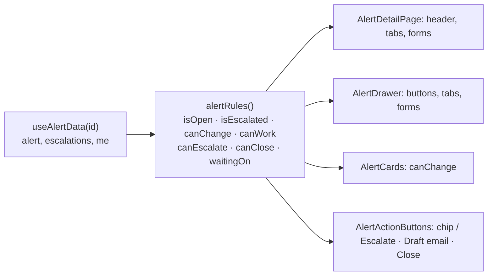

# Flow F31: Escalation and closed-alert rules

**Goal:** an alert waits for one team's answer at a time, and can't be closed while it waits (the answer is part of
the decision). In the UI, what may be done with an alert is decided in ONE place, so the full page, the slide-over
panel, the tabs, the forms and the cards can't drift apart; a closed alert is read-only everywhere.
**New idea:** **a single source of truth for UI permissions** (`alertRules`), mirroring the business rules the
backend enforces.

**Built on:** `main` · **Status:** done, 192 backend tests pass (2 new), `npm run build` passes, checked against a running
backend, pushed

## The rules

| Situation | Backend (Alert entity) | UI (alertRules + AlertActionButtons) |
|---|---|---|
| Escalate while ESCALATED | 409 "This alert is already escalated; record the team's answer first" | no Escalate button; chip "⇡ Escalated to *team* · waiting" (opens the Actions tab) |
| Close while ESCALATED | 409 "Waiting on an escalation; record the team's answer before closing" | Close alert disabled, tooltip "Record the team's answer first" |
| After the outcome (back to INVESTIGATING) | escalate and close work again | Escalate and Close come back |
| CLOSED | every change → 409 (as before) | no buttons, no forms, cards read-only (page and panel) |
| Manager | investigation endpoints → 403 (F25) | no investigation buttons; priority/assignee cards only while open |

## Files

| File | What it does |
|---|---|
| `alert/domain/Alert.java` | `escalate()` refuses when ESCALATED; `close()` refuses when ESCALATED (after the "already closed" check, before the pending-steps check); comments updated. |
| `test/.../alert/AlertTest.java` | Both refusals with their messages; after the answer, escalating again and closing work. |
| `test/.../escalation/EscalationIntegrationTest.java` | The same through the API (409 messages, still one escalation, then 201 and close 200 after the answers). |
| `test/.../QueryCountIntegrationTest.java` | Records each escalation's answer before the next one (5 rows as before). |
| `frontend/src/alertRules.ts` (new) | The one rule: `isOpen`, `isEscalated`, `canChange` (cards, any role, open), `canWork` (analyst, open), `canEscalate`, `canClose`, `waitingOn` (the team without an answer). |
| `frontend/src/api/useAlertData.ts` | Returns `rules` instead of separate flags. |
| `frontend/src/components/AlertActionButtons.tsx` (new) | The alert-wide buttons for page and panel, from the rules. |
| `frontend/src/components/CloseAlertButton.tsx` | `disabledReason`: disabled with a tooltip (on a wrapper, since disabled buttons get no mouse events in some browsers) and a screen-reader text. |
| `frontend/src/components/AlertCards.tsx` | `canChange` from the rules instead of its own check. |
| `frontend/src/pages/AlertDetailPage.tsx`, `components/AlertDrawer.tsx` | Use `rules` everywhere and `AlertActionButtons`. |
| `frontend/src/index.css` | The orange escalated chip, `.visually-hidden`. |

## About the reported bug

On the current build, a CLOSED alert opened on the full page showed no header buttons (checked with a screenshot
against a running backend): the page already hid them with the same "open and analyst" condition. The old code had
the condition in two places (page and panel) computed separately; now both, and every form and card, ask
`alertRules`, so a future change can't show buttons on one and not the other. If you still see buttons on a closed
alert, a stale dev build is the likely cause; a hard reload (Ctrl+F5) after `npm run dev` restarts picks up this one.

## Decisions

- **The rules live in the entity** (`escalate`, `close`), like the other alert rules, so every way in (API, future
  integrations) gets them.
- **The chip opens the Actions tab,** where the escalation's answer is recorded; that is the only way forward.
- **Recording the answer stays possible while ESCALATED** (the escalation form is part of `canWork`).
- 409 messages from the backend still show in the Escalate and Close modals if a race ever lets one through.

## How to verify

As the analyst: escalate an alert → the header shows "⇡ Escalated to … · waiting", Close alert is greyed out with
the tooltip; click the chip → Actions tab → set an outcome → Escalate and Close are back. Close it → no buttons, cards
read-only, on the page and in the queue's panel. `POST /alerts/{id}/escalations` twice → the second is 409.

## New concepts introduced

- **Single source of truth** for permissions in the UI.
- **Accessible disabled buttons** (tooltip on a wrapper, `aria-describedby`).
