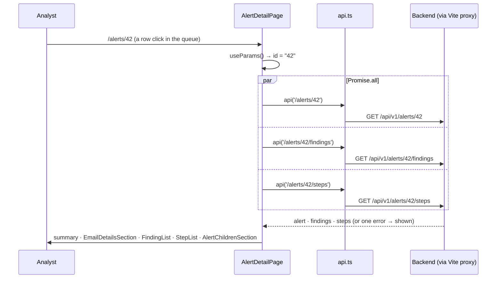

# Flow F4: Alert detail page (read only)

**Goal:** one page that shows everything about an alert: its status and verdicts, the email, recipients, URLs,
attachments, clicks, the findings (with why they matter) and the playbook steps.
**New idea:** URL parameters (`/alerts/:id`), several requests at once, and splitting a page into components.

**Built on:** `main` · **Status:** done, `npm run build` passes, checked against the running backend, pushed

## How it works

## Files

| File | What it does |
|---|---|
| `src/pages/AlertDetailPage.tsx` (new) | Reads `id` from the URL, loads the alert, findings and steps together (`Promise.all`), shows the summary (status, priority, verdict, suggested verdict + reason, case type/source, received/closed) and the sections; "Back to the queue". |
| `src/components/EmailDetailsSection.tsx` (new) | Subject, from, envelope sender, Reply-To, SPF/DKIM/DMARC, phish score. |
| `src/components/AlertChildrenSection.tsx` (new) | Tables of recipients, URLs (bad-list in red), attachments, clicks. |
| `src/components/FindingList.tsx` (new) | Each finding: title, severity, source, "Why this matters". |
| `src/components/StepList.tsx` (new) | The steps in order: title, status, question, answer, "Why it matters". |
| `src/api/types.ts` | `AlertDetail` (+ email, recipient, URL, attachment, click), `Finding`, `AlertStep`. |
| `src/App.tsx` | `/alerts/:id` → `AlertDetailPage`. |
| `src/index.css` | Sections, label/value grid, card lists, wrapping long URLs/hashes. |

## Checked against the running backend

Backend (dev profile) + `npm run dev`, every call through the Vite proxy on :5173: the app page is served for
`/alerts/1`; a wrong password → `401 "Invalid email or password"`; `GET /users/me` → Dana Analyst; the queue → 15
alerts; `GET /alerts/{id}`, `/findings`, `/steps` → 200; a bad token → 401 (which sends the page to login).

## Decisions

- **Read only** (as asked): no buttons to assign, work steps or close yet.
- **One page, five small components**, so each file stays short and has one job.
- **`Promise.all`:** the three requests run at the same time; one error message if any fails.
- **Raw headers are not shown** (they can be 100,000 characters); everything else the brief lists is.

## New concepts introduced

- **Route parameters** (`useParams`).
- **Parallel requests** with `Promise.all`.
- **Props**: passing data from a page to its components.
