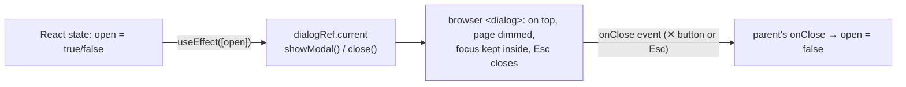

# Flow F6: Detail page layout (header + tabs) and a reusable Modal

**Goal:** the alert detail page becomes a workspace: a header that always shows what the case is and where it stands,
and tabs for each kind of work. Plus one pop-up window component for the forms of the next flows.
**New idea:** UI state (which tab is open) vs data state, refs to DOM elements (`useRef`), and the native `<dialog>`.

**Built on:** `main` · **Status:** done, `npm run build` passes, pushed

## Layout

```
┌─ AlertHeader (position: sticky) ──────────────────────────────────────────┐
│ INC-GEN-1a2b3c   Invoice overdue          Status  Priority  Assignee        │
└────────────────────────────────────────────────────────────────────────────┘
 [Overview] [Investigation] [Evidence] [Actions] [AI]        ← Tabs (tab = useState)
┌────────────────────────────────────────────────────────────────────────────┐
│ Overview      → OverviewSection (verdict, suggested verdict + reason, facts) │
│ Investigation → StepList                                                    │
│ Evidence      → EmailDetailsSection + AlertChildrenSection + FindingList     │
│ Actions / AI  → placeholders until F9 / F10                                  │
└────────────────────────────────────────────────────────────────────────────┘
```



## Files

| File | What it does |
|---|---|
| `src/components/Modal.tsx` (new) | `<dialog>` + `useRef`; an effect calls `showModal()` / `close()` when the `open` prop changes; `onClose` covers the ✕ button and Esc; the content is only rendered while open (so a form starts empty each time). Used from F9. |
| `src/components/AlertHeader.tsx` (new) | Ticket, subject, status, priority badge, assignee (`User #id` or Unassigned). Sticky at the top. |
| `src/components/Tabs.tsx` (new) | A row of tab buttons; shows the active one and reports clicks. |
| `src/components/OverviewSection.tsx` (new) | The Overview tab: verdict, suggested verdict + reason, from, case type/source, received, closed. |
| `src/pages/AlertDetailPage.tsx` | Same three requests as before; `tab` state picks which existing sections to show. |
| `src/api/types.ts` | `AlertDetail.assigneeId`. |
| `src/index.css` | Sticky header, tabs, modal and its backdrop. |

## Decisions

- **Tabs only change what is shown.** Everything is loaded once (nothing new to load, as asked), so switching tabs is
  instant and the data is the same everywhere.
- **The active tab lives in `useState`**, not in the URL: simplest; a reload opens Overview again.
- **The native `<dialog>`** gives focus handling, Esc to close and a backdrop for free; no library needed.
- **Assignee shows `User #id`:** the backend has no "user by id" endpoint for the front end; F7 shows "you" for your
  own id (from `/users/me`).

## How to verify

Open an alert: the header stays visible while scrolling; the five tabs switch the content; Evidence shows email,
recipients, URLs, attachments, clicks and findings; Investigation shows the steps.

## New concepts introduced

- **UI state vs server data**; conditional rendering per tab.
- **`useRef`** to reach a DOM element, and keeping it in sync with React state in an effect.
- **The `<dialog>` element** and `position: sticky`.
