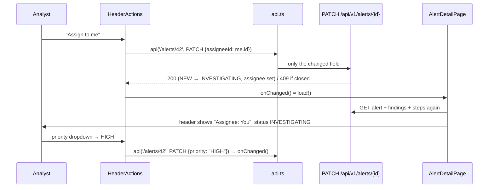

# Flow F7: Header actions (assign to me, change priority)

**Goal:** the analyst picks up an alert ("Assign to me") and sets its priority, right from the header.
**New idea:** changing data from the UI (`PATCH`), then loading it again so every part of the page agrees.

**Built on:** `main` · **Status:** done, `npm run build` passes, pushed

## How it works

## Files

| File | What it does |
|---|---|
| `src/components/HeaderActions.tsx` (new) | "Assign to me" (hidden when it's already you), the priority `<select>`; each sends `PATCH` with only that field, disables itself while waiting, shows the backend's error, then calls `onChanged`. |
| `src/components/AlertHeader.tsx` | Assignee shows **You** for your own id; shows the actions only when the alert is not CLOSED. |
| `src/pages/AlertDetailPage.tsx` | `load()` (the three requests) runs when the page opens and is passed down as `onChanged`; also loads `GET /users/me` for "me". |
| `src/index.css` | Header actions row, inline label, `select`/`textarea` styles. |

## Decisions

- **Reload after every change** (as asked) instead of patching local state: one source of truth, the backend; the
  backend's own rules (e.g. assigning a NEW alert makes it INVESTIGATING) show up without copying them into the UI.
- **The page loads `/users/me` itself** (the top bar does too): two small requests instead of sharing state through
  a React context, which would be one more concept for now.
- **Closed alerts show no actions** in the header (the backend would answer 409 anyway).

## How to verify

Open a NEW alert → "Assign to me" → Assignee becomes **You** and Status **INVESTIGATING**; the button disappears.
Change the priority → the badge changes. Both still work after a page reload (they're saved).

## New concepts introduced

- **Sending changes** with `PATCH` and only the changed fields.
- **Lifting state up**: the page owns the data and passes `onChanged` down to the components that change it.
