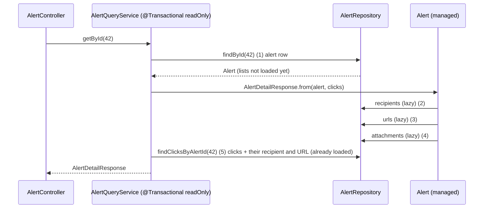

# Refactor: the simplest correct version

**Goal:** same features, less machinery. Remove the query tricks, the special locking and the race recovery,
and keep only what a reader needs to follow the code. 88 tests passing (was 89: three tests of removed
internals went, two new ones came in, see below).

New rule in `CLAUDE.md` (HOW WE WORK): *always choose the simplest correct solution; no performance
optimizations, special locking or clever tricks unless Leul asks for them; if something more complex seems
needed, ask first.*

## The steps

| # | Commit | What changed |
|---|---|---|
| 1 | `fcdbc9f refactor(alert): load detail with findById and lazy child lists` | `findWithRecipientsById` / `findWithUrlsById` / `findWithAttachmentsById` and the 3-query trick are gone. The detail view loads the alert with `findById`; recipients, URLs and attachments load **lazily** while `AlertDetailResponse` is built; clicks still come from `findClicksByAlertId`. |
| 2 | `f3c3416 refactor(alert): read side in AlertQueryService with @Transactional(readOnly = true)` | New `alert/service/AlertQueryService.getById(id)`: load + build the detail DTO in one read-only transaction (needed so the lazy lists can load). `AlertController` (GET) and `AlertService` (create/update/close responses) call it. `TransactionTemplate` and the `PlatformTransactionManager` constructor argument are gone. |
| 3 | `336f211 refactor(alert): drop OPTIMISTIC_FORCE_INCREMENT; a step change touches the alert's updatedAt` | `findForChangeById` (`@Lock(OPTIMISTIC_FORCE_INCREMENT)`) and `findForChangeWithStepProgressById` are gone; steps and close use `findWithStepProgressById`. `Alert.recordStep()` sets `updatedAt = clock.instant()`, so the alert row changes and `@Version` goes up the normal way. |
| 4 | `d0e2a2f refactor(alert): build the create response with AlertQueryService.getById` | `Alert.clicksOfNewAlert()` and `Url.clicksOfNewUrl()` are gone. After saving, `create` returns `AlertQueryService.getById(id)`, the same code path as `GET /alerts/{id}`. |
| 5 | `11149bd refactor(alert): make create a plain @Transactional method; duplicate insert gives 409` | `AlertService.create()` is `@Transactional`: ticket exists → return it (200); otherwise build, attach the playbook, `save` (201). The try/catch race recovery is gone. `GlobalExceptionHandler` maps `DataIntegrityViolationException` to **409** `Alert with this ticket number already exists`. |
| 6 | `94eb95c refactor(alert): drop the client version check on PATCH; @Version alone gives 409` | `UpdateAlertRequest.version` and its check in `AlertService.update` are gone. `@Version` still turns a concurrent change into 409. |
| 7 | `45fe647 refactor(alert): remove @DecidedVerdict; Alert.close refuses UNDECIDED with 400` | The custom constraint is deleted. `CloseAlertRequest` keeps `@NotNull`; `Alert.close()` throws `BadRequestException("verdict", …)` for UNDECIDED. Same 400 body as before (`fieldErrors[0].field = "verdict"`, same message). |
| 8 | `docs: …` | Comments that explained removed tricks were shortened; flow docs and README updated. |

## Behaviour changes (small, on purpose)

- **Two simultaneous POSTs of the same new ticket:** before, the loser re-read the winner's row and answered 200.
  Now the loser's insert hits the unique constraint and answers **409**. A sequential resend still gets **200**.
  Never a second row.
- **PATCH `version`:** no longer read. A client that still sends it is not refused (unknown JSON fields are ignored).
  Lost updates are still stopped by `@Version` when two requests overlap.
- **Detail view:** 5 queries instead of 4 (alert, 3 lazy lists, clicks). Still the same number for 1 child or 25.

## Decisions

- **Why `updatedAt` in `recordStep()` is enough.** Hibernate increments `@Version` when any alert column changes.
  A step change now changes `updatedAt`, so "work a step" and "close" that started from the same version can't
  both commit: the second gets 409. Covered by `AlertTest.aStepChangeTouchesTheAlert` and
  `AlertCloseIntegrationTest.aStepChangeBumpsTheAlertVersion`.
- **`AlertQueryService` is its own bean** so `AlertService` calls it through Spring's proxy, and its
  `@Transactional` applies. Inside `create`/`update`/`close` it joins the caller's transaction, finds the same
  `Alert` instance in the persistence context, and returns the just-saved state.
- **`update` and `close` still call `flush()`** before building the response, so the response shows the new
  `version` and `updatedAt`.
- **`list` stays in `AlertService`.** Only the detail read moved; nothing else needed it.
- **The 409 message names the ticket number** because that unique constraint is the only one a client can hit today.
  If another constraint becomes reachable, the handler will need a more general message. (Done in Flow 11: `The request conflicts with existing data`.)

## Tests that changed

- Removed: `AlertServiceTest.returnsExistingAlertWhenAConcurrentRequestWinsTheRace`,
  `AlertServiceTest.updateRefusesAStaleVersion`, `AlertUpdateIntegrationTest.aStaleVersionGives409`.
- Added: `AlertTest.aStepChangeTouchesTheAlert`, `ErrorHandlingIntegrationTest.databaseConstraintGives409`.
- Changed: the detail statement count is 5; `AlertServiceTest` stubs `findById`/`save` and uses a real
  `AlertQueryService`; the concurrent-create test accepts 201/200/409 (exactly one 201, one row); the
  concurrent-PATCH test accepts 200/409 and checks the version went up once per 200.

## How to verify

1. `./mvnw test` → 88 tests, 0 failures (Docker must be running).
2. `GET /api/v1/alerts/{id}` returns the same JSON as before.
3. Close with `{"verdict": "UNDECIDED"}` → 400 with `fieldErrors[0].field = "verdict"`.

## New concepts introduced

- **Lazy loading inside a read-only transaction**: lists load on first access; the transaction keeps the session open.
- **A read-side service** (`AlertQueryService`) shared by the controller and the write side.
- **Letting the database constraint decide**: no catch-and-retry; the error handler turns it into 409.
